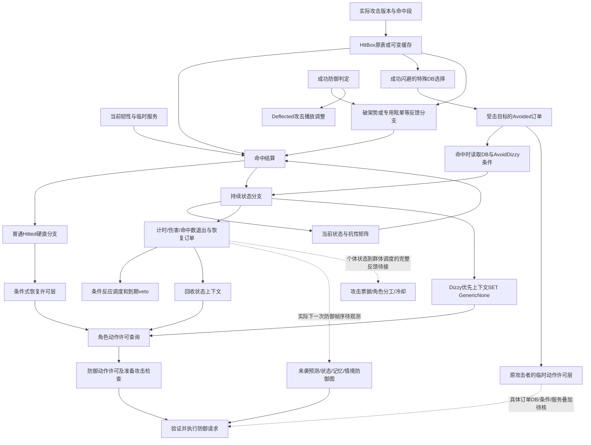

# 系统线索与关系图

[[00索引/首页|首页]] · [[01机制/连续受击与反击追击的系统链|综合机制]] · [[02实现/连续受击与反击追击的系统链|证据编号E01–E22]]

同一因素重复出现时更新本表，不拆成互不关联的待办。阻塞主线先追到能解释该子链；直接关联完成当前子链后展开；其他线索只保留证据和入口。本表不表示全部线索都已解释实战效果。

## 系统关系图

实线为已核对的代码／数据连接；虚线为仍需接通的具体桥。节点属于某条分支，不代表每次命中全经过。

## 线索索引

| ID／因素与作用位置 | 发现依据与已知作用 | 输入／关联输出 | 未解问题与下一项必要取证 | 优先级／回查入口 |
|---|---|---|---|---|
| S01 普通硬直刷新 | E03/E04；LongestStun为真或AlreadyGuardBroken时与既有剩余时间取max，Grunt策略false | 本次stun、既有Hitted→恢复许可时机 | 正常无前置Hitted取消／新建与回收已闭合E17；AI查询已接E20；剩+0x74消费者、特殊前置序列／冻结／预测 | **阻塞主线**；recovery底稿、综合机制普通受击表 |
| S02 状态累计限制 | E05；Dizzy有时间、伤害、命中限制，按攻击名归组 | 命中／伤害事件→状态退出、抗性变化 | 新命中保留／转移计数的全部分支；固定攻击名与段数对照 | **阻塞主线**；受击硬直与脱离、recovery底稿 |
| S03 恢复许可与AI选择 | E03/E06/E07；Push/Pop恢复层与情境防御请求是不同环节 | 状态／订单→层；来袭预测／记忆→候选 | E20已闭合NPC首上下文→四项防御动作gate；剩实际并存上下文、恢复层激活条件及最终帧序 | **阻塞主线**；综合实现E03/E06/E07 |
| S04 闪避按攻击分流 | E10/E11；DizzyOnAvoid选特殊DB，命中结算读目标Avoided订单DB可置AvoidDizzy | 来袭HitBox→避免结果／订单DB→后续Impact→Dizzy | 订单保存与期限消费已闭合；Hook等3份引用已对上E22；剩Jab对照、外部停止、缓存覆写和命中当刻SuperDizzy条件 | **阻塞主线**；avoid底稿与system-avoid-config-samples.csv |
| S05 招架按反馈分流 | E08/E09；破架势与条件专用眩晕模板不同 | 防守者GuardDB／来袭属性／当前架势→原攻击者Impact | Grunt原表DizzyOnParry全false，3份实际AttackDB已核E22；继续追缓存写参／普通反馈；不能直接套模板 | **阻塞主线**；parry底稿 |
| S06 当前状态抗性 | E01；Base/Adv矩阵相同，InFight与Dizzy不同 | 当前最高状态→命中属性效果 | 9条状态差异候选的实际动作引用、Dizzy禁止顶层与SuperDizzy分支 | 直接关联；system-recovery-hitbox-state-candidates.json |
| S07 动作期间临时韧性 | E02；服务加减当前韧性，可绕过正常受击订单路径 | 服务bonus／起止→当前韧性→冲击力判定 | KneeStrike+4／SpinKick+2及动画通知已核；剩基础韧性、实例修正和实际命中结果 | 直接关联；攻击冲击力韧性与伤害 |
| S08 受击动画决定状态时长 | E05/E08；ParryDizzy使用UseHitAnimDuration，普通stun20帧另列 | 命中模板／动画选择→持续状态时长 | 普通Dizzy基础时长Base3秒、Adv1.5秒的消费者已闭合E16；仍需具体命中覆盖、duration修正与旧状态更新 | 直接关联；parry、recovery底稿 |
| S09 SuperDizzy量及可用性 | E09/E11；反馈量与状态gate都涉及它 | 防反反馈、目标gauge→是否可附加／重施眩晕 | 当前值、消耗／恢复消费者及分支语义；不把名称当结论 | 直接关联；avoid与resilience底稿 |
| S10 命中记忆与图反转 | E07；received memory类型3，avoid-success memory类型2；默认反转false已补证 | 近期攻击／闪避→候选测试 | 成功动作6条父路径已接E22（Push内层Base／Adv均3秒mask2）；剩掩码标签、竞争候选、组合首攻击与票据接受 | 直接关联；敌人如何选择防御、recovery底稿 |
| S11 Deflected播放调整 | E12；读所有者GuardDB，按曲线影响攻击播放并收尾 | 反馈结果／原攻击订单→恢复时序 | EndOfStrike延迟、Grunt duration0路径；不能用主角0.6补值 | 直接关联；parry底稿 |
| S12 技能／神龛／覆盖 | E09；架势反馈读取ParryImpactOnStructureBonus；攻击组件可覆盖 | 角色属性／来袭数据→最终反馈量 | 固定成长版本和各覆盖写入者，再给最终数值 | 后续扩展；parry底稿 |
| S13 姿态／命中段／缓存版本 | E13；N44不同槽指不同动作；缓存优先原表 | 输入节点、姿态、AttackDB→实际HitBox | 固定具体槽／条件覆写与缓存生命周期；避免合并两种伤害 | 直接关联；玩家输入图、版本表 |
| S14 成功闪避后的玩家输入层 | MainChar_Avoid_AvoidDB：AllDefensiveOptions，延迟0.08秒Punishable_AvoidSuccess | 玩家成功闪避→玩家动作许可 | 层具体覆盖与反击节点条件；不推导敌方不能防御 | 直接关联；avoid底稿 |
| S15 架势崩溃独立分支 | E08/E09；能直接改变反馈与状态路径，且有独立最长stun条件 | 当前架势／反馈→崩溃状态与恢复 | 相同招式不同初始架势对照；查guardbreak状态时间／动作 | 直接关联；综合机制招架分流 |
| S16 群体票据与状态反馈 | 已有EndCombo清理、倒地／起身和冷却接口 | 个体状态／连段结束→票据或角色调度入口 | 完整配额、评分、释放与接替，待个体主链后展开 | 后续扩展；群体AI与状态反馈、notes/group-ai-state.md |
| S17 同数值不同枚举 | EHitDismissReason输出11，EComboEndReason也有11但不同类型 | Hit过滤→下游消费 | 前者PDB无成员，需真正枚举身份／消费者；不能据此说结束PunishableAvoided连段 | 后续扩展；avoid底稿 |
| S18 按状态覆写攻击效果等级 | FHitboxDataRow.m_AttackPropertyLevelOverrides，PDB偏移+472；GetAttackPropertyLevel参与读取；原导出部分Map仍保留未解码原始摘要 | 当前状态不只影响防守抗性，也可能选择攻击侧等级覆写 | 对具体样本确认映射为空或解码；未解析的不能按基础等级保证结果 | 直接关联；E01与玩家字段中文说明 |
| S19 反击招式自身制造状态 | MC_3Punches_FR末段3Punches_HB03基础Dizzy等级14，超过Grunt InFight抗性11；前两段无该基础等级 | 玩家反击动作／命中段→进入持续受控，可能与招架直接反馈不同 | 核对该动作实际输入／条件覆写，以及用户实测是否用此招式；不提前归因 | 直接关联；综合机制招架候选与玩家徒手输入图 |
| S20 原攻击者Avoided许可与服务 | E15；Push/Pop层已闭合，OrderAvoided CDO引用AllDefensiveOptions、条件及订单服务 | 原攻击者订单DB→临时动作许可；不同于玩家成功闪避输入层 | 默认组件引用与6服务已接E21；剩IsPlayer条件字节码、8.0单位及具体实例激活；不能把顶层AllDefensiveOptions翻成禁止格挡 | 直接关联；avoid底稿、system-avoid-orderdb.json |
| S21 状态许可上下文与防御gate | E20；Dizzy→priority1／SET GenericNone；NPC实际读首上下文，四项防御全禁则退出更新 | 状态推入／移除→动作许可→防御请求 | 实际并存的同／更高优先上下文与首次防御帧序；不将Invalid13误当NPC全允许 | **阻塞主线已部分闭合**；综合机制“眩晕如何阻止防御” |
| S22 订单服务条件和时间基准 | E21；Avoided／Deflected各3服务，Force状态duration=-1，许可层有IsPlayer条件 | 服务范围／条件→Avoided状态、GenericNone或Parry取消层 | 解BPE_CanActivate实际返回及8.0范围单位；上下文与层内优先级分开 | **阻塞主线**；订单服务配置与order-services底稿 |
| S23 反击组合票据与入口映射 | E22；成功防御动作关联票据30／31、CustomCombo1／2 | 防御图→动作→组合入口→实际攻击 | 解首攻击映射与票据接受；不能把图内100%等同必反击 | 直接关联；Grunt反击条件与动作 |
| S24 DizzyReduction可用项 | E20；GenericNone允许此动作，但无本轮消费者证明 | Dizzy许可掩码→候选缩短状态接口 | 找到输入／AI消费者后才解释是否能缩短；当前不借名字归因 | 后续扩展；hitted-services底稿 |

“底稿”对应研究根目录 `notes/recovery-system-chain.md`、`notes/parry-system-chain.md`、`notes/avoid-system-chain.md`。证据编号与准确RVA集中在[[02实现/连续受击与反击追击的系统链]]。

## 当轮验收与下一项工作

| 验收项 | 本轮状态 | 下一项必要取证 |
|---|---|---|
| 脱离原因 | 状态退出、Hitted恢复层、AI选择各自入口明确；正常Hitted替换链已闭合；Dizzy至AI许可gate已闭合；特殊分支与实际首次防御帧序仍缺 | S01→S03，计时写入及正常Hitted替换已补；优先解IsPlayer服务条件，随后核8.0时间基准与实际上下文 |
| 追击原因 | 闪避特殊DB与AvoidDizzy、招架模板和反馈分流已定位 | S04／S05，闪避订单保存与计时已闭合；已核3份实际攻击行；继续缓存写参、提前取消及状态刷新 |
| 共享与分流 | 共用Impact／状态／恢复逻辑；三入口差异单独列出 | 固定同一追击版本，避免拿不同招式解释状态差异 |
| 敌人差异 | 同受击DB、同矩阵；不同Dizzy基础时长／限制和情境图 | 对上Normal0实际原型及其动作引用，运行实例仍未观测 |
| 扩展线索 | 统一登记作用、证据、关联、缺口和优先级 | 随新证据合并条目；不把S12/S16/S17升级成本轮必须解决 |
| 实战 | 方案已写入综合机制，未执行 | 静态仍可推进；不会自行启动运行时操作 |

## 文档与证据验证

本轮自动检查包括知识库清单／双向链接／来源路径、Python语法、匹配EXE与反汇编哈希，以及定向能力资产／订单包哈希和新表格列数。结果分别见研究根目录`inventory/knowledge-vault-verification.json`与`inventory/system-chain-evidence-verification.json`；本批新增核查见`inventory/followup-unpacking-verification.json`。检查不等于运行游戏；尚未在Obsidian内验看Mermaid渲染，也未测最终窗口或伤害。
## 补解包进度入口

[[00索引/解包与解析进度]]汇总本轮定向提取、字段解析与旧缺口重试。[[03配置/订单与服务/索引]]维护订单默认值与服务配置。

新因素：普通受击替换涉及订单子类型、Running/Pending状态、前置依赖、取消命令与许可层句柄；已合并S01／S03。解析器不支持某类属性tag不等于资源不存在，已列为技术缺口E19，不冒充机制发现。
## 案例研究补充S25

| 因素与位置 | 证据及已知作用 | 关联 | 缺口／下一步 | 优先级／入口 |
|---|---|---|---|---|
| S25 普通硬直结束的事件通知 | E23；计时到零且恢复条件通过，加入恢复层并广播OnIsStunChanged；InternalBeginPlay已订阅到AI自身回调 | 自身受击谓词→跟踪玩家攻击信息→防御重新评估 | 其他目标订单／许可变化也触发更新；须核普通受击中的最终执行限制，不能把本回调当全局禁防 | **阻塞主线**；[[01机制/受击与追击案例]]C01／C02 |
| S26 输入图与命中时序分层 | N44→45仅证明保存输入路径；槽0/1正面、2/3背面已由GetAttackName与象限枚举接通；标签条件覆写的57条已解为替换设置，运行期启用仍待核 | 玩家出招→命中事件→敌人受击更新 | 两动画帧号不能跨动作直接相减；需动作启动、播放速率、冻结、受击动画与覆写 | **阻塞主线**；案例C01及配置对照 |

原图中普通恢复层到防御查询的箭头表示可达路径，不表示计时未结束时所有入口禁防。最新主线与带判断节点的分支图见[[01机制/连续受击与反击追击的系统链]]。S01/S03的下一步以本批为准：先普通受击实际执行限制，不再优先扩展反击首招映射。

## 20261029通用状态规则批次

本段生成源：`scripts/rules_update_progress_20261029.py`。合并旧时间／累计／状态覆写因素，新增交互事件的作用位置；不新增假定的防无限连总开关。

| 因素与位置 | 证据及已知作用 | 关联与缺口 | 优先级／回查 |
|---|---|---|---|
| S27 防守结果到效果分类 | ComputeImpactType中GuardType非None时跳过普通效果等级／抗性选型；不能用推开等级证明穿防 | 关联S18攻击覆写与既有抗性；破架势和反馈另有分支 | 直接关联；底稿rules-resolution R01–R03 |
| S28 事件顺序与状态累计（合并既有计数因素） | 普通伤害路径OnDamage→UpdateFightingStateFromImpact→OnHit；前后可能面对不同元素，计数来源和归组策略不同 | 关联同态重建；新元素攻击名默认值仍未核，不换算拳数 | 直接关联；底稿rules-hit-count及rules-state-update |
| S29 状态时长与分字段继承（合并既有时间因素） | 时间来源、累计继承和自动退出分开判断；普通Dizzy与SuperDizzy不同；暂停／无限跳过本段Tick时间和累计检查 | 关联状态退出与许可回收；持续性字段消费者仍缺 | 直接关联；底稿rules-state-update |
| S25普通受击执行门续接 | 既有E23只证明条件性重评估，不能推出此前所有入口禁防 | 继续追AI防御请求→动作／订单接受，定位实际阻止执行的条件 | 阻塞主线；底稿rules-resolution R04／R07 |

以上前三条已接通的关系：防守结果→分类路径；普通伤害通知→状态更新→命中通知；状态退出→回收自身许可。尚待接通：普通Hitted中防御评估→实际动作执行。这里的顺序为已核对分支中的调用顺序，不代表全部命中类型的统一实战帧序。

## 规则主文与线索的分工

当前完整解释位于[[01机制/连续受击与反击追击的系统链]]；本页继续用于查找证据缺口和展开顺序，不作为读懂主文的前置条件。既有S27–S29已整理进主文，没有新增系统因素。下一项研究仍是S25普通受击的防御实际执行门；阅读整理完成不代表该因果缺口已解决。

## 机制规格的接口缺口

系统关系的权威定义和守卫统一在[[01机制/连续受击与反击追击的系统链|系统规格正文]]；此页只跟踪展开入口，不替代正文。

| 因素／位置 | 已确定的接口与证据 | 关联与未解部分 | 优先级 |
|---|---|---|---|
| S25／A6 动作准入 | 许可查询和防御评估有静态入口 | 评估结果到实际订单／动作接受的具体谓词；不再以解释固定连打为验收 | 阻塞完整系统接口 |
| S29／D5 时间分支修订 | 攻击侧keep缺状态走0基线并绕过默认计算，目标侧D6另有回退 | GetDuration内部、各调用的τ与冻结时间F分开；底稿state-spec-refinements P3/P4 | 直接关联 |
| S30 Opened附加接口 | T1的部分Apply参数使PushOpenedState被调用 | 完整生命周期和消费者未恢复，不将Opened名称译成已确认动作能力 | 直接关联，非本轮扩查 |
| S31 Tick时间输入 | Tick只消费传入Δt | 全局／角色时间缩放和冻结怎样形成Δt未恢复 | 后续扩展 |
| S28／U1至U7 累计记录 | 两类事件分别遍历当时存在的状态，按精确守卫更新 | 构造初值、其他状态调用者和具体配置变体 | 直接关联 |

证据：`notes/20261029-state-spec-refinements.md`，正文同名接口编号给出下一项必要取证。

玩家招式待核08补充：[[03配置/玩家攻击/招式待核项与已确认信息]]记录朝向四槽、普通与Alt共用短按松键手势／同键输入栈，以及可避方向位。高度分类仍须接具体AvoidMatchCondition，不能把目标部位或强度当攻击上下段；不改变受击主链的实战完成状态。

徒手13批：[[03配置/玩家攻击/徒手节点覆盖核对]]补独立Ability动作入口与专注VitalPointData链。专注的实际m_Name到FocusNames、覆盖命中表已接通；结束后的许可／普通连招跟进仍是具名缺口，不能据未查到ComboTree边断言不能衔接。

徒手时间轴14批：攻击窗口进入以OR推入许可层，退出按句柄撤销，玩家同组候选再经当前context/movement许可与攻击Ability表序、目标和节点检查。此链只绑定玩家攻击，不推为敌人恢复规则；完整Ability激活/打断守卫和节点fallback内部仍缺。单个Jab源动画已解126帧，动作实际播放范围仍缺。导航：[[03配置/玩家攻击/招式待核项与已确认信息#14版窗口规则与具体缺口]]；原始证据见notes/player-timeline-14-availability.md与notes/player-timeline-14-timing.md。
