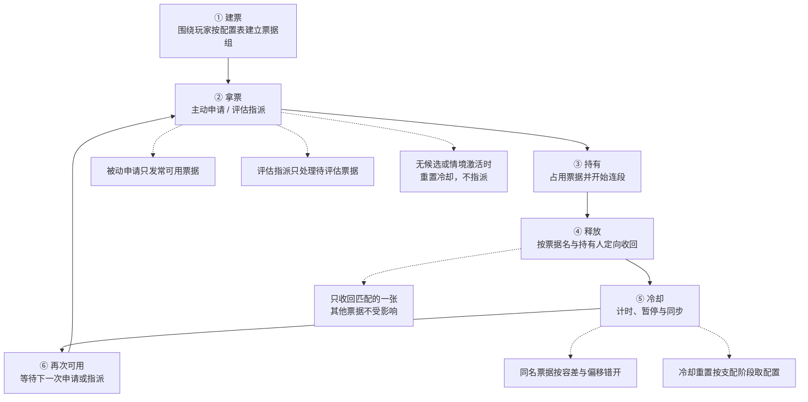
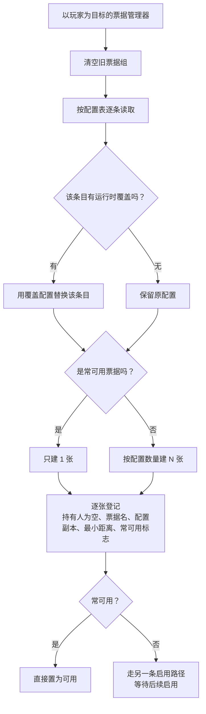
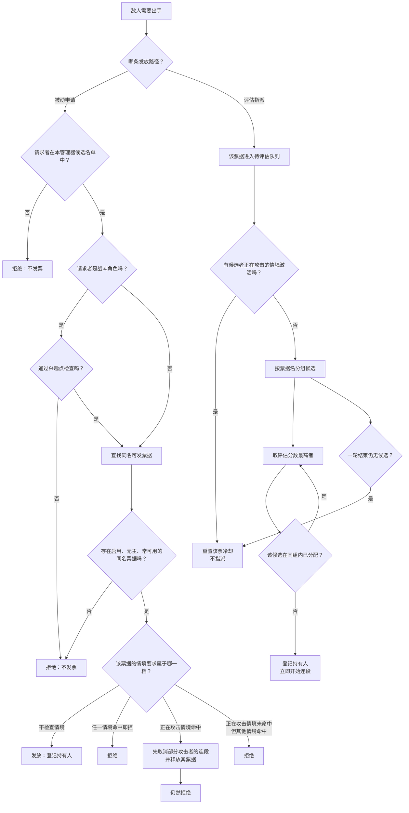
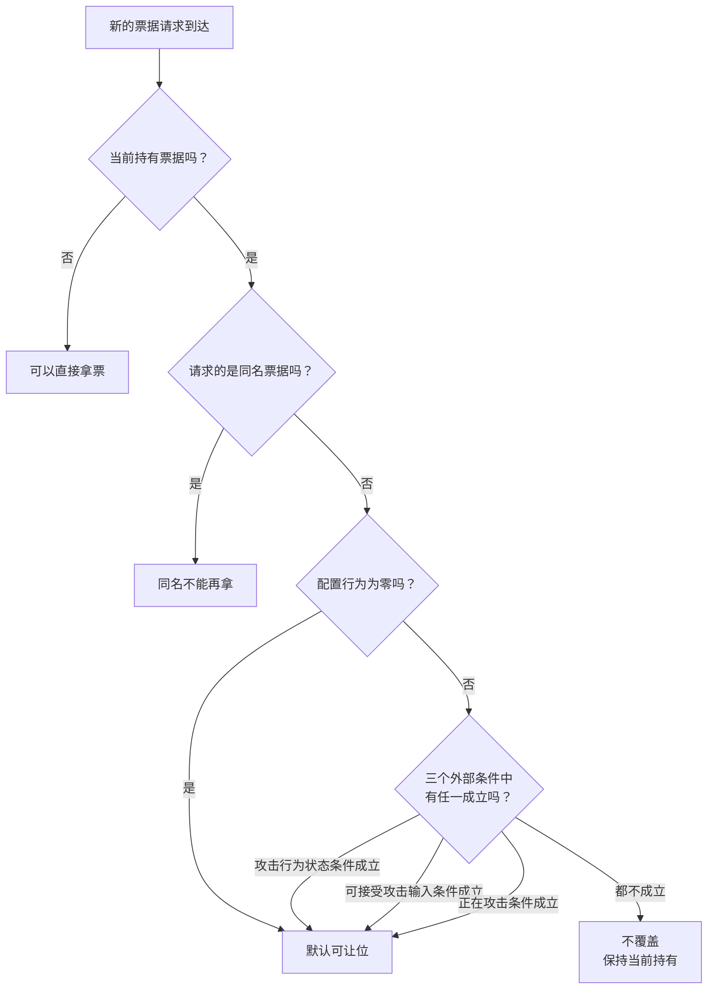
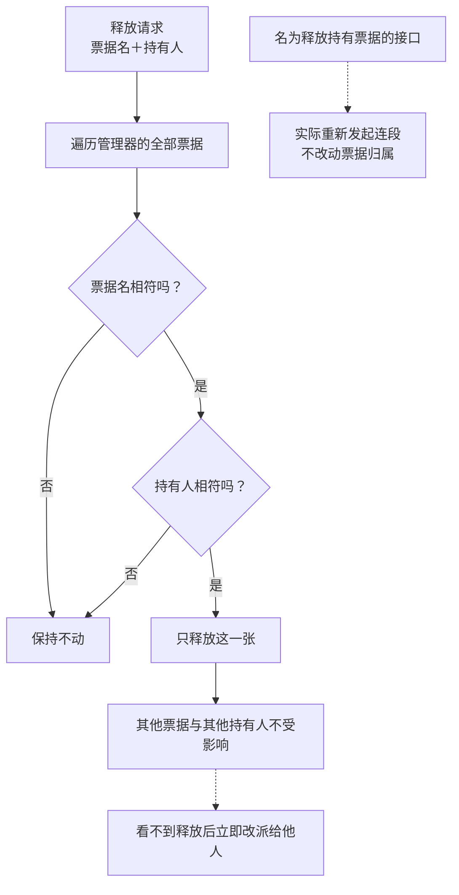
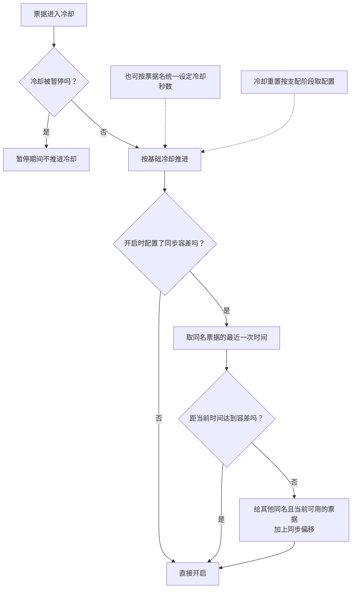

# 攻击票据调度：申请、指派、持有、释放与冷却

> **主读篇。** 本簇的完整机制以本篇为准，日常只读这一篇；实现细节、字段与原始反汇编留在实现页与底稿，只在需要核对时跳转。

[[00索引/首页|首页]] · [[01机制/敌人AI/00阅读入口|本簇阅读入口]] · [[02实现/攻击票据调度闭环|实现证据]] · [[03配置/群体票据/索引|配置索引]]

**一句话结论：** 敌方会围绕玩家建立一组攻击票据；“可以出手”的许可只通过“请求者主动申请常可用票据”或“评估后按分数指派待评估票据”两条路发出，释放时按票据名与持有人定向收回，冷却再决定这张票据何时重新可用。

## 0. 范围与边界

本页讲多个敌人同时在场时，攻击许可怎样建立、发放、持有、让位、释放与冷却。对象是围攻玩家的敌人一方，以及以玩家为目标的票据管理器；样本是 50 个已提取攻击票据配置；构建为 `Sifu-Win64-Shipping.exe` 对应版本（哈希见实现页），内容为当前构建的静态规则，不是实战帧表。

代码里把这套票据所属的被攻击目标叫“防守者”。本作正常关卡基本只有玩家与敌人两方，所以这里的防守者就是玩家；敌人是攻击者或候选者，不是防守者。后文描述角色时直接写“玩家”。敌人自己也会格挡、招架，但那属于防御选择系统，与本页的角色划分无关。

管理器在什么时机把玩家绑定为防守者，本批没有追到调用点；这属于实现层的未闭合项，不影响“防守者就是玩家”的读法，详见实现页。

本页不展开：行为树与空间查询如何挑选动作、武器票据与位置票据的独立规则、角色票据管理器的完整评分、运行时实战中的实际出手频率。这些内容只在解释入口或退出时引用，并标为未闭合。

图中的实线是已接通的主路径，虚线是例外、跨层引用或尚未闭合的接口。节点文字只写事件、条件与结果；具体函数名、字段名、偏移与地址集中在实现页与底稿。

| 本页说法  | 含义                         | 不是什么             |
| ----- | -------------------------- | ---------------- |
| 票据    | 以玩家为目标的票据管理器内的一张“本次可以出手”的许可实例    | 不是敌人本身，也不是一个招式   |
| 常可用票据 | 建立后即处于可用状态、可被请求者直接申请的票据    | 不是无视一切条件的永久许可    |
| 主动申请  | 请求者向以玩家为目标的管理器索要一张常可用票据       | 不是评估系统按分数指派      |
| 评估指派  | 管理器评估候选后，把待评估票据发给分数最高者     | 不是请求者自行领取        |
| 持有    | 某个攻击者当前占用了这张票据             | 不等于该攻击者已经开始或完成连段 |
| 定向释放  | 按票据名与持有人两重匹配，只收回这一张        | 不是清空全部票据         |
| 同步冷却  | 同名票据开启时，用同步容差与同步偏移错开再次可用时间 | 不是把同名票据合并成一张     |

## 1. 总览图

这六步是同一张票据的生命周期，不是每次出手都要从建票重走。建票在管理器初始化或配置刷新时发生；拿票在每次需要出手时发生；释放与冷却发生在一次占用结束之后。虚线标出两条发放路径各自的对象范围、指派失败时的落点，以及释放与冷却中尚未完全闭合的旁支。

## 2. 图1：建票

这一层回答：围绕玩家的一套票据组里到底有几张票据、每张票据带着什么信息。

这一层在回答“票据组的规模与初始状态”。管理器先清空旧票据组，保证配置刷新不会残留上一轮的实例；配置表逐条提供票据，运行时覆盖可以在不改配置表的前提下替换某一条。常可用条目固定只建一张，其余条目按配置数量建立同等数量的实例。每张实例都登记持有人为空、票据名、配置副本、最小距离与常可用标志；常可用票据建立后直接可用，非常可用票据走另一条启用路径。

配置里的“数量”只决定管理器内该票据的实例张数，不等于全场同时攻击人数。常可用票据固定一张，说明这类票据在同一套票据组里本来就是单份许可。

## 3. 图2：拿票的两条路

这一层回答：一次“可以出手”的许可从哪里发出，什么条件下被拒。

这一层有两条并行的发放路径，彼此不替代：

1. **被动申请只发常可用票据。** 请求者必须先在管理器的候选名单中；若请求者是战斗角色，还要通过兴趣点检查，否则直接拒绝。随后管理器在票据组里找第一张“票据名相符、目标相符、处于启用、没有持有人、常可用”的票据，其中“目标相符”指这张票同属玩家这套票据组。找不到就拒绝；找不到不等于管理器没有票据，只说明没有符合条件的常可用票据。
2. **情境三档决定申请能否通过。** 配置不要求检查情境时直接发放；要求“任一情境命中即拒”时，只要有任何相关情境处于激活状态就拒绝；要求“正在攻击情境命中时处理”时，若该情境命中，会先取消一部分攻击者的连段并释放其票据，然后仍然拒绝请求者，未命中但其他情境命中时也拒绝。后一档的取消动作不是给请求者让位，它只是清走一部分正在攻击的候选。
3. **评估指派走另一条队列。** 管理器逐张处理待评估票据；若“有候选者正在攻击”的情境已激活，就重置这张票据的冷却并跳过。否则把候选按票据名分组，每组取评估分数最高者，同组内已分配的候选不重复分配；登记持有人后立即开始连段。配置允许重复时，重复次数在配置区间内随机取整数。一轮下来没有候选，同样重置冷却。

两条路径都真实存在，但外部调用者尚未定位：本批看到的是管理器对外提供的申请入口与评估完成后的指派逻辑，谁在运行时触发被动申请还没有证据。

## 4. 图3：持有与让位

这一层回答：已经拿着票据的攻击者，什么时候必须把出手机会让给新的票据。

这一层在回答“新票据能否盖过旧持有”。当前没有票据时可以直接拿；请求同名票据时不能重复持有；配置行为为零的票据默认可让位。其余情况要看三个外部条件：攻击行为状态条件、可接受攻击输入条件、正在攻击条件，三者中任一成立就允许让位，都不成立则保持当前持有。

让位是“新票据可以盖过旧持有”的判断，不等于旧票据立即被释放；释放仍走下一层的定向路径。

## 5. 图4：定向释放

这一层回答：一次释放到底收回了什么，会不会顺带清空别人。

这一层在回答“释放的作用范围”。释放请求同时带着票据名与持有人，管理器遍历全部票据，先看票据名是否相符，再看持有人是否相符，两者都命中才释放这一张；票据名或持有人任一不符的票据完全不动。因此释放是定向收回，不是清空全部票据。

本批从释放路径看不到“某张票据被收回后立即改派给另一名敌人”的动作；这限制“释放是否触发即时接替”的结论。另有一个名为释放持有票据的接口，实际做的是重新发起连段参数，并不改动管理器的票据归属，不能按名字理解为全局释放。

## 6. 图5：冷却与同步

这一层回答：票据释放后何时重新可用，同名票据之间怎样错开。

这一层在回答“同一张票据从释放到再次可用之间发生什么”。冷却被暂停时，票据不推进计时，直接按未就绪处理；未暂停时按基础冷却推进。开启票据时，如果配置了同步容差，管理器会找同名票据里最近一次时间，当前时间与它相差达到容差就正常开启，不足容差就给其他同名且当前可用的票据加上同步偏移，然后再开启。

此外还可以按票据名统一设定冷却秒数。冷却重置按支配阶段取配置，这是既有证据已经接通的规则；本批没有新增难度槽位标签，因此“哪个阶段对应哪一档难度”仍不能从本页直接断言。

## 7. 证据索引

| 用途 | 入口 |
|---|---|
| 实现证据（函数、字段、偏移、原始输出） | [[02实现/攻击票据调度闭环]] |
| 50 个票据配置的数量、角色掩码与冷却 | [[03配置/群体票据/索引]] |
| 单个票据的字段明细 | [[03配置/群体票据/攻击票据配置]] |
| 本批静态取证底稿 | `notes/20261102-攻击票据调度.md` |

四阶段标注：**已提取** 50 个攻击票据配置；**已解析** 票据对象、管理器数组与基类票据的字段布局；**已接通逻辑** 建票、两条发放、持有覆盖、定向释放、冷却与评分的静态路径；**未实战** 本批不运行游戏。

## 8. 未决分支

| 未决项 | 缺什么 | 限制哪条结论 | 下一步查什么 |
|---|---|---|---|
| 申请入口的外部调用者 | 未定位触发被动申请的运行时调用 | 不能确认被动申请在实战中由谁、何时发起 | 反汇编行为树任务与战斗组件中的申请调用 |
| 释放与重置所用接口的实名 | 仅有接口编号 | 不能把“重置冷却”与“释放”对应到确定的接口名 | 反汇编票据基类实现并对照接口表 |
| 四冷却槽与三档难度标签 | 槽位与难度档未命名 | 不能断言某难度使用哪一档冷却 | 对照冷却重置取值函数与配置结构 |
| 按难度数量消费者 | 未见读取难度数量的代码 | 不能断言不同难度下票据实例数量如何变化 | 反汇编配置数量读取函数 |
| 角色掩码消费者 | 未见掩码筛选代码 | 不能把配置里的角色掩码翻译成实际候选筛选 | 追角色票据管理器的候选增删 |
| 评分权重表与评估器子类 | 未见具体权重与子类求和 | 不能给出“为什么这个候选分更高”的数值解释 | 反汇编评分输入来源与评估器子类 |
| 两处候选数组的关系 | 两处结构相同、用途不同 | 不能确认申请与评估是否使用同一份候选名单 | 查管理器构造与候选增删入口 |
| 兴趣点布尔语义 | 只知为假则拒 | 不能说明申请者必须站在什么位置或满足什么条件 | 反汇编兴趣点判断函数 |

## 9. 参数附录

这里只写参数的作用与选择顺序，具体数值集中在 [[03配置/群体票据/攻击票据配置]]，不把配置值当成最终拳数或时间。

| 参数 | 作用 | 选择顺序 |
|---|---|---|
| 数量 | 决定管理器内该票据的实例张数 | 常可用条目固定一张；其余条目按配置数量建立 |
| 常可用标志 | 决定票据建立后是否立即可用、能否被被动申请 | 建票时读取；申请时作为筛选条件之一 |
| 最小距离 | 参与“正在攻击情境命中”时的取消筛选 | 申请时先取管理器级距离基准，再按票据配置比较 |
| 情境行为 | 决定主动申请要不要检查情境、检查到哪一档 | 建票时随配置复制；申请时按三档分支 |
| 同步容差 | 决定同名票据开启时是否要错开 | 开启票据时先看容差是否大于零 |
| 同步偏移 | 容差不足时加到其他同名可用票据上的时间量 | 仅在容差不足时使用 |
| 冷却时长 | 释放后到再次可用的基础等待 | 按支配阶段取配置，再由票据冷却计时推进 |
| 重复次数区间 | 评估指派后连段的重复次数 | 票据允许重复时，在配置区间内随机取值 |
| 角色掩码 | 配置层面对可参与角色的分类 | 已提取原值；消费位置未闭合 |
| 评分权重 | 每个评估测试的默认权重与覆盖权重 | 默认权重固定，特定测试类型可被覆盖 |
