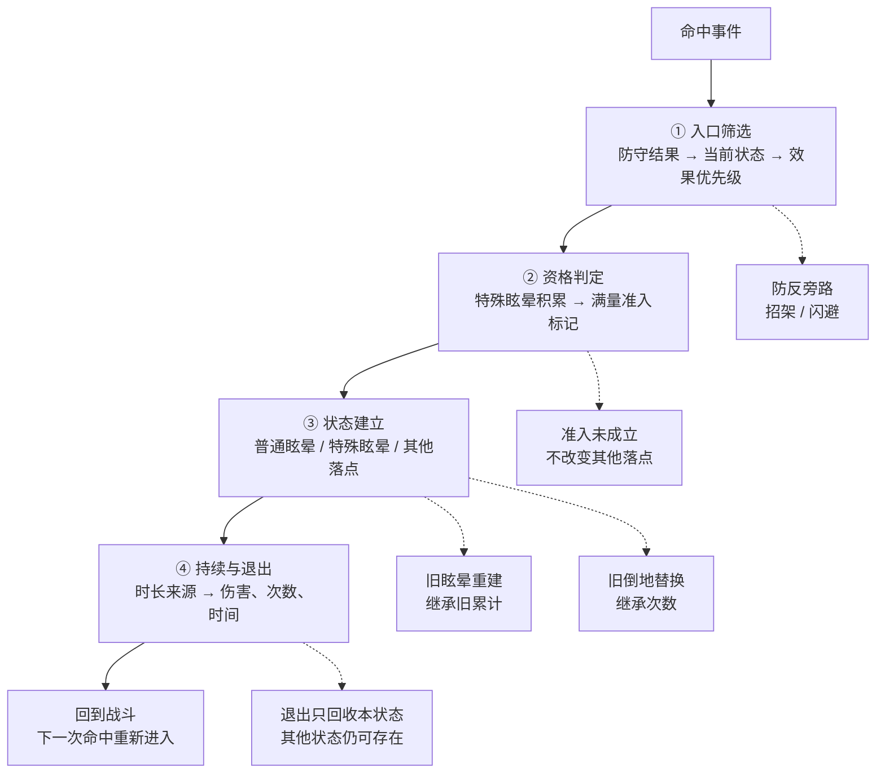
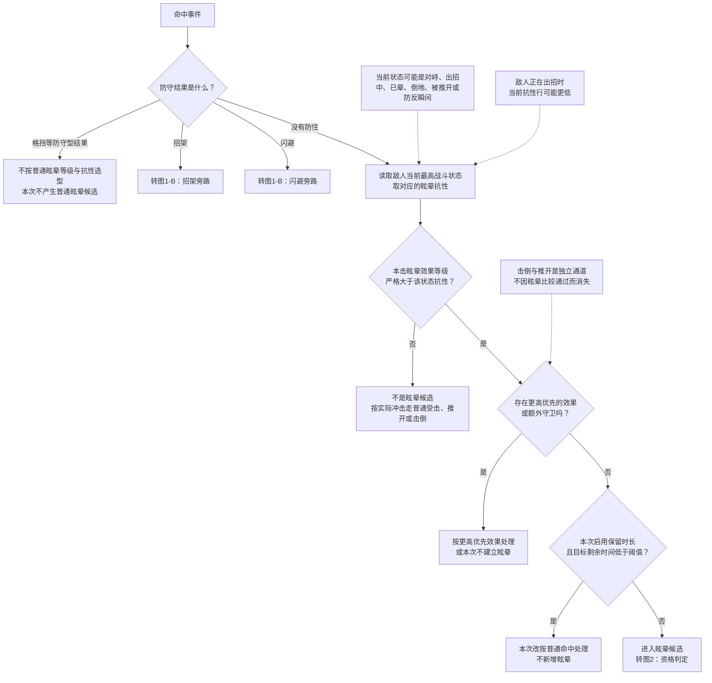
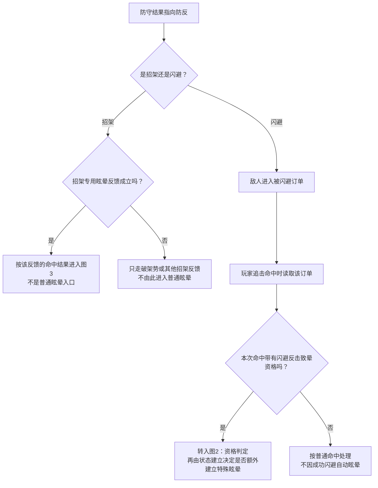
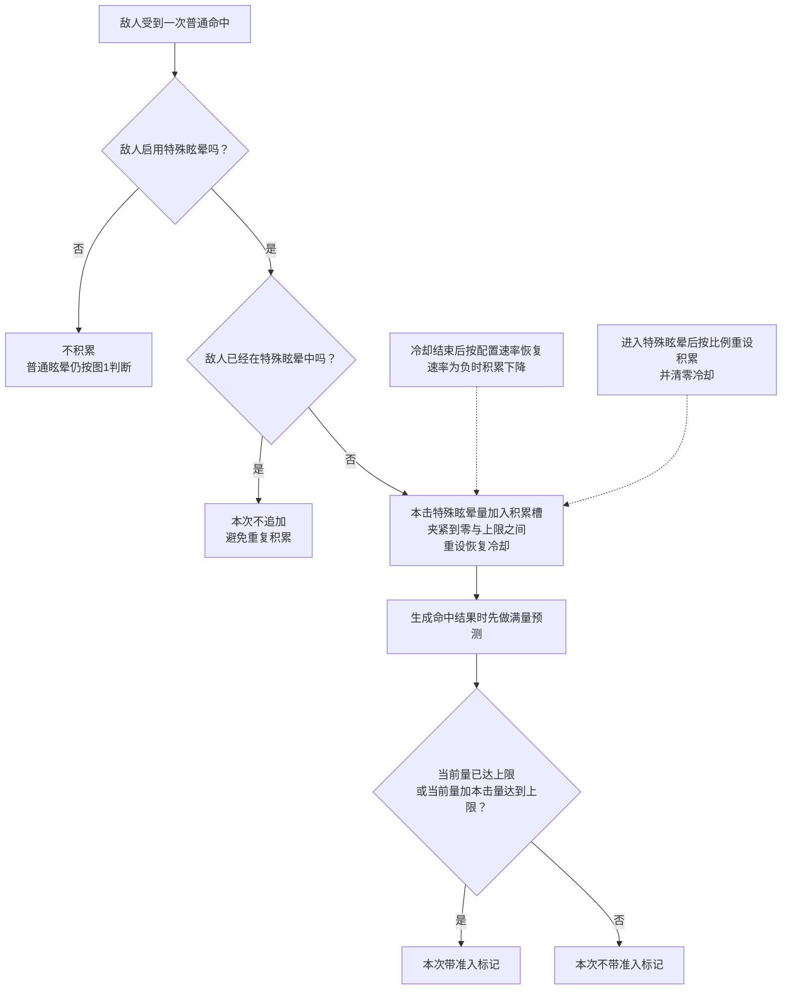
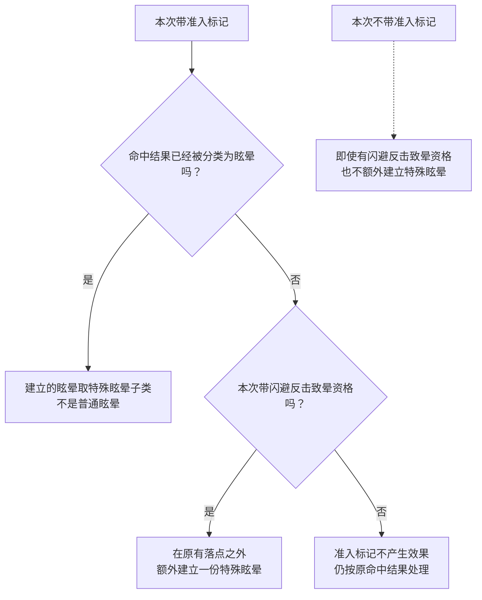
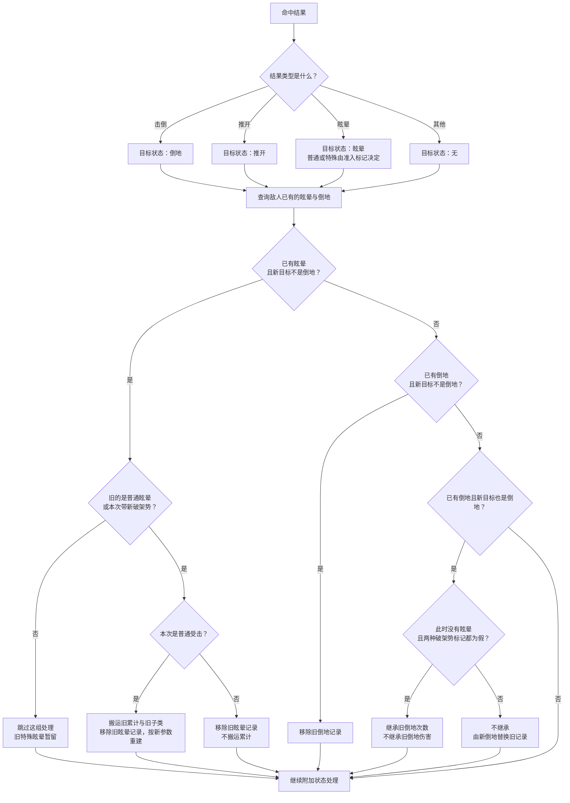
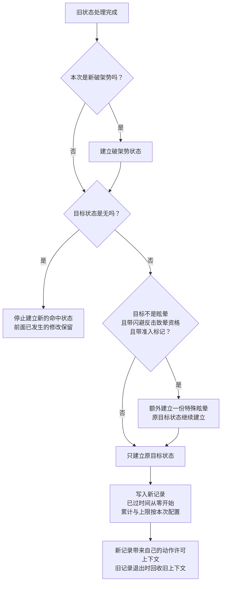
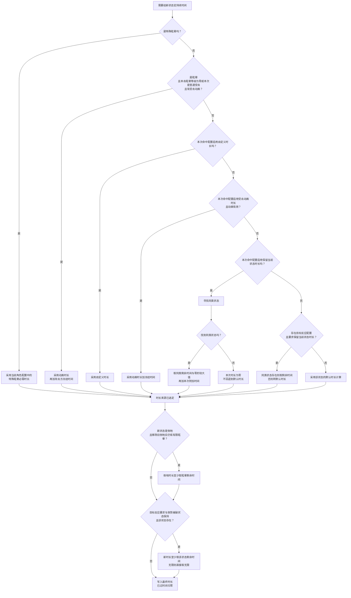
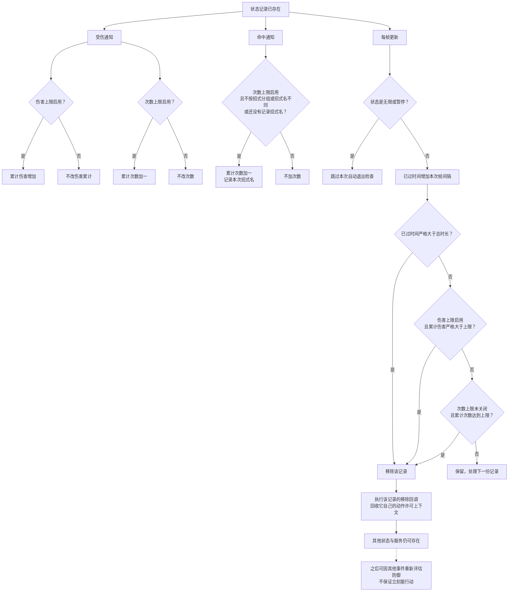

# 眩晕的进入、建立与退出：系统剖析

> **主读篇（用户指定）。** 本簇的完整机制以本篇为准，日常只读这一篇；其余五篇降为备查材料，只在需要精确字段、案例或历史取证时才跳转。此标记由用户 2026-11-02 明确定下。

[[00索引/首页|首页]] · [[01机制/状态与眩晕/00阅读入口|本簇阅读入口]] · [[01机制/状态与眩晕/连续受击与反击追击的系统链|战斗状态与事件：系统规格]] · [[02实现/玩家进攻与敌人状态转换调查|证据定位]] · [[03配置/攻防交互补证配置|配置对照]]

**一句话结论：** 普通眩晕靠“本击眩晕效果等级严格高于敌人当前状态抗性”取得候选资格；特殊眩晕另有一套独立积累，满量只给出准入标记。两者最终都要经过旧状态处理、建立新记录、选择持续时间和累计退出，才能成为敌人实际承受的眩晕。

## 0. 范围与边界

本页完整剖析一次命中从“可能致晕”到“实际进入眩晕”再到“退出眩晕”的系统路径。对象是玩家进攻、敌人受击；样本以普通难度的普通／进阶杂兵为主；内容是当前构建的静态规则，不是实战帧表，也不是某个招式的固定拳数表。

本页不展开：眩晕中敌人的具体AI行为、动画与音效表现、招架完整反馈链、墙撞与倒地的完整链、双方同时命中的额外规则。这些内容只在需要解释入口或退出时引用，并标为未闭合。

图中的实线是已接通的主路径，虚线是例外、跨层引用或尚未闭合的接口。节点文字只写事件、条件和结果；具体函数名、字段名、配置行号和地址集中在[[02实现/玩家进攻与敌人状态转换调查|实现页]]与[[03配置/攻防交互补证配置|配置页]]。

| 本页说法 | 含义 | 不是什么 |
|---|---|---|
| 普通眩晕 | 单次命中通过效果等级与抗性比较后建立的眩晕状态 | 不是必须先打满的条 |
| 特殊眩晕 | 由独立积累槽满量准入后建立的眩晕子类 | 不是普通眩晕自动升级 |
| 眩晕积累槽 | 敌人单独保存的特殊眩晕量，有上限、冷却和恢复速率 | 不是生命、韧性或持续状态累计伤害 |
| 准入标记 | 本次命中是否达到满量条件的记录 | 不是已经进入眩晕 |
| 当前状态抗性 | 敌人此刻最高战斗状态对应的一行抗性值 | 不是随每拳消耗的护甲 |
| 效果等级 | 本次命中在眩晕通道上的强度 | 不是最终伤害或拳数 |
| 破架势 | 本次命中新打破敌人架势 | 不等于已经进入眩晕 |
| 闪避反击致晕资格 | 玩家成功闪避后，后续命中可使用的额外致晕条件 | 不是成功闪避本身让敌人眩晕 |

## 1. 总览图

四层是判断层次，不是每次命中都要逐层走完。一次普通受击可能只经过入口筛选就落到普通受击；一次被格挡的攻击可能在入口就被挡回；一次闪避反击可能从防反旁路进入，再经过资格判定与状态建立。虚线表示这些跳转和例外，不表示流程图不完整。

## 2. 图1：入口筛选

这一层的前提是“这一击已经被判为命中，防守结果也已经产生”。它只回答一个问题：这次命中是否有资格成为眩晕候选。

### 2.1 主入口：这一下能不能成为眩晕

这一层有三个不能合并的判断：

1. **防守结果先分流。** 格挡等防守型结果不按普通效果等级与抗性重新选一次眩晕；招架和闪避各自有专用旁路。
2. **当前状态决定抗性行。** 同一个敌人在对峙、出招中、已晕、倒地、被推开或防反瞬间，可能取到不同的眩晕抗性；这不是逐拳扣减。
3. **眩晕通道不是唯一结果。** 击倒、推开是独立通道；即使眩晕比较通过，也可能被更高优先的效果或额外守卫拦下。

“严格大于”是确定的比较方向：本击效果等级必须高于当前抗性，才形成眩晕候选。相等不成立。这个候选还不是实际状态，后面还要经过资格与建立。

保留时长分支的作用是：当目标已经处在同类状态、且剩余时间低于配置阈值时，本次改按普通命中处理，避免把一次本来会致晕的命中重复叠成新的控制。它不表示整次命中消失，也不表示旧状态立即结束。

### 2.2 防反旁路：招架与闪避不是同一条路

招架和闪避的差别是入口差别，不是结果强弱差别：

- **招架**走专用眩晕反馈。该反馈是否成立、是否启用，取决于目标配置与本击反馈；不能直接套普通眩晕比较。破架势与专用眩晕是两条相关但不同的结果。
- **闪避**先让敌人进入被闪避订单。订单有期限；玩家后续追击命中时读取它，才可能取得闪避反击致晕资格。成功闪避本身不等于敌人已经眩晕。
- 两者都可能最终进入图3，但进入时携带的条件不同：招架携带专用反馈结果，闪避携带追击命中的致晕资格。

### 2.3 本层结论

- 普通眩晕的入口是“效果等级严格高于当前状态抗性”，不是“把一条眩晕条打满”。
- 防守结果会跳过普通眩晕选型；招架与闪避各有旁路，不能合并成“防反后统一眩晕”。
- 当前状态会改变抗性行，出招中、已晕、倒地、被推开、防反瞬间都可能不同。
- 保留时长可以把一次临近重复控制的眩晕改成普通命中，但不会取消整次命中。
- 击倒、推开与眩晕是不同通道；通过眩晕比较不等于其他通道不存在。

## 3. 图2：资格判定

这一层只回答：这一击有没有拿到特殊眩晕的准入资格。拿到也不等于已经进入特殊眩晕；没拿到也不影响普通眩晕或其他落点。

### 3.1 积累与满量准入

这条积累链与普通眩晕的单击比较是两套入口：

- 普通眩晕不消耗这条积累槽；它只比较本击效果等级与当前抗性。
- 特殊眩晕的积累只在敌人启用该机制、且当前不处于特殊眩晕时追加；追加后夹紧在零与上限之间，并重设恢复冷却。
- 满量预测发生在实际加量之前：当前量已达到上限，或当前量加本击量达到上限，本次就带准入标记。标记只说明“后续分支可以尝试特殊眩晕”，不说明已经建立。
- 冷却结束后才恢复；跨过冷却零点时只用超出部分计算，之后按配置速率变化，速率为负则积累下降。
- 进入特殊眩晕后按配置比例重设积累并清零冷却，不是一直保留满量到动画结束。

### 3.2 准入标记的两个去向

准入标记只有两个确定去向：

1. 本击已经被分类为眩晕时，用它决定这次眩晕是普通还是特殊。
2. 本击没有被分类为眩晕，但带有闪避反击致晕资格时，用它决定是否在原有落点之外额外建立一份特殊眩晕。

除此之外，标记不会自行建立状态。没有标记时，即使有闪避反击致晕资格，也不会额外建立特殊眩晕。

### 3.3 本层结论

- 普通眩晕与特殊眩晕是两套入口：前者看单击效果等级，后者看独立积累槽。
- 积累槽满量只写准入标记，不是已经眩晕。
- 准入标记只服务两个去向：决定眩晕子类，或在闪避反击命中时额外建立特殊眩晕。
- 敌人已在特殊眩晕中时不重复积累；进入后积累按比例重设，冷却清零。
- 构造默认值不是具体敌人的最终配置，也不能换算成固定拳数。

## 4. 图3：状态建立

这一层把候选变成一份实际状态记录。顺序是：先决定要建立哪种状态，再处理旧记录，最后选择持续时间。每一步都有条件，不是从表里任选一行。

### 4.1 目标状态与旧状态处理

这里最重要的是区分“命中结果类型”和“状态类型”：击倒结果对应倒地状态，推开结果对应推开状态，眩晕结果对应眩晕状态，其他结果不直接对应新状态。两者不是同一套分类，不能按名称互换。

旧记录的处理有五条确定分支：

- **普通眩晕遇到普通受击，或特殊眩晕遇到普通受击且本次带新破架势**：搬运旧累计值与旧子类，移除旧记录，再按本次参数重建。旧记录移除时，它自己拥有的动作许可上下文也会退出；新记录按自己的配置建立新上下文。这不是原地改几个数值。
- **特殊眩晕遇到普通受击且没有新破架势**：跳过这组搬运与移除。旧特殊眩晕暂留；本次不通过这条路径重建。
- **已有眩晕但本次不是普通受击**：只要新目标不是倒地，旧眩晕记录会被移除，但不搬运累计值。旧许可上下文随旧记录退出，后续状态再按本次参数建立。
- **旧倒地遇到新目标不是倒地**：移除旧倒地记录。
- **旧倒地遇到新目标也是倒地**：只有在此时没有眩晕、且两种破架势标记都为假时，才继承旧倒地次数，不继承旧伤害；其他情况由新倒地替换旧记录。

### 4.2 附加状态与新记录

- 新破架势会建立破架势状态，且不因目标状态是否为空而取消。
- 目标状态为空时，不再建立新的命中状态；但旧状态处理中已经发生的修改不会撤销。
- 目标不是眩晕、却同时带有闪避反击致晕资格与准入标记时，会在原目标之外额外建立一份特殊眩晕；原目标状态仍然建立。
- 新记录写入时，已过时间从零开始；持续时长与累计上限是两项独立选择，不能从继承的累计值倒推。

### 4.3 本次状态的持续时间从哪里来

这是一棵短路树：前面的来源一旦选定，后面的来源不再参与选择。图中只写主要来源；部分来源还会叠加本次调用传入的附加时间，具体分支见[[01机制/状态与眩晕/连续受击与反击追击的系统链|系统规格]]的时长选择。最后的倒地与架势被破调整是在已选时长上取较大值，不是另建一份状态。

需要特别记住两点：

- “保留当前状态时长”找不到同类状态时，本次时长可以为零，不回退到默认时长。这是函数的真实控制流，不能因为看起来不合理就补一个回退。
- 特殊眩晕的必需时长、动画时长、自定义时长、默认时长是不同来源；配置值不等于最终晕多久，还要看本次命中状态、冻结时间和目标反应。

### 4.4 本层结论

- 目标状态由命中结果映射，但映射之后仍会被旧状态处理改变。
- 普通眩晕可以带旧累计重建；特殊眩晕遇到普通受击且无新破架势时跳过这组处理。
- 旧倒地只继承次数，不继承伤害；新倒地可以替换旧记录。
- 新破架势可以与其他状态并存。
- 目标不是眩晕时，闪避反击命中仍可能额外建立特殊眩晕。
- 持续时间按短路来源选择；新记录已过时间从零开始，并带来自己的许可上下文。

## 5. 图4：持续与退出

状态建立后，有三套事件可以修改它：受伤通知、命中通知、每帧更新。它们各自维护累计量，最后形成三条退出条件。三套累计量不能合并成一根“连续挨打条”。

三条退出条件的比较方向不同：

- **时间退出**：已过时间严格大于总时长。
- **伤害退出**：伤害上限启用，且累计伤害严格大于上限。
- **次数退出**：次数上限未关闭，且累计次数达到上限。

受伤通知和命中通知都会遍历通知发生时存在的每份状态，不是只改最高状态。伤害通知可以同时增加伤害累计与次数累计；命中通知按招式名决定是否增加次数，按招式分组时相同招式不重复计数。因此配置里的次数不能直接换算成玩家拳数。

无限或暂停只跳过每帧的自动退出检查，不阻止其他事件显式移除记录。记录被移除后，只回收它自己拥有的许可上下文，其他状态与服务拥有的上下文仍然存在；所以“失去一份眩晕”不等于敌人立刻回到完全正常，也不等于AI立刻执行防御。

每帧更新收到的是组件本次的帧间隔，不直接等于现实时间；全局时间缩放、冻结和角色时间怎样形成这个间隔仍未恢复，不能把这里的累计当作真实秒表。

### 5.1 本层结论

- 退出有三条：时间、伤害、次数；前两条严格大于，次数达到即可。
- 受伤与命中分别更新不同累计量，不能合并成一根条。
- 次数受通知路径、状态重建和按招式分组影响，不能直接换算成拳数。
- 移除一份状态只回收它自己的许可，不清空其他状态。
- 退出后可能重新评估防御，但不保证立刻能行动。

## 6. 证据索引

证据编号与函数入口集中在[[02实现/玩家进攻与敌人状态转换调查|实现页]]；配置值与样本边界在[[03配置/攻防交互补证配置|配置页]]；完整状态转移、时长树与退出规则在[[01机制/状态与眩晕/连续受击与反击追击的系统链|系统规格]]。

| 环节 | 证据 | 已支持的结论 | 边界 |
|---|---|---|---|
| 防守结果分流入门 | E01–E03 | 防御请求与实际执行分开；格挡、招架、闪避不是同一入口 | 最终订单接受仍未完整闭合 |
| 当前状态与效果比较 | 系统规格C1–C3；抗性矩阵 | 当前状态取抗性行；效果等级严格大于才形成候选；防守结果可跳过普通选型 | 不能把抗性当逐拳消耗 |
| 特殊眩晕积累 | G01–G05 | 难度参数写入、加量夹紧、满量预测、冷却恢复、进入后重设 | 各敌人难度覆写未逐例核 |
| 攻击期抗性变化 | C01–C03 | 攻击订单启动时建立反击窗口，收招或停止时清理；不是同时命中特判 | 具体订单子类与最高状态另核 |
| 闪避反击入口 | 系统规格C4；既有闪避底稿 | 被闪避订单保存配置，追击命中读取后可能带致晕资格 | 订单保存与消费已接，缓存覆写未穷尽 |
| 旧状态与重建 | 系统规格T1–T2 | 普通眩晕可带累计重建；旧倒地只继承次数 | 新记录的攻击名初始化仍待核 |
| 新状态与附加特殊眩晕 | 系统规格T3–T6 | 破架势、额外特殊眩晕、原目标状态可并存 | 目标为空时只停止新建，不撤销旧修改 |
| 持续时间 | 系统规格D1–D9 | 短路来源、倒地取眩晕剩余、架势被破取较大值 | 默认时长内部未展开 |
| 累计与退出 | 系统规格U1–U7 | 伤害、命中、时间三类更新与三条退出 | 帧间隔如何形成未恢复 |
| 倒地配置样本 | W04及配置页 | 伤害上限未启用、次数参数为2 | 次数不等于两拳，时长不等于最终倒地时间 |

构建标识：EXE SHA256 `a603e29f9a0a4b06e43f662ec6a67f41bea37a57216fb454e106e9e64af28254`；PDB SHA256 `5925d79b63df58ff98575454f3d31b07a4e0da44f96dc19461fc5b7e56d1b90c`，GUID `fdd64e0f-b9ed-4479-8fd8-efe0038b919d`，age1。代码地址与类型结论只适用于这一构建。

## 7. 未决分支

图中虚线对应的未闭合项集中在这里。它们不改变已经确定的入口、建立和退出规则，但会改变某次实战是否走到对应分支。

| 未决分支 | 目前能确定什么 | 影响 | 下一步或推翻条件 |
|---|---|---|---|
| 普通受击期间的有效许可与最终订单接受 | 受击计时结束可触发防御重评；当前许可查询与最终执行分开 | 不能断言“硬直未结束必受击”或“计时结束立刻能防” | 固定敌人与招式，把许可变化、当前层查询与订单接受接到同一事件链 |
| 各敌人特殊眩晕难度覆写与全分类真值表 | 积累、满量预测、冷却与进入后重设已接通 | 不能报告所有敌人统一阈值或固定拳数 | 逐敌人难度行核参数，并展开准入标记到实际状态的全部条件 |
| 招架模板与直接反馈是否都加积累 | 招架存在专用眩晕反馈，也存在给原攻击者加积累的路径 | 不能把两条反馈量无条件相加 | 对固定来袭行追同一次命中结果与模板调用路径 |
| 双方同时命中的额外规则 | 攻击期窗口已接到攻击订单建立与清理 | 不能把反击窗口当作同时命中特判 | 追请求调度与同时命中时的额外分支 |
| 墙撞服务实际挂载与近墙选择 | 碰撞服务有原生默认墙撞命中；远墙与近墙配置存在 | 不能把远墙样本推广到全部环境与全部敌人 | 核具体订单服务、蓝图覆写、近墙消费者与墙撞后的状态处理 |
| 运行期状态、难度与实例覆写 | 静态可达与配置值已核 | 不证明某次实战一定触发 | 设计固定输入的最小现场观测，记录实际状态与事件顺序 |

这些分支的图例统一用虚线，不与实线主路径混在一起；当新证据接通其中一条时，应改为实线并在证据索引补一行，而不是只在正文加一句“可能”。

## 8. 参数与证据附录

以下只列解释本页所需的样本，不展开全部资产。完整值与来源见[[03配置/攻防交互补证配置|配置对照]]和[[03配置/覆盖范围与读表说明|覆盖范围与读表说明]]。

普通／进阶杂兵的保存抗性样本相同：

| 当前状态 | 击倒抗性 | 推开抗性 | 眩晕抗性 |
|---|---:|---:|---:|
| 对峙 | 2 | 2 | 11 |
| 出招中 | 0 | 0 | 1 |
| 已晕 | 0 | 0 | 1 |
| 倒地 | 0 | 0 | 0 |
| 被闪避／被招架／架势被破瞬间 | 0 | 0 | 1 |
| 被推开 | 0 | 100 | 1 |

特殊眩晕的原生构造默认值：启用、最大量150、普通冷却3、满量冷却3、进入后比例0、恢复速率-20。这是构造默认值，不是普通／进阶杂兵的最终难度配置；实际参数由敌人原型的难度行写入，仍需逐例核对。

倒地样本保存：伤害上限-1、次数上限2、按招式分组关闭、移动时长参数4。伤害上限不大于零时不启用伤害退出；次数2不等于实战两拳，4也不是不受覆盖的最终倒地时间。

配置值统一按“保存配置”处理，不直接当作最终伤害、最终不可行动时间或保证拳数；父级覆盖、敌人变体、难度和运行时条件仍须结合具体实例。
