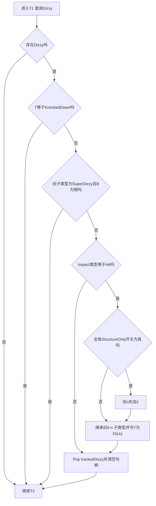
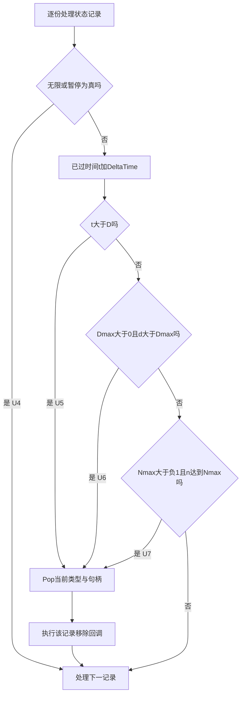
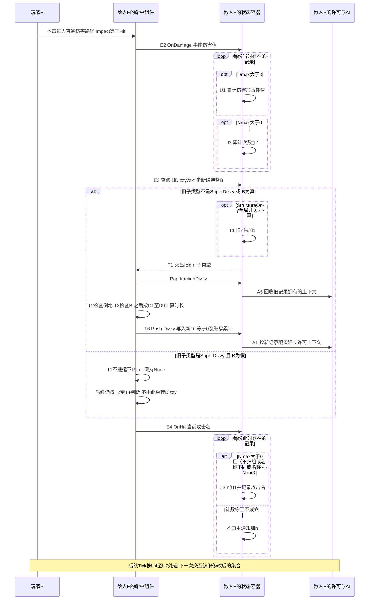

# 战斗状态与事件：系统规格

> **规格篇。** 概念主文见 [[01机制/状态与眩晕/进入眩晕的系统剖析|进入眩晕的系统剖析]]；本簇阅读顺序见 [[01机制/状态与眩晕/00阅读入口|状态与眩晕阅读入口]]。本页保存精确状态转移、时长选择与退出规则。
>
> **2026-10-30 后续补证：** [[01机制/状态与眩晕/玩家进攻与敌人状态转换调查|攻防调查报告]]补入SuperDizzy积累与恢复、Counter_Hit攻击订单入口、预测／当前防御许可及墙撞子链。本篇原接口缺口按该报告缩小范围；未解决项仍保留，不视为完整系统已恢复。

本文还原当前构建中**命中结果如何修改角色状态、状态怎样更新，以及状态如何向动作系统和AI输出限制**。它是一份开发者视角的系统说明，不以解释某套连招或某个玩家现象为章节目标。

规格覆盖已核对的状态容器、命中驱动转移、时间与累计更新、许可生命周期。命中分类器和AI最终执行器尚未完整恢复，作为有边界的接口保留。图中的条件来自静态分支，图与表共享编号；不是实战帧表，也不是可直接编译的源码。全文固定玩家为攻击方P、敌人为受击方E；事件作用于谁会明确写出。

## 1. 系统模型：角色持有状态集合，不是单一状态枚举

每个角色各自持有下面几类数据。玩家与敌人可以使用共用组件，但输入、配置和AI入口不同；不能据此视为完全对称。

| 数据 | 所有者 | 保存内容 | 与其他数据的连接 |
|---|---|---|---|
| 战斗状态集合 `States` | 角色的防御组件 | 多份带类型、子类型、句柄和累计数据的记录 | 命中、服务和更新事件可以增删；查询函数可以从中选出一个类型供其他计算使用 |
| 动作／订单集合 `Orders` | 角色的动作系统 | 普通受击、被避开、被招架等正在执行的过程 | 动作有自己的计时和服务；服务可增删States或许可上下文，不等于状态记录本身 |
| 动作许可上下文 `Contexts` | 角色的许可系统 | 上下文优先级、层及动作允许位 | 状态进入可创建上下文；状态移除回收自己拥有的上下文；NPC查询读取有效上下文 |
| 本次命中结果 `Impact` | 本次交互的数据 | 已确定的命中类型、破架势标记、特殊眩晕可用标记等 | 作为事件输入驱动状态转移，不是永久保存在角色身上的状态 |

**状态存在、状态被选为“最高状态”、某动作许可为真、AI选中该动作，是四种不同的事实。** 删除一份状态不等于把角色赋值为“正常”；集合里可能还有其他状态。本文的“移除”只删除指定类型／句柄对应的记录，不表示清空全部受控效果。

### 1.1 一份状态记录包含什么

下表中的中文短名在后续条件和伪代码中保持一致。

| 中文短名 | 内部字段／对象 | 含义 |
|---|---|---|
| 类型、子类型、句柄 | `m_eState`、`m_eSubFightingState`、`m_iHandleID` | 类型描述类别；子类型区分普通与特殊版本；句柄标识本次创建的记录 |
| 总时长D、已过时间t | `m_fStateDuration`、`m_fElapsedTime` | 剩余时间查询为 `D-t`；重新创建时t从0开始，D另外计算 |
| 暂停、无限 | `m_bPause`、`m_bInfinite` | 控制本节后面列出的自动更新／退出检查；不阻止其他调用显式删除记录 |
| 累计伤害d、伤害上限Dmax | `m_fAccumulatedDamages`、`m_fMaxAccumulatedDamages` | 累计属于这份状态记录，不是角色生命值或全局挨打统计 |
| 累计次数n、次数上限Nmax | `m_iAccumulatedHits`、`m_iMaxAccumulatedHits` | 不同事件可以修改n，不能直接按玩家输入次数解释 |
| 按攻击名归组、上次攻击名 | `m_bGroupMaxAccumulatedHitsByAttack`、`m_LastAttackName` | 供命中通知一路决定是否再次加n；伤害通知一路不使用这项去重 |
| 移除回调 | `m_OnFightingStateRemoved` | 删除记录时执行；状态拥有的许可上下文通过相关回调回收 |

### 1.2 状态类型与选择函数

`GetHighestActiveFightingState` 依次检查下表，从第一个存在的类型返回；全不存在返回None。**这是一次查询的选择顺序，不是状态互斥关系、进入顺序或退出顺序，也不是读取名为PersistencePriority的配置后排序。**

| 查询顺序 | 类型与数值 | 本规格中的处理范围 |
|---:|---|---|
| 1 | 架势崩溃 StructureBroken＝7 | 新破架势触发建立；还能影响其他状态的时长保持 |
| 2 | 眩晕 Dizzy＝4 | 普通子类型None＝0与特殊子类型SuperDizzy＝1分开处理 |
| 3 | 倒地 KnockedDown＝3 | 命中驱动建立／替换及部分累计继承 |
| 4 | Counter_Hit＝2 | 只确认类型及选择位置，本规格不补造其完整入口 |
| 5 | 攻击被避开 Avoided＝6 | 与同名订单区分；服务可附加状态，具体条件另核 |
| 6 | 被招架 Parried＝8 | 与同名／相关订单区分；不等于已进入Dizzy |
| 7 | 被推开 Pushed＝5 | 命中类型Push映射的状态 |
| 8 | 战斗中 InFight＝1 | 只确认类型及选择位置 |
| 9 | 战斗外 OutOfFight＝0 | 只确认类型及选择位置 |

例如，**若状态集合中实际同时存在Dizzy和KnockedDown，最高状态查询返回Dizzy；KnockedDown仍在集合中，仍能被单独查询和更新。** 这是查询规则的结果，不代表已经证明任意攻击都能在实战制造这组状态。

## 2. 事件接口与处理次序

| 事件 | 接收者 | 读取什么 | 修改什么／产生什么 |
|---|---|---|---|
| E1：应用一次Impact | E的命中组件 | 本次结果、E的States、目标反应配置、受击动画容器 | 触发伤害处理、状态转移和命中通知等分支 |
| E2：伤害通知 OnDamage | E的防御组件 | 事件伤害值、通知当时存在的每份状态 | 按U1/U2修改d、n；不直接删除状态 |
| E3：命中结果更新状态 | E的命中／防御组件 | Impact类型、标记、当前States及所跟踪句柄 | 按T0–T6增删／重建记录，调用时长计算 |
| E4：命中通知 OnHit | E的防御组件 | 通知当时存在的每份状态、当前攻击名 | 按U3修改n和上次攻击名；不直接删除状态 |
| E5：每次状态更新 Tick | E的防御组件 | 每份状态及本次经过时间Δt | 按U4–U7更新t或删除记录 |
| E6：显式Push／Pop | 发起调用的服务或组件→E的防御组件 | 类型、句柄、参数／回调 | 进入或退出指定记录，影响其许可上下文 |

已接通的一条普通生命伤害路径，局部调用顺序为 **E2→E3→E4**。它不是对所有Impact的统一承诺：必须进入相应伤害分支并继续到末尾广播。E5不是人为插在这三次调用之间的固定步骤；不能把局部同步顺序画成实战帧序。

## 3. 状态转移：从已分类的命中结果开始

本节接收“命中分类器已经输出的Impact”。分类器怎样决定该类型，见第7节接口；不将下游状态转移与上游数值判定混成同一个判断。

先定义本次局部变量，后面按编号顺序执行，**不是从表中任选一行**：

```text
B = 本击.m_bGuardBreak 且 非 本击.m_bAlreadyGuardBroken  // 本次新破架势
T = 本次准备建立的状态类型，初始None
继承伤害 = 0；继承次数 = 0；子类型 = None
trackedDizzy / trackedDown = 命中组件保存的旧状态句柄
```

### T0：把本次命中类型映射为候选状态

| 条件 | 写入局部变量 | 然后 |
|---|---|---|
| Impact类型＝KnockDown（5） | T＝KnockedDown（3） | 进入T1 |
| Impact类型＝Push（6） | T＝Pushed（5） | 进入T1 |
| Impact类型＝Dizzy（7） | T＝Dizzy（4）；子类型按本击特殊眩晕可用标记选0或1 | 进入T1 |
| 其他Impact类型 | T仍为None | 仍进入T1；None不是“后面完全不改状态” |

命中类型与状态类型是两套枚举，例如命中类型Dizzy＝7对应状态Dizzy＝4。编号不可互换。

### T1：处理已有眩晕

先查找E的Dizzy记录。只有以下守卫全部成立才进入本阶段的处理体：

**存在Dizzy 且 T不是KnockedDown 且〔旧子类型不是SuperDizzy 或 B为真〕。**

| 处理体中的条件 | 执行结果 | 不成立时 |
|---|---|---|
| 本次Impact类型＝普通Hit（0） | 若全局 `s_bHasStructureOnly` 为真，先给旧n加1；然后令继承次数＝旧n、继承伤害＝旧d、子类型＝旧子类型、T＝Dizzy；本次Apply请求调用附加的PushOpenedState接口，其完整语义尚未恢复 | 不搬运这组旧累计值，也不由此把T改为Dizzy |
| 已进入处理体，不论本次是否为Hit | 按trackedDizzy句柄调用Pop，并清空该跟踪句柄 | 整体守卫不成立则不由T1移除该句柄 |

这意味着：**普通眩晕遇到Hit可以走“带累计重建”；旧SuperDizzy遇到Hit且没有新破架势时，会跳过这一搬运／删除处理体。** 本次不进入该处理体不等于其他阶段不能改变状态。

### T2：处理已有倒地

这里重新查询的是**T1执行之后**的状态集合。

| 条件 | 执行结果 |
|---|---|
| 当前不存在KnockedDown | 跳过T2 |
| 存在KnockedDown，且T不是KnockedDown | 按trackedDown句柄Pop旧倒地，清空跟踪句柄 |
| 存在KnockedDown，T＝KnockedDown，且此时不存在Dizzy，且本击GuardBreak＝false，且AlreadyGuardBroken＝false | 继承次数＝旧倒地n；不从旧倒地搬运d |
| 存在KnockedDown，T＝KnockedDown，但上行附加守卫不全成立 | 本阶段不搬运旧倒地n；进入后续Apply，由倒地创建路径替换旧句柄 |

注意此处检查的是两个标记**分别都为false**，比“B为false”更严格。B为false还包含两个标记都为true的情况，不能替换条件。

### T3–T6：建立新状态与附加状态

| 编号与条件 | 动作／副作用 | 下一步 |
|---|---|---|
| T3：B为真 | 调用PushGuardBreakFightingState建立相应破架势状态 | 无论T是否None，继续T4 |
| T4：T＝None | 本函数不再进入下面的命中状态Apply | 结束本段状态创建；T1–T3已经发生的修改不会撤销 |
| T5：T不是Dizzy，且AvoidDizzy标记为真，且SuperDizzyAvailable为真 | **额外**Apply一份Dizzy、子类型SuperDizzy；使用其对应参数并更新相关句柄 | 仍继续T6，不把T替换成Dizzy |
| T6：T不是None | 按T、子类型、继承d/n等参数调用Apply，计算D，再Push新元素；更新应跟踪的句柄 | 结束；状态集合可能包含多项 |

Apply若处理KnockedDown，会先移除其所跟踪的旧倒地句柄；若此时还存在有限Dizzy，会以该眩晕剩余时间与已选时长取较大值。**这是一条明确的跨状态时间依赖，不是把两个状态合为一个。**

以下图只展开T1的判断，每一条边都有条件；其他阶段按表顺序继续：



**Pop旧记录→执行移除回调→Push新记录，不是一次无副作用的原地赋值。** 累计可以被搬运，旧许可上下文却要随旧记录退出，再按新记录的配置建立。也不能把该函数返回的单一类型标签当作States集合的完整快照。

## 4. 新记录的持续时间：按短路分支选择

记 `τ` 为Apply调用传入的额外时长参数；`F` 为本次Impact中的**攻击方冻结时长**；`A` 为传入受击动画容器的时长。τ与F不是同一个字段。`L`为这次实际采用的攻击效果等级配置。

下表D1–D7是顺序短路树：某行取值后不继续后面的来源选择。D8–D9是之后的附加处理。

| 编号 | 判断条件 | 成立时的D | 不成立时 |
|---|---|---|---|
| D1 | T＝Dizzy且子类型＝SuperDizzy | 角色当前抗性DB中特殊眩晕必需时长＋τ | 看D2 |
| D2 | 有有效动画容器且T＝Dizzy，且〔L的眩晕等级为0 或 本次Impact类型为Hit〕 | A＋F | 看D3 |
| D3 | L启用自定义时长 | 自定义时长原值；此分支不再统一加τ | 看D4 |
| D4 | L启用受击动画时长且动画对象有效 | A＋F | 看D5 |
| D5 | L启用保留当前状态时长 | 进入下表D5子树 | 看D6 |
| D6 | 有对应目标反应配置，且其“受击总保留当前状态时长”开关为真 | 找到同类状态时取 `max(剩余时间,0)＋τ`；未找到时转默认状态时长计算＋τ | 看D7 |
| D7 | 前面均未选定来源 | 调用GetDurationOfFightingState取得默认结果，再加τ | 不将此调用内部未展开的全部条件伪装为一个固定表值 |
| D8 | T＝KnockedDown，且删除旧倒地后仍查到有限Dizzy | `D=max(D,眩晕剩余时间)` | D不因此改变 |
| D9 | 目标反应启用与StructureBroken保持，且查到该状态 | 若其无限则D＝-1，否则 `D=max(D,其剩余时间)` | D不因此改变 |

| D5保时长子树 | 结果 |
|---|---|
| 找不到同类状态 | 当前局部时长保持0，直接进入后段，不回退到D7，也不走加τ的公共路径 |
| 找到同类状态且有限 | `D=max(剩余时间,0)＋τ` |
| 找到同类状态且无限，并存在对应目标反应配置 | 转动画时长分支 `D=A＋F`；此跳转本身不再检查D4开关 |
| 找到同类状态且无限，但没有对应目标反应配置 | 走 `max(剩余时间,0)＋τ` 的路径 |

这里列的是函数的真实控制流，不据字段名替它设计一个更合理的回退。特别是D5“状态缺失”路径，前版底稿曾误写为回退默认时长，已按跳转修订。

最终Push写入新记录：`总时长=D；已过时间=0；无限=(D<0)`，并写入本次上限、累计d/n及子类型。**t归零与D的来源是两项不同决策。** 新记录的最后攻击名没有经上述旧记录搬运参数传入，准确初始化仍待核。

累计上限的来源也单独选择，不从继承的d/n倒推：

| Apply中的条件 | 传给新记录的Dmax、Nmax |
|---|---|
| 存在对应反应，且T＝Dizzy、子类型＝SuperDizzy | 角色当前DB的SuperDizzyReaction中相应两项 |
| 存在对应反应，其余情况 | 本次所选FPropertyReaction中的相应两项 |
| 无对应反应 | 本函数保留局部默认-1、-1作为上限参数；不是所有状态调用者的通用默认承诺 |

## 5. 累计与退出：每个事件的字段级规则

E2、E4都遍历通知发生时存在的记录，不是只修改最高状态。

| 编号／事件 | 守卫 | 字段修改 | 不满足守卫 |
|---|---|---|---|
| U1：E2伤害通知 | Dmax＞0 | `d += 事件传入伤害` | d不由此修改 |
| U2：同一E2伤害通知 | Nmax＞0 | `n += 1` | n不由此修改 |
| U3：E4命中通知 | Nmax＞0，且〔不归组 或 攻击名不同 或 当前攻击名为None〕 | `n += 1`，记录本次攻击名 | 不由此加n或改记录名 |
| U4：E5状态更新 | 无限或暂停为真 | 跳过该记录本次U5–U7 | 否则先令 `t += Δt`，再按U5–U7检查 |
| U5：时间退出 | `t>D` | Pop该类型／句柄 | 否则检查U6 |
| U6：伤害退出 | `Dmax>0 且 d>Dmax` | Pop该类型／句柄 | 否则检查U7 |
| U7：次数退出 | `Nmax>-1 且 n>=Nmax` | Pop该类型／句柄 | 保留，处理下一记录 |

U1/U2不检查按攻击名归组，也不以伤害事件的bApplied为过滤条件。U4不阻止其他事件调用U1–U3，只跳过这段自动退出检查。`Nmax=0`会参与U7，但不参与U2/U3的加数；`Nmax<0`关闭此次数退出门。时间和伤害是严格大于，次数是达到即可。

Δt是组件本次Tick收到的时间参数，不直接等于现实时间经过量；时间缩放／冻结怎样作用于该输入尚未恢复，因此不能把这段加法当作独立的真实时间秒表。

Tick删除记录后不递增该数组索引，而是重新处理该位置；保留记录时才前进。删除回调可能改变许可等外部数据，不能把退出步骤只看作一个布尔值翻转。



## 6. 生命周期输出：状态、许可和动作系统的连接

这里用已核对的Dizzy反应配置说明接口的实际连接，不把配置结果写成所有状态的固定语义。

| 编号 | 输入／条件 | 系统动作与输出 |
|---|---|---|
| A1：建立状态 | Push时，目标反应引用许可层 | 创建并保存该记录拥有的许可上下文；已核对Dizzy样本以priority1上下文SET GenericNone |
| A2：查询动作许可 | NPC调用IsAvailable | 已核对NPC路径读取排序后的首个BasicGameplay上下文；不是把所有并存上下文无条件做交集 |
| A3：样本限制生效 | A2实际采用A1的GenericNone结果 | Guard、Parry、Avoid、Dodge四项不在允许白名单中；具体查询返回不允许。若有其他优先上下文，不能仅凭Dizzy存在就跳过A2 |
| A4：AI防御评估入口 | 四项防御许可全部为false | UpdateDefenseNeed由此提前退出；否则只是继续其他评估，不是自动选中防御 |
| A5：记录退出 | Pop找到对应类型／句柄并执行其移除回调 | 回收该记录保存的许可上下文；不清除其他记录／服务拥有的上下文 |
| A6：动作执行 | AI形成防御选择或请求 | 到最终动作／订单准入的全部条件尚未恢复；本规格不画“许可为真→一定执行成功”的确定连接 |

普通受击订单另有一条接口：硬直计时不大于0、动画剩余时间大于0、非致命、允许打断、结束不强制中断动画、存在且尚未推入恢复层等条件通过时，加入恢复层并广播硬直变化。AI订阅该通知，其自身IsStun为false且玩家攻击信息条件通过时，由这条回调重新评估防御。其他事件也可触发评估，故这不是单一全局开关。更细的攻击信息谓词和A6仍是具名缺口。

## 7. 与状态系统交互的上游接口

这些入口不是本规格的新章节中心，而是为状态系统提供输入的调用者。只展开已经确定的守卫。

| 接口 | 已确定的判断／变换 | 传给本系统的结果与边界 |
|---|---|---|
| C1：效果分类 | 攻击覆写按E的查询状态选择；抗性通常按状态取行，B为真时临时采用StructureBroken行，不要求该状态已经Push。攻击等级严格高于对应抗性才形成候选，之后还有候选优先与状态条件 | 输出Impact类型。分类器全部分支未在本文伪造为完整决策表 |
| C2：防守分流 | GuardType不是None时，跳过普通等级／抗性候选选择；仍进入后段公共检查 | 不等于立即返回、无效果或完全跳过C3；预置AvoidDizzy等结果仍须看实际分支 |
| C3：时间阈值修正 | 启用攻击侧保时长，且候选为KnockDown／Push／Dizzy，且对应状态存在且有限，且剩余时间低于配置阈值 | 把本次Impact类型改为Hit；再由T0–T6处理，不能直接断言旧状态结束 |
| C4：被闪避后的命中 | 敌方命中段标记先选择反应DB；该DB由原攻击者敌人的Avoided订单保存；之后玩家命中同一目标时读回，相关字段为真可设AvoidDizzy | 成功闪避不是直接Push Dizzy；本次仍需经过效果分类与T0–T6，订单时长不是Dizzy的D |
| C5：玩家选招条件 | 已解析条件查询目标敌人的ParryVictim订单，或目标Hitted中指定破架势反馈命中行 | 对手的动作记录也可作为玩家选招输入；不把该订单查询当作Dizzy存在查询 |

## 8. 带实际守卫的局部交互时序

为让分支可以逐项核对，本图选择**E已有Dizzy、本击Impact类型已经是Hit、且普通伤害分支确实执行**作为输入前提。它展示状态处理接口的条件，不宣称某套输入必然制造这个前提。



本图不把T1重建与E4广播之间的其他应用流程删改为“从未存在”；只展示所研究的接口调用。瞬时回调、动画播放时间与实际下一次输入不由图中纵向距离表示。

## 9. 实现边界与继续恢复的接口

| 未完成接口 | 缺的不是哪句概括，而是什么具体证据 |
|---|---|
| C1完整分类器 | 全部候选选择、已有状态过滤与攻击效果覆写的完整分支及输入来源 |
| D7默认时长计算器 | GetDurationOfFightingState内部各状态分支与传入DB／角色当前DB的实际关系 |
| A6动作准入 | AI选择结果到具体动作／订单接受函数的拒绝／通过谓词 |
| 状态新元素构造 | 最后攻击名和其他未被调用参数覆盖字段的准确初值 |
| Opened附加接口 | 特定Apply参数会调用PushOpenedState；其完整生命周期、消费者及与其他状态的关系未恢复，不凭名称解释为“开放防御” |
| Tick时间输入 | 全局／角色时间缩放与冻结怎样形成传入Δt；不从字段名推断冻结期间状态是否计时 |
| 非命中状态入口 | Counter_Hit、Parried、Avoided、战斗内外状态的全部Push／Pop调用者与服务条件 |
| 返回标签语义 | Update返回值受两个调用布尔参数及新破架势标记影响；它与状态集合／最高状态是不同输出，调用者完整消费未恢复 |

后续按这些接口补全系统，不把某个实战现象能讲通当作机制恢复完成。已知规则以T／D／U／A／C编号维护，配置变体只替换相应输入；不能修改判断式来迁就某个例子。

## 证据与附录

| 本文部分 | 精确证据入口 |
|---|---|
| 状态集合、类型和固定选择顺序 | `inventory/followup-hitted-type-layouts.json`；`inventory/state-spec-20261029-priority.json`；GetHighestActiveFightingState RVA `0x195C370` |
| T0–T6 | UpdateFightingStateFromImpact RVA `0x1A70A70`，本次逐分支复读；修订记录 `notes/20261029-state-spec-refinements.md` |
| D1–D9 | ApplyFightingStateFromImpact RVA `0x1A46990`，本次核对跳转与字段；同修订记录 |
| U1–U7 | OnDamage `0x1965280`、OnHit `0x19653B0`、TickComponent `0x196A130`；`notes/20261029-rules-hit-count.md` |
| A1–A5及普通受击通知 | 既有E20／E23；`notes/hitted-services-followup.md`、`notes/case-study-ordinary-20261028.md` |
| C1–C3 | ComputeImpactType `0x1A51F10`；`notes/20261029-rules-resolution.md` R01–R03 |
| C4／C5 | `notes/avoid-system-chain.md`；`inventory/20261029-parry-condition.json` |

[[02实现/连续受击与反击追击的系统链|函数、数据与规则编号对照]] · [[03配置/受击案例配置对照#通用规则的字段中文说明|字段中文释义与配置样本]] · [[00索引/首页|知识库首页]]

范围：当前本机匹配EXE/PDB的静态机制规格；未运行游戏，不包含完整全角色配置及实战验证。其他专题页作为附录，重复解释以本规格为准。更新：2026-10-29。
