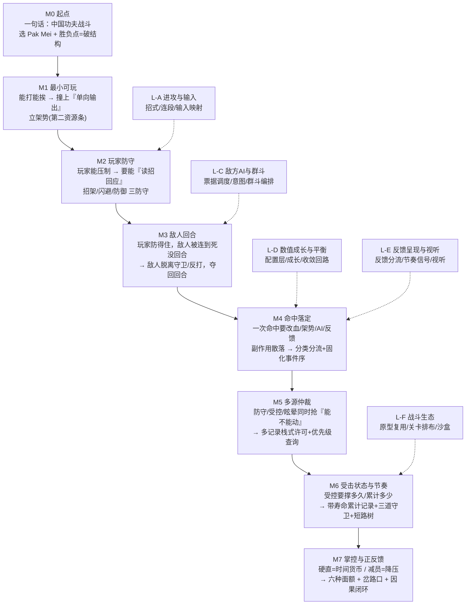

# A-设计树 · 从零演进地图与导航

> **本层只做一件事：逆向描述《师父》(Sifu) 这套战斗系统是怎么从一句话长出来的。**
>
> 只有 Sifu 的路——它遇到了什么冲突、做了什么选择、为什么。**不铺"别的游戏怎么做"**；想看同一处有哪几种取法，去 [[../B-范式/00索引|B-范式]]。
>
> 读法：把这里当成一份"如果从零重做 Sifu，会怎么一步步走过来"的施工日志。

## 根意图与四条承诺

起点那句话（Sifu 版）：

> **"我要做一款以中国功夫为主题、强调真实命中与策略性攻防的近战战斗系统。"**

它逼出四条承诺（Sifu 自己认下的，后文每个决定都拿它当判据）：

| 承诺 | 翻译成设计要求 |
|---|---|
| ① 每次命中都有实在感 | 命中要"看得见"：反应、停顿、反馈，不吞 |
| ② 防守是主动决策 | 防御/闪避/招架各占一维，不被同一状态叠死；成功有回报 |
| ③ 被连击也"可控" | 不存在"一进被连就必死"；总有时限/次数/反抗窗口 |
| ④ 节奏可懂、深度留得住 | 规则统一可预测；深度来自取舍而非复杂度 |

## 从零演进地图

主线是"遇到冲突→做出机制"的一串因果，旁支是几条并行推进的线。

## 阶段 → 文件

| 阶段 | 讲什么 | 文件 |
|---|---|---|
| M0+M1 | 起点、风格、胜负点；最小可玩与架势 | [[01起点与最小可玩]] |
| L-A | 玩家进攻、连段、输入映射 | [[02玩家进攻与输入]] |
| M2 | 玩家防守：格挡/招架/闪避/位移四套 | [[03玩家防守手段]] |
| M4+M5 | 命中分层进入、多源仲裁、副作用定序 | [[04命中建模与交互]] |
| M6 | 受击状态刻划、时长、退出 | [[05受击状态与节奏]] |
| M3+L-C | 敌人回合、票据调度、群斗 | [[06敌方AI与群斗]] |
| L-D | 数值来源、成长、平衡回路 | [[07数值成长与平衡]] |
| L-E | 反馈分流、节奏信号、视听 | [[08反馈呈现与视听]] |
| L-F | 原型复用、关卡排布、沙盒循环 | [[09战斗生态]] |
| M7 收束 | 一对多怎么掌控：硬直货币、减员降压、正反馈闭环 | [[10掌控局面与正反馈]] |

## 维护约定

- **本层只写 Sifu 的历程**：它遇到什么、做了什么、为什么。写别的游戏怎么做＝越界，挪去 B-范式。
- 每个阶段讲完，末尾给一行指路：**"这处冲突在范式里有哪几种取法 → [[../B-范式/xxx]]"**。
- 废案只在取点旁一句"若走另一路会怎样"，不展开。
- 阶段之间是因果：上一段的选择制造了下一段的冲突。

## 采样状态

| 阶段 | 状态 |
|---|---|
| M0+M1（01） | 图驱动＋注解（选 Pak Mei 的理由、胜负点=结构的三层因果、架势立起后的四个子问题） |
| 02 玩家进攻 | 图驱动＋注解（9 图：按对手状态分七类牌、两链前摇曲线、连段出口、推击与撞墙、击倒四条路、倒地窗口与次数上限、处决三环境、输入维度、武器方言） |
| 03 玩家防守 | 图驱动＋注解（6 图：四张牌风险梯度、格挡的全局常数、出招内的反悔窗口、一次输入三段判定、两条成功回报链、失败惩罚分级、维度共用） |
| 04 命中建模 | 图驱动＋注解（多通道效果、命中分型、定序、墙撞） |
| 05 受击状态 | 图驱动＋注解（寿命累计记录、时长短路树、三道退出、抗性表） |
| 06 敌方AI | 图驱动＋注解（7 图：不限流的灾难、四道关、记忆逼变化、票据=威胁预算、压力≠攻击、分工轮转、可读性与归因；附反证表） |
| 07 数值 | 图驱动＋注解（分表配置、原型派生、显式覆盖、可解释来源） |
| 08 反馈 | 图驱动＋注解（结果分流、结构条可视化、分档克制） |
| 09 生态 | 图驱动＋注解（原型/动作复用、编排式难度、局外循环、空间） |
| 10 掌控 | 图驱动＋注解（7 图：三个压力源、硬直=时间货币、六种面额、硬直岔路口、减员降压曲线、因果闭环、反馈三层；并附"少一环会怎样"反证表） |

> **每篇的写法：图承载分析，文字只做注解。** 一个议题可以拆成多张图，**一张图讲一个决定**——把这一层的设计结构画出来（分支、通道、顺序、生命周期、风险梯度），图下再解释"为什么这样设计、另一个取法会怎样"。往下一层再拆一个决定。不写动画名/通知/函数/字段/地址（用户 2026-11-16 指令：要图的方式、要更细一层，不要一问一答的散文）。
>
> **思想性要求（用户 2026-11-16 指令，全部文档适用）：** 每节必须以**可争论的判断/命题**领起，而不是陈述"设计现状"。判断要能被反驳、能说出"不这样会怎样"，并尽量给出可迁移到其他项目的结论。写完后自查：**这一段是在"介绍 Sifu 有什么"，还是在"提出一个主张"？** 前者要改成后者。

---

返回 [[../00阅读入口|04方法论入口]] · 下一步 [[01起点与最小可玩]]