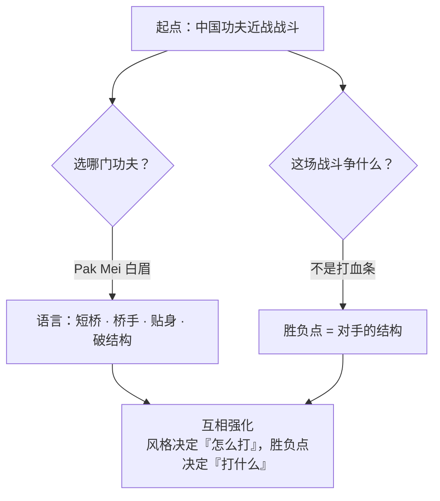
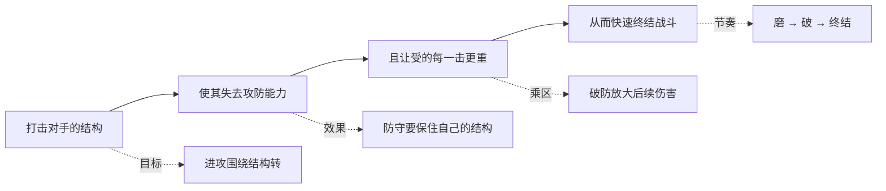
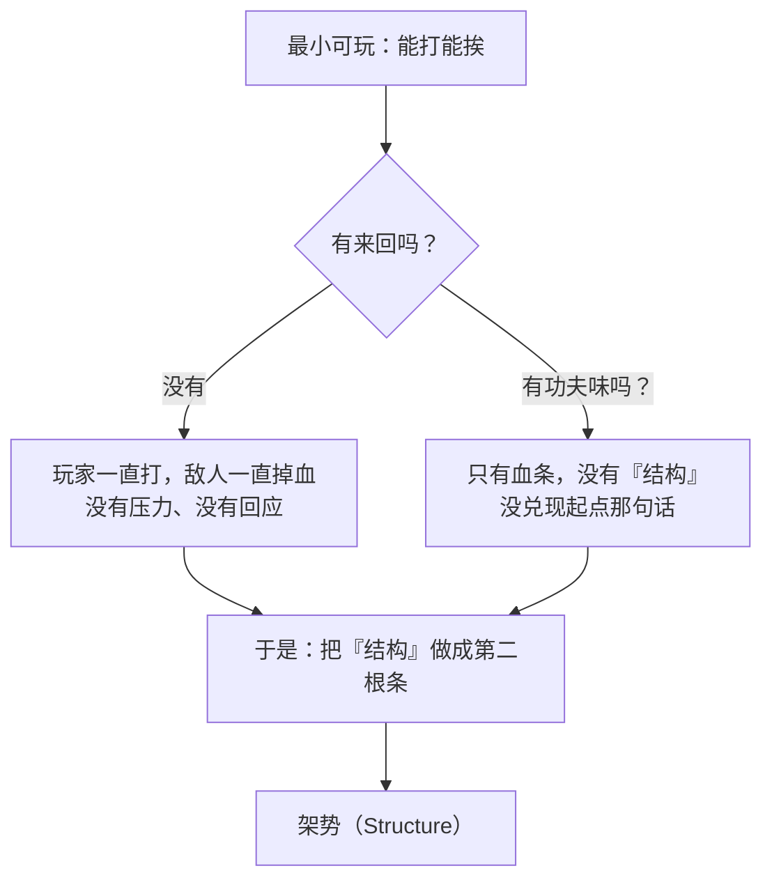
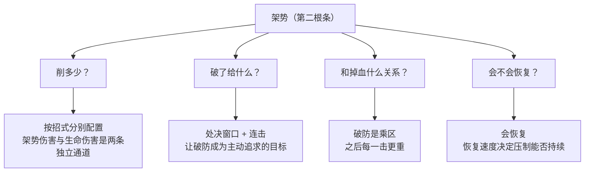
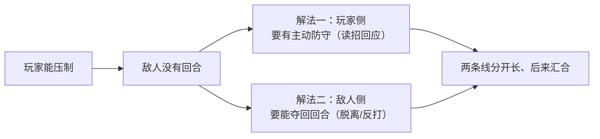

# 01 起点与最小可玩 · 一句话能生出多少东西

> 演进的第一段。这一节想证明的不是"Sifu 的起点是什么"，而是一个判断：
>
> **起点不是设定，是母题。判断一句话值不值得当起点，看它能生出多少下游问题——生不出来的，就只是背景介绍。**

---

## 一、题材不是皮，题材是约束生成器

"我要做一款以中国功夫为主题、强调真实命中与策略性攻防的近战战斗系统。"

这句话听起来只是"题材 + 手感"。但它当场就锁死了两个决定，而且这两个决定会一路管到底。

**第一个：选哪门功夫。** 功夫不是铁板一块——咏春、太极、洪拳、白眉，距离、发力、节奏都不同，做出来是四种游戏。Sifu 选 **Pak Mei**，Layani 说这是"非常快、显而易见的选择"。

**为什么显而易见？** 因为白眉的语言正好是"短桥、桥手、贴身、破结构"——它天然贴着"打结构"这个想法。

> 这里有一个常被低估的判断：**风格不是美术皮，是战斗的语言。** 选了门派，就等于选了距离、节奏、胜负感。反过来也成立——**如果你说不清"你的战斗语言是什么"，那你其实还没选风格，只是选了配色。**

**第二个：这场战斗争什么。** 这是整个项目最关键的一步。绝大多数动作游戏的默认答案是"把血条打空"，但这个答案对功夫是错的——功夫不是比谁血多，是比谁先让对方**失去攻防能力**。

> **胜负点 = 对手的结构（Structure），不是血条。**

---

## 二、"争结构"这四个字，为什么能生出一整个系统

Layani 的原话不是口号，是一条四段因果链：

**四段各长一个子系统：**

- **"打击结构"是目标** → 进攻手段必须能持续削结构（[[02玩家进攻与输入]]）。
- **"失去攻防能力"是效果** → 结构被破 = 对方暂时不能防、不能动，于是有了处决窗口（[[05受击状态与节奏]]）。
- **"每一击更重"是乘区** → 破防不是终点，是放大器；它把"磨结构"和"打伤害"绑成一条链，而不是两套并行的小游戏。
- **"快速终结"是节奏** → 整场战斗的呼吸是"磨—破—终结"，不是"慢慢换血"。

> **这就是"母题"和"设定"的区别。** "我们要做中国功夫"是设定，生不出东西；"胜负点是结构，破防让后续每击更重"是母题，它自己会长出子系统。**判断一个起点好不好，就看它能不能被展开成一条因果链。**

---

## 三、最小可玩：它的用处不是"验证好玩"，是"暴露冲突"

有了方向，第一个能玩的版本很快：角色能出招，敌人能受击，按一下打一下，敌人扣血。

**这个版本立刻暴露两件事：**

1. **战斗是单方面输出。** 玩家一直打，敌人一直掉血，中间没有"对话"——没有压力、没有回应。
2. **它没有兑现起点那句话。** 它只有血条，没有"结构"。

> 这里有一个方法论层面的判断：**最小可玩的真正价值，不是"确认这样好玩"，而是"把冲突提前暴露出来"。** 一个能跑但很薄的版本，会立刻告诉你"缺了什么"——而缺的那块，正好是母题指向的东西。**如果最小可玩暴露不出任何冲突，说明起点太含糊，或者你在做的其实是另一个游戏。**

于是架势被立起来：敌人头顶一根**白色结构条**，每次受击往下掉；掉空 = **破架势** → **处决** + **连击**。

Caselli 把这条钉死了：**"我们把 Structure 这个原则做成了战斗系统的核心，而且很早就实现了。"**

> **"很早"这两个字值得停一下。** 结构条不是后期平衡时补上去的补丁，是第一天就定的地基。很多项目会先把血条做完、玩法跑通，再想"要不要加个破防条"——那样加出来的往往是装饰。**Sifu 是反过来：先定"争结构"，再让所有系统围着它长。**
>
> 可迁移的判断：**胜负点是乘数，不是加数。** 它是加数，就只能在最后往上叠；它是乘数，就必须在第一天就位——因为它会改变其他每一个系统的形状。

---

## 四、好设计会"生产问题"，而不是"解决问题"

一根新条不是"加完了"，而是"打开了一串新问题"。这是这一节最想传递的直觉：**判断一个设计做得好不好，可以看它生出了多少新问题。**

**削多少。** Sifu 的选择是**按招式分别配置**——有的招更疼，有的招更破防（[[04命中建模与交互]] 的五通道）。两条通道独立，才能表达"不疼但很破防"这种拆招。

**破了给什么。** 只加伤害，还是开一个专门出口？Sifu 选后者：破架势 → 处决窗口 + 连击。这让"破防"成为**玩家会主动追求的目标**，而不是顺带的副产品。

**破防和掉血什么关系。** Sifu 里是"互相放大"：结构被破之后受击更重。**破防是乘区，它不直接扣血，但让之后的每一击都更值钱。**

**结构会不会恢复。** 如果破了就永远破，战斗会变成单向碾压。所以必须恢复——不挨打时白条会回。**恢复太快，玩家白磨；恢复太慢，敌人一旦被破就翻不了身。** 这一个参数就决定了"压制"能不能成立。

> **这四个问题没有一个是"要不要加架势"，全是"加了之后必须回答什么"。** 这就是好设计的特征：**它不是终点，是一个问题发生器。** 反过来说，如果一个设计加进去之后什么新问题都没生出来，那它大概率是装饰。

---

## 五、下一个冲突

架势让"磨—破—终结"成立了，但也立刻带来新问题：玩家可以靠结构条一路压制，敌人几乎毫无还手。战斗还是单向的，只是从"单向掉血"变成了"单向磨条"。

**注意这里的分叉方式：同一个问题，从两边各解一次。** 玩家侧要有主动防守（[[03玩家防守手段]]），敌人侧要能夺回回合（[[05受击状态与节奏]] 的退出守卫）。两条线分开长、后来汇合——防守成功会反过来削对方结构，脱离机制会让敌人重新获得进攻权。

> 可迁移的判断：**遇到"系统失衡"时，先问"该从哪一侧解"。** 只从一侧解，往往得到的是补丁；两侧同时解，才得到结构。

---

## 六、这一节收成一句话

| 层 | 判断（不是描述） |
|---|---|
| 题材 | 题材不是皮，是约束生成器——选门派=选战斗语言 |
| 母题 | 起点必须能展开成因果链；生不出下游问题的只是背景介绍 |
| 胜负点 | 胜负点是乘数不是加数，所以必须第一天就位，否则只能是装饰 |
| 最小可玩 | 它的用处不是验证好玩，是提前暴露冲突 |
| 好设计 | 不解决问题，生产问题——看它生出多少新问题 |
| 失衡 | 先问"该从哪一侧解"，两侧同时解才有结构 |

**这一层的设计价值：** 它示范了一个可迁移的动作——**动手之前先回答"这场战斗争什么"，并让这个答案能生出因果链**。答案能生出下游设计，系统才会自己长；答案只有一句话，所有系统就只能各自为政。

## 范式指路

- 这场战斗"争什么"还有别的取法 → [[../B-范式/胜负点决策轴]]
- "怎么制造来回"也有别的取法 → [[../B-范式/制造来回决策轴]]

---

上一级 [[00全貌与导航]] · 下一步 [[02玩家进攻与输入]]（L-A 进攻线）与 [[03玩家防守手段]]（M2 防守线）· 返回 [[../00阅读入口|04方法论入口]]