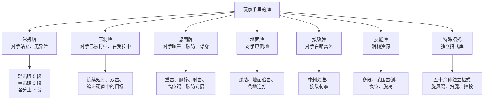
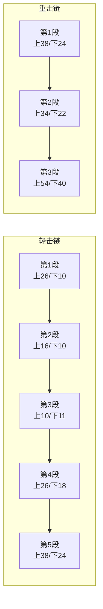
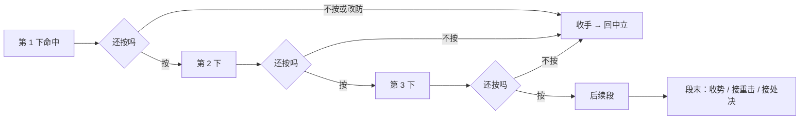
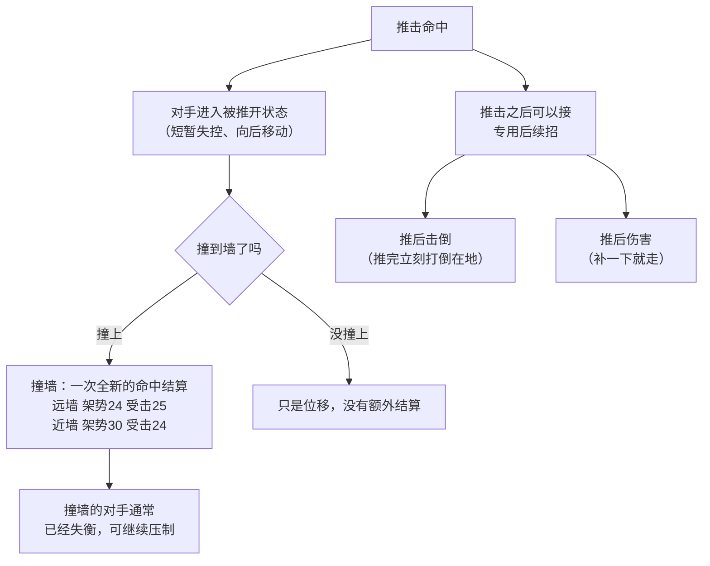
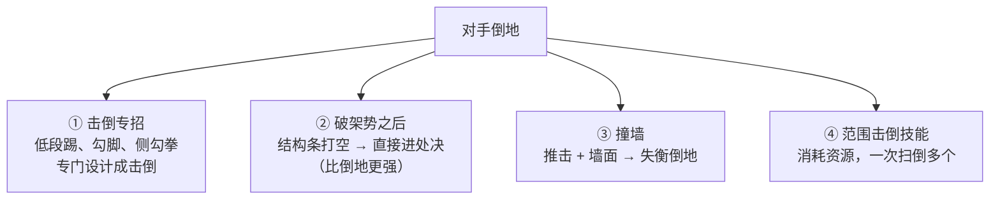
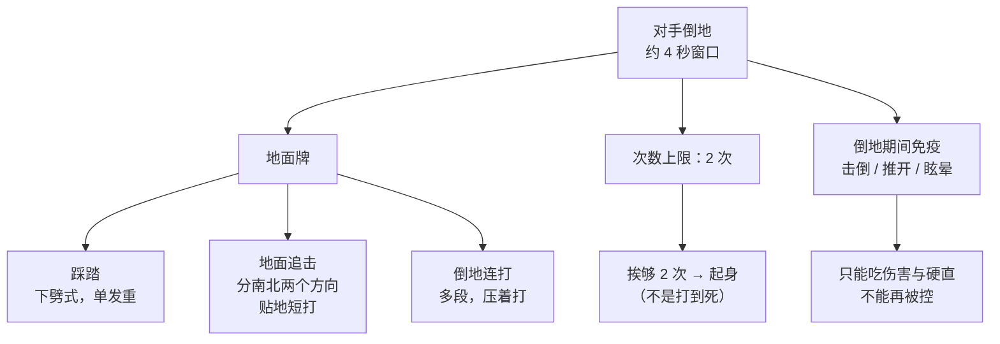
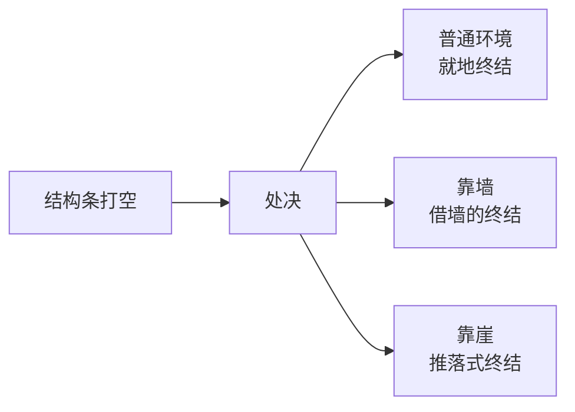
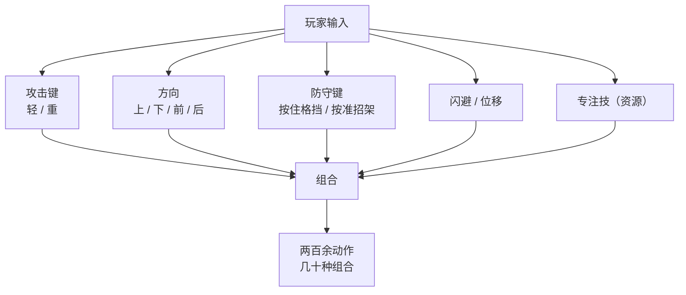

# 02 玩家进攻与输入 · 手里的牌是怎么组织的

> 承接 [[01起点与最小可玩]]（L-A 进攻线）。胜负点是"破结构"，玩家就必须有手段持续施压并最终破防。
>
> 但这一节要反驳一个最流行的假设：**"招式越多，战斗越深"。**
>
> Sifu 有两百多个动作，可玩家同一时刻真正在考虑的永远只有两三张牌。**深度不来自数量，来自"每张牌只在特定局面成立"这个条件结构。**

---

## 一、牌面不是清单，是"条件牌"

初学者会以为招式按伤害排（轻/中/重）。Sifu 不是。它的招式库明显按**目标的当前状态**分家：

**为什么按目标状态分，而不是按伤害分：**

- 因为**"这一下打出去划不划算"取决于对手在干什么**。同一记重拳，打在站立对手身上是赌；打在眩晕对手身上是白送。按伤害分类，玩家学不到这层判断；按状态分类，玩家自然学会"看对手状态出牌"。
- 这也解释了为什么两百多个动作不崩：它们不是并列的两百个选项，是**七组各有触发条件的牌**。

> 这就是本节的核心判断：**深度不是"选项多"，是"选项有前提"。** 一百个永远可用的选项 = 一个选项（永远用最好的那个）；七个各有前提的组 = 真正的选择。
>
> 可迁移的检验：**如果你数不清"玩家此刻不该用哪些招"，那你的招式库就还没有条件结构。**

---

## 二、常规牌：前摇是节奏语言，不是难度旋钮

站立状态下最常用的是两条链：轻击链五段、重击链三段，每段都有上段与下段两个版本。

（数字是"出手到命中的前摇"，单位帧。只用来读节奏曲线。）

**这里有个反直觉的发现：前摇不是单调递增的。**

- 轻击链上段 **26 → 16 → 10 → 26 → 38**：慢起、中段提速、收尾最慢。
- 轻击链下段 **10 → 10 → 11 → 18 → 24**：近似递增，但起点极快。
- 重击链 **38 → 34 → 54** 与 **24 → 22 → 40**：**末段一定最慢**。

两条规律：

1. **末段一定最慢、最重。** 这是"贪到底"的价格——玩家能感到"这一下打出去就收不回了"。
2. **中间允许有提速的节奏点。** 轻击链第 3 段是全程最快（上段 10 帧），它不"更强"，它"更稳"——给玩家一个可以放心按下去的节拍。

> **设计含义：连段的紧张感不来自"越往后越慢"，而来自慢—快—慢的曲线。** 全程递增会让玩家觉得越打越笨；有提速点才有"这段我打得顺"的手感。
>
> 更一般的判断：**前摇是节奏语言，不是难度旋钮。** 很多人调前摇是为了"调难度"（越长越难），但真正的作用是**给动作写句子**——短句、长句、停顿，构成一段可以朗读的节奏。

**上下段为什么是两套数字：** 下段普遍更快（轻击链首段 10 对 26，重击链末段 40 对 54）。因为下段要对付的是**站着防守的对手**——它必须比上段更快才抢得进去。这跟防守侧共用同一个维度（[[03玩家防守手段]]）。

---

## 三、连段：本质是一连串"我还能不能贪"

三个设计：

1. **每段之后都有出口。** 玩家可以随时停手去防、去闪、去换招。连段因此不是不可中断的表演，而是**一连串"我还能不能贪这一下"的小决定**。
2. **贪的代价由前摇承担。** 想接下去就得付下一段的出手时间，末段最贵。系统没有额外加"贪刀惩罚"规则——**惩罚是前摇结构自然长出来的**。
3. **段末有高价值出口**（接重击、接处决）。这让"打完整套"有回报，而不是"打几下都差不多"。

> 可迁移的判断：**好的连段系统不需要"连段惩罚"这种规则，它把惩罚写进了时间结构里。** 规则是外加的，结构是内生的——内生的东西玩家感觉不到被限制，只会觉得"这招重"。

---

## 四、推击：一招的价值可以不在自己身上

推击最容易被当成"小招"忽略，但它的设计位置很特殊：**它不负责伤害，负责重排空间。**

**三个设计点：**

1. **撞墙会重新结算一次命中。** 这不是"推击伤害的追加"，是一次独立的新命中——所以它能触发硬直、架势削减、乃至二次控制。**场地是推击的放大器**：同一记推击，空地只是位移，墙边是两段效果。
2. **撞墙分远近两档。** 近墙伤害更高（生命 30 对 0）——因为"贴身撞"更狠。**把距离也做进了结算。**
3. **推击后面挂着专用后续招。** 推完可以立刻接"推后击倒"或"推后伤害"——推击不是终点，是**下一段连招的开关**。

> **本节最想传递的判断：一招的价值可以不在它自己身上，而在"它把对手放进什么局面"。**
>
> 推击是"局面改写器"：它把"对手在你面前"改写成"对手在墙边/在地面/在你的技能范围内"。**这类招不产生伤害，产生的是"下一步的可能性"——而它们往往是最难被替代的招。**

---

## 五、击倒：四条路 = 四种代价

把对手打倒在地，Sifu 给了四条互不相同的途径，而不是一条"击倒值满了就倒"：

**为什么要有四条路：**

- 因为**击倒的"代价"应该不同**。专招（①）要选对时机，风险在出招本身；破架势（②）要长时间压制，回报是处决；撞墙（③）要场地，是环境红利；范围技能（④）消耗资源，是对付群斗的解法。
- 如果只有一条路（"击倒值打满"），这四种战术全会被压扁成"多打几下"。

> 可迁移的判断：**同一个结果，如果有多条到达路径，每条路径就该有不同的代价。** 路径单一，战术就单一；路径多样但代价相同，等于还是一条。

**击倒和眩晕是两条独立通道，抗性也不同。** 站立时对击倒抗性 2、对眩晕抗性 11——**"打倒他"比"打晕他"容易得多**。这是有意的：**倒地是常用手段，眩晕是稀有奖励。** 一旦倒地，对击倒和眩晕的抗性都变成 0（免疫）——倒地期间不能再被控，只能挨打。这防止了"倒地→再控→再倒地"的死循环。

---

## 六、倒地攻击：地面阶段的难点不是"怎么打"，是"怎么让他起来"

对手倒地后，玩家有一段有限时间可以打，但**不能无限打**。

**三个设计点：**

1. **倒地是"限时窗口"，不是"免费输出期"。** 约 4 秒，够打两三下，不够打完一整套。**刚好让玩家"有得赚但不至于赚翻"。**
2. **次数上限 2 次，是防无限压制的闸门。** 没有它，倒地就是"打倒在地→踩到死"的必胜循环。上限一设，倒地变成"赚一波节奏"而不是"结束战斗"。
3. **倒地期间免疫控制。** 不能再被击倒、推开或眩晕——所以不能靠"倒地→推→撞墙→再倒地"链式控制。地面阶段是纯粹的伤害交换，不再有控制博弈。

> **这一节最反直觉的判断：地面阶段的设计难点不是"怎么打"，是"怎么让他起来"。**
>
> 所有参数（窗口时长、次数上限、免疫）都在回答同一个问题：怎样让"打倒"有回报，又不让"打倒"变成"结束"。**一个阶段的"出口"设计得比"内容"更关键——因为出口决定了这个阶段会不会吞掉整场战斗。**

---

## 七、处决：终结的三种场地语言

结构条打空之后不是"多打几下"，是**一次性的终结演出**，而且按场地分三种：

三种处决不是"同一动作三个镜头"，是**三种场地语言**：靠墙用墙，靠崖用高度，空地用招式本身。这跟推击撞墙是同一套思路——**场地参与结算**。

另外，**招架成功也会通向处决**：对手结构已空时被你招架，直接触发处决。这条路径把防守和终结连了起来（[[03玩家防守手段]]）。

> 可迁移的判断：**如果"终结"只有一种表现，那它就是动画；有三种场地语言，它才是系统的出口。** 终结方式越多，玩家在战斗过程中越会主动"把对手往墙边带"——**终结手段反过来塑造了战斗过程。**

---

## 八、输入：深度来自组合，不来自按钮数

**五个维度，两百多个动作，几十种有效组合。** 按钮不多，但组合空间大——这是"深度"的另一种来源：**不是"学更多按键"，是"学更多组合的时机"。**

> 这也解释了为什么 Sifu 的设计理念是"以练习掌握"（mastery through practice）：**知识是有限的（五个维度），熟练是无限的（时机）。** 玩家不会因为"记不住招式表"而卡住，但会因为"读不准时机"而一直有得练。

---

## 九、这一节收成一句话

| 层 | 判断（不是描述） |
|---|---|
| 牌面 | 深度不是选项多，是选项有前提——数不清"此刻不该用哪些招"就还没有条件结构 |
| 前摇 | 节奏语言，不是难度旋钮——慢快慢构成可朗读的句子 |
| 连段 | 本质是一连串"我还能不能贪"；惩罚写进时间结构，而非外加规则 |
| 推击 | 一招的价值可以不在自己身上，在它把对手放进什么局面 |
| 击倒 | 同一结果四条路，每条路代价不同；路径单一则战术单一 |
| 倒地 | 难点不是"怎么打"，是"怎么让他起来"——出口决定阶段会不会吞掉战斗 |
| 处决 | 终结手段反过来塑造战斗过程（把对手往墙边带） |
| 输入 | 深度来自组合与时机，不来自按钮数 |

**这一层的设计价值：** 它把"招式"从"一堆动作"变成了**一组有前提、有代价、有出口的条件牌**。玩家不是在背招式表，是在读局面、选牌、承担代价——**而这就是"策略"在动作层的样子。**

下一站：玩家能打，那对手也能打——**玩家凭什么防住？** → [[03玩家防守手段]]。

## 范式指路

- 进攻与连段怎么组织、牌面怎么分组 → [[../B-范式/00索引]]（待建轴）

---

上一级 [[00全貌与导航]] · 下一步 [[03玩家防守手段]] · 返回 [[../00阅读入口|04方法论入口]]