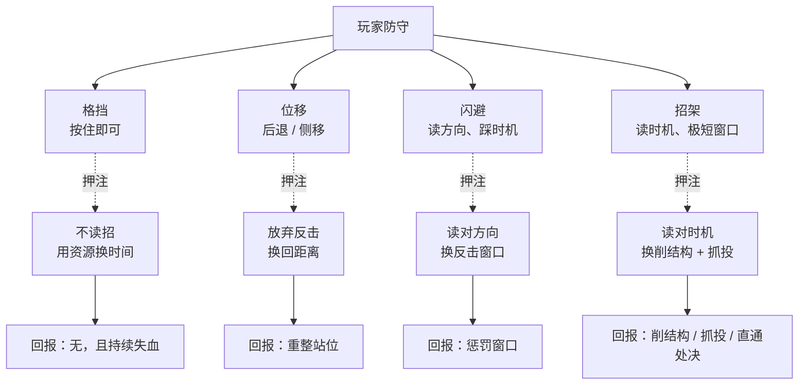
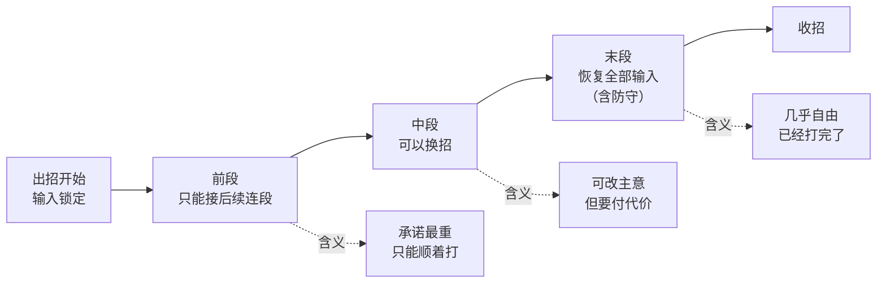
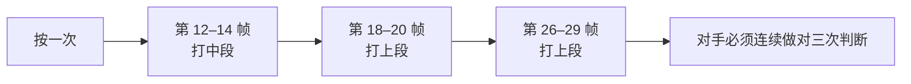
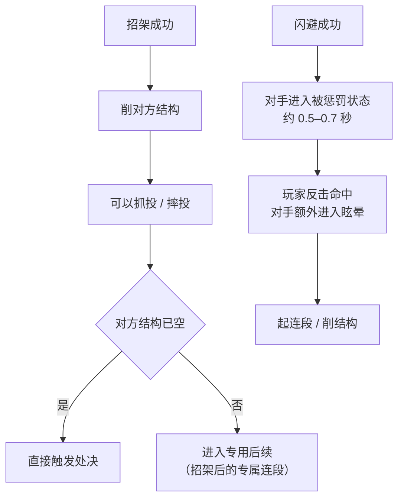
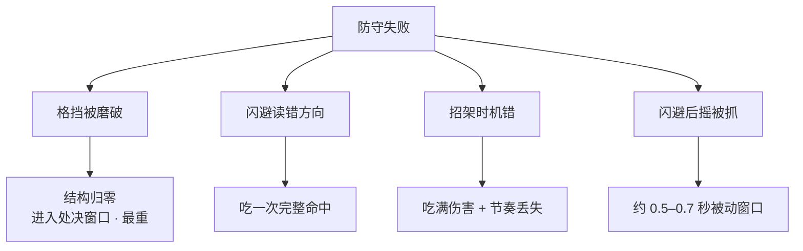
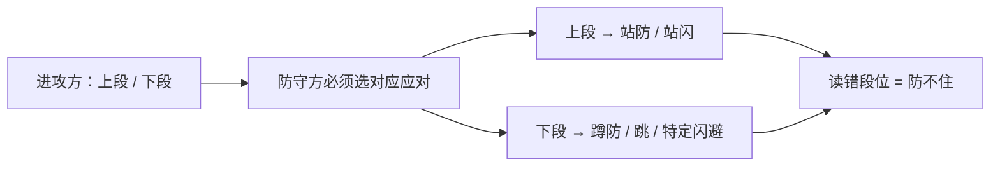

# 03 玩家防守手段 · 防守不是"不受伤"，是"投资"

> 承接 [[02玩家进攻与输入]]（M2 防守线）。进攻有了，但只有进攻的战斗是单向的。
>
> 这一节要推翻一个默认假设：**"防守 = 这次没掉血"。**
>
> 如果防守只等于不掉血，最优策略永远是"防到对方露出破绽"，战斗退化成消极等待。Sifu 的解法是：**防守必须能换到进攻资源**。四张牌不是四种"防不防得住"，是四种**投资**——你押了什么、赢了拿什么、输了赔什么。

---

## 一、四张牌：不是四种格挡，是四种风险等级

**关键差别不是"防不防得住"，是你押了什么、输了赔什么：**

- **格挡是保底，但不是安全。** 永远可用、不用读招，代价是持续吃架势伤害——磨久了破防。
- **位移是脱离，不是防守。** 把战斗拉回中立，但放弃了反击。
- **闪避要求读方向。** 读对给惩罚窗口，读错直接挨打——它把"观察"变成一种能力。
- **招架要求读时机。** 窗口极短，回报最大。

> **本节第一个判断：一种防守等于没有选择。** 如果只有格挡，玩家永远选最安全的那个，战斗变成"按住防等破绽"。
>
> 而且注意四张牌的**回报是不同类型**的（时间/距离/窗口/结构），不是"同一种回报的大小不同"。**类型不同才有取舍；只是大小不同，那就永远选最大的那个。**

---

## 二、格挡的账：一个全局常数，而不是逐招调参

格挡不是"减伤"，是"把伤害换个通道付"。同一记攻击，命中、被格挡、被弹开，架势伤害是三档：

| 同一记攻击 | 直接命中 | 被格挡 | 被弹开 |
|---|---|---|---|
| 轻击（刺拳类） | 12 | 10 | 8 |
| 重击（重型挥击） | 36 | 30 | 24 |
| 占命中的比例 | 100% | 约 83% | 约 67% |

**这张表最值得注意的不是数字，是比例。** 轻击和重击的绝对量差三倍，但"格挡保留 83%、弹开保留 67%"这个比例**完全一致**。

这说明它不是逐招调出来的，是一条**全局设计常数**：无论多重的攻击，格挡都吃掉约六分之一，弹开吃掉约三分之一。

> **为什么这很重要：比例不变、绝对量变，才让防守手感"跨招式一致"。**
>
> 如果每招单独调比例，玩家就学不到"格挡大概能省多少"这个直觉——他每遇到一招都要重新估。**统一比例等于给"防守强度"定了一个可迁移的标尺：你防得越好，省下的架势越多，而"多防几下就能扛住"这件事永远成立，不会因为遇到重击就突然失效。**
>
> 可迁移的判断：**凡是"玩家需要建立直觉"的量，都该有一个跨内容不变的比例。**

---

## 三、出招途中能不能反悔：一条随进度移动的线

这是防守设计里最容易被忽略、但决定手感的一层。

很多游戏里"出招"是全有或全无：按下去就一直打完。Sifu 不是——**一个攻击动作内部，在不同阶段开放不同的输入**。

以一套三连拳为例：**第 34 帧之后**开放"接后续连段"，**第 40 到 80 帧之间**开放"换招"，**第 80 帧之后**恢复全部输入。

**为什么这样切：**

1. **前段锁死，是为了让"出招"成为真正的承诺。** 按下去就得认。如果一出手就能立刻取消，所有攻击都没有风险，"读招"也就不存在了。
2. **中段开口，是给"打错了"留一条退路。** 发现自己判断失误（对手起手了），可以改主意——但要付代价，因为已经花掉了一部分时间。
3. **末段全开，是因为伤害已经兑现。** 这时候再锁着没有意义。

> **本节第二个判断："能不能反悔"不是开关，是一条随动作进度移动的线。**
>
> 这条线越靠前，动作越"重"（承诺强、风险高）；越靠后，动作越"轻"。
>
> 这直接回答了一个常见疑问："为什么有的招感觉笨重、有的招感觉灵活？"——**不只是前摇长短，还有它多早允许你改主意。** 整套招式的手感差异，很大程度上是这条线的位置差异，而不是数值差异。

---

## 四、一次输入，三段命中：把一次判断变成三次

同一套三连拳还有另一个设计：**一次按键，产生三段命中，而且三段打的高度不一样。**

防守方不是"防住一下"就完了——**一次进攻可能要求你连续应对三个不同高度的判定**。防错其中任何一段，后面的就漏了。

> **判断：多段命中不是"伤害乘三"，是"把一次判断变成三次判断"。**
>
> 它提高的是防守的认知负荷，也就是提高了"读招"的价值。**如果一段攻击只有一次判定，那"读招"只需要读一次；三次判定，读招才变成一件有分量的事。**

---

## 五、防守成功换到了什么：这是本节的核心

在很多游戏里，防守成功 = 这次没掉血。Sifu 不是，防守成功会**直接改变战局**。

**两条回报链的差别很关键：**

- **招架走"结构"这条线**：削结构 → 抓投 → 结构空 → 处决。而且招架之后有一套**专属后续连段**——不是你平时的连段，是专门为"刚招架成功"这个瞬间准备的牌。**这是把"防守成功"直接做成了一个新招式入口。**
- **闪避走"惩罚窗口"这条线**：闪避成功会在对手身上挂一个约 0.5–0.7 秒的"可被惩罚"标记；玩家在这个窗口内反击命中，对手会**额外进入眩晕**。也就是说，闪避的回报不是"能打一下"，是"这一下打得更狠"。

> **本节最重要的判断：防守必须产出进攻资源，否则它只是"延迟失败"。**
>
> 如果防守只等于不掉血，最优策略永远是"防到对方露出破绽"——战斗变成消极等待，双方都在等对方先动。让防守直接产出资源（削结构、抓投、惩罚窗口、专属连段），防守就从被动变成**主动的进攻手段**：玩家会主动去找"我要招架这一下"。
>
> 这也兑现了承诺②"防守是主动决策"——玩家在选的是"我要哪种回报"，不是"我要不要防"。

---

## 六、防守失败赔多少：分级，不一刀切

三个设计点：

1. **格挡失败的代价最重**（结构归零）。这看着反直觉——最安全的防守赔得最多。但**正因为如此，玩家不能一直格挡，必须主动去招架或闪避**。这是用惩罚把玩家从保底策略里赶出去。
2. **闪避有后摇惩罚窗口**。闪避不是无敌帧的免费午餐，它是一个**有承诺的动作**，乱闪要付钱。
3. **招架失败吃满**。高风险对应高惩罚，玩家才会认真读时机。

> **判断：惩罚设计不是让玩家疼，是让玩家不敢用错策略。**
>
> 而且注意：**最安全的那个选项，必须赔得最重。** 否则保底策略会吞掉所有其他策略——玩家没有理由冒险。这条规则几乎是"选项多样性"的必要条件，不只是防守，任何"有保底选项"的系统都成立。

---

## 七、防守和进攻是同一套维度

- 玩家只需要学**一套**维度（上下），就同时理解进攻和防守。
- 它制造了"猜段位"的博弈：进攻方换段位是为了让防守方选错，防守方读段位是为了接对。**这是攻防之间最直接的一次心理对赌。**
- 它让"读招"有了具体内容——不是读"他要不要打"，而是读"他要打哪一段"。

> **判断：好的系统让玩家学一次、用两次。** 上下段既是进攻维度又是防守维度，学习成本减半，博弈深度翻倍。**如果你的进攻维度和防守维度是两套，那玩家要学两遍，而两套之间还未必有博弈。**

---

## 八、这一节收成一句话

| 层 | 判断（不是描述） |
|---|---|
| 防守的本质 | 不是"不受伤"，是"投资"——必须换到进攻资源，否则只是延迟失败 |
| 四张牌 | 不是四种格挡，是四种风险等级；回报类型不同才有取舍 |
| 格挡的账 | 全局常数（83%/67%）——需要建立直觉的量，都该有跨内容不变的比例 |
| 反悔窗口 | 不是开关，是一条随进度移动的线；手感差异主要来自线的位置 |
| 多段命中 | 不是伤害乘三，是把一次判断变成三次 |
| 成功回报 | 防守产出进攻资源，防守才从被动变主动 |
| 失败代价 | 最安全的选项必须赔得最重，否则保底策略吞掉一切 |
| 维度共用 | 让玩家学一次、用两次 |

**这一层的设计价值：** 防守从"一个按钮"变成了**四种不同风险的投资 + 一条随动作移动的反悔线**。玩家每一刻都在选"我押哪种回报、我承担哪种失败"——**这就是"策略性攻防"的实体。**

下一站：双方都能打能防了，一次命中到底怎么结算 → [[04命中建模与交互]]。

## 范式指路

- 防守怎么给选项、回报怎么设计 → [[../B-范式/00索引]]（待建轴）

---

上一级 [[00全貌与导航]] · 下一步 [[04命中建模与交互]] · 返回 [[../00阅读入口|04方法论入口]]