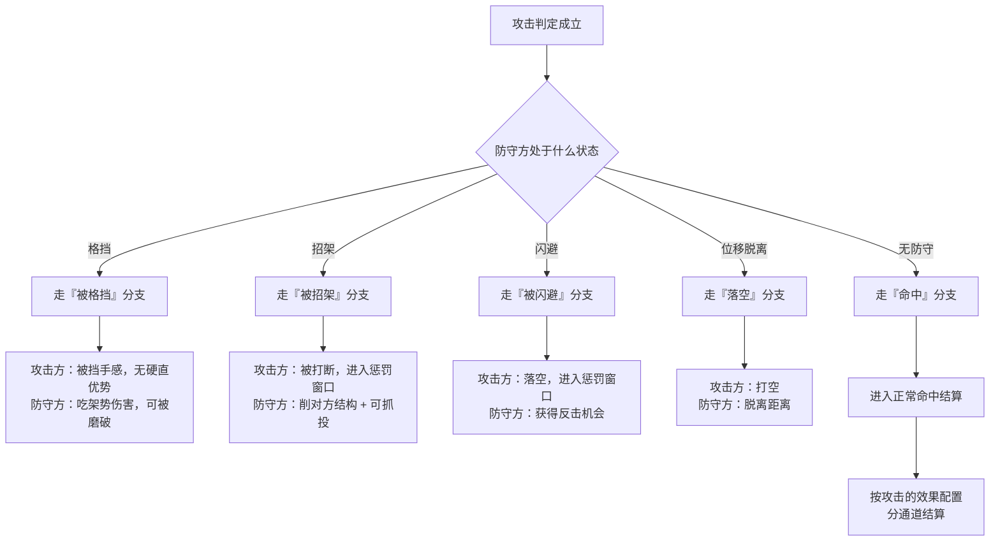
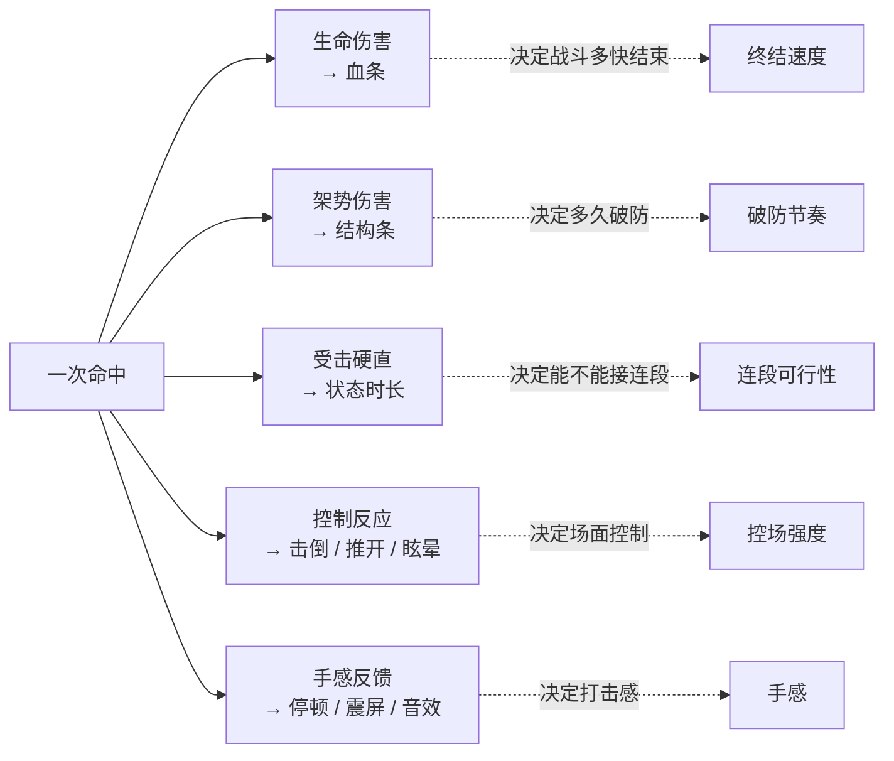
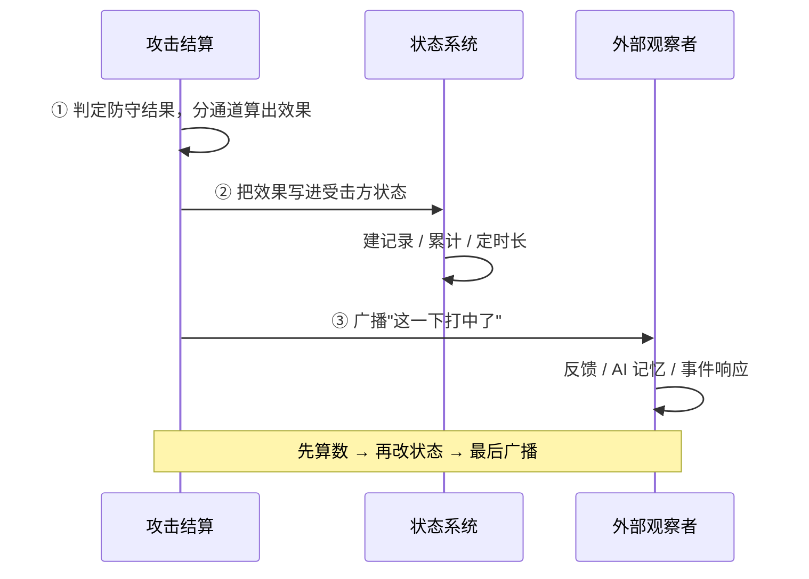
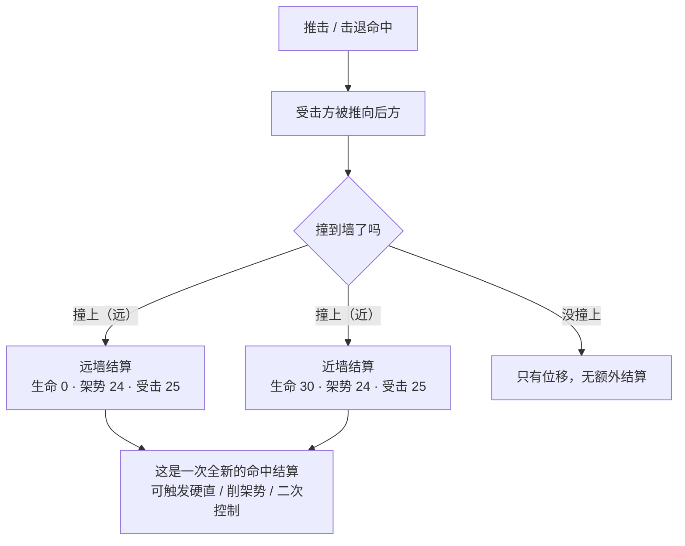
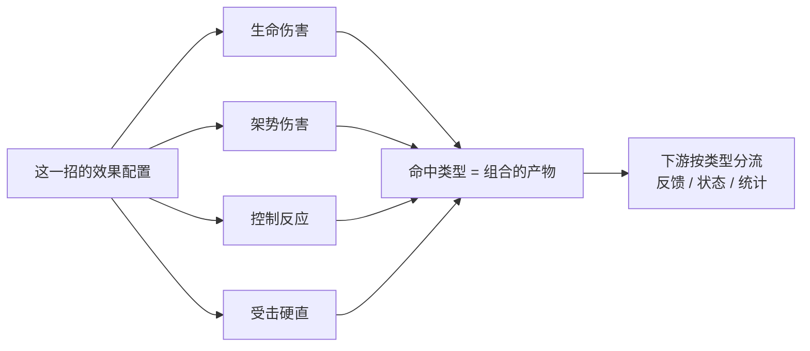

# 04 命中建模与交互 · 一次命中不是"一个事件"

> 承接 [[03玩家防守手段]]。玩家能打、也能防了。现在要回答最具体的一层：**一次攻击命中（或被防住）的那一瞬间，系统里按什么顺序发生了什么。**
>
> 这一节的核心判断：**命中不是"一个事件"，是一次结算流程。** 而流程的形状，决定了这个系统能不能表达"不疼但很破防"、"被防住也算进攻"、"墙也是参与者"这类东西。
>
> 一旦把它当"一个事件"处理（打中→扣血→播动画），这些表达全部做不到——不是没做，是**结构上装不下**。

---

## 一、第一刀：先判"防守结果"，再决定后面全部

很多项目的命中处理是"打中 → 扣血 → 播放受击"。Sifu 不是。它的入口第一件事是问：**这一下有没有被防住、被什么方式防住？**

**为什么第一刀要切在这里：**

- **防守结果是"语义"，不是"数值修正"。** 被格挡、被招架、被闪避在玩法上是三种完全不同的结果（一个是被磨、一个是反打、一个是空挥），它们该走三条不同的流程，而不是"同一条流程 × 一个系数"。
- **切在这一层，下游才能各自长。** 如果先算伤害再判断有没有防住，那"招架后能抓投"这种后续分支就没地方挂。
- **它也决定了反馈**（[[08反馈呈现与视听]]）：结果先分好类，反馈才能按类分流。

> **本节第一个判断：把"结果分类"放在"数值计算"之前，不是因为代码整洁，是因为玩法语义必须先行。**
>
> "同一条流程 × 系数"的做法，本质上假设所有防守都是"伤害打折"。但招架不是打折——招架是**攻守易位**。**用同一个乘法去表达两种不同性质的事，系统就永远只能做出"防住了但没变化"的手感。**

---

## 二、第二刀：一次命中改的不是一个数，是五个通道

玩家感觉"这一下很重"，其实是好几个通道同时在动。Sifu 把它们分开配置，因为它们的**作用对象完全不同**。

**五个通道分开的理由：**

- 如果只有一个"伤害值"，那"这一招很疼但不破防"和"这一招不疼但很破防"就没法表达。而这两种招在功夫里是完全不同的语言——前者是重击，后者是拆招。
- 五个通道各有各的"调参者"和"验证方式"：生命伤害看战斗时长，架势伤害看破防频率，硬直看连段是否顺，控制看场面是否失控，手感看打击是否有反馈。**混在一起调，永远是按下葫芦浮起瓢。**

> **判断：通道的数量，等于这个系统能表达的"独立语言"的数量。**
>
> 一个通道 = 只能说"多疼"；五个通道 = 能说"多疼 / 多破防 / 多难接 / 多失控 / 多有感"。**想要更丰富的表达，第一步不是加招式，是加通道。**

---

## 三、第三刀：顺序——先算数、再改状态、最后广播

命中之后要干三件事：算数值、改状态、通知外部（反馈、AI、其他系统）。这三件事的**顺序**，决定了会不会出现"中间态"。

**三个顺序的理由：**

1. **先算数**：数值必须在状态改变之前定下来，否则"打中之后的数值"会被新状态影响（比如刚进入的硬直反过来改变伤害），结算就不确定了。
2. **再改状态**：状态是"这一下的结果"，必须在数值确定后写。
3. **最后广播**：外部系统（反馈、AI、成就）看到的世界必须是**已经稳定**的。如果先广播再改状态，外部会读到"打中了但还没硬直"的瞬间。

> **判断：顺序不是实现细节，是设计。**
>
> 它决定了系统里"有没有中间态"。中间态意味着：任何观察者都可能读到不一致的世界，于是每个观察者都要自己处理"万一还没算完"。**这类防御性代码一多，系统就再也改不动了。**
>
> 可迁移的做法：**任何"算、改、通知"三段，都应该固定成这个顺序，并且不允许观察者插入中间。**

---

## 四、环境不是背景，是结算的一部分

同一记攻击，打在空地上和打在墙边，结果不一样。这不是"场景加了点特效"，是**墙参与了结算**。

**三个设计点：**

1. **撞墙是一次全新的命中结算**，不是"推击伤害的追加"。所以它能触发硬直、架势削减、乃至二次控制。
2. **远近两档**：远墙（撞飞出去）生命 0，近墙（贴着墙撞）生命 30——**"贴身撞"更狠**。把距离也做进了结算。
3. **场地是放大器**：同一记推击，空地只是位移，墙边是两段效果。

> **判断：当环境能改变结算结果，它就从"背景"变成了"参与者"。**
>
> 这个变化的意义远超"多一种效果"：它让玩家的**站位**有了价值，让"把对手往墙边带"成为一种主动策略。**环境参与结算，是"空间"从装饰变成资源的那一刻。**
>
> 反过来说：**如果你的环境只影响"能不能打中"，那它只是碰撞体，不是设计。**

---

## 五、命中类型：不是设计师分类，是效果组合的副产品

系统里会有"这一下是普通命中、还是重击、还是墙撞"这样的分类。容易误以为是设计师手填的标签。

**判断：类型是"由什么组成"推出来的，不是"由谁决定"填上去的。**

这个做法有一个很大的好处：**加新招时不需要先想"它属于哪一类"**——只要把五个通道填好，类型自然落位。**分类是结果，不是前提。**

> 可迁移的判断：**凡是"分类"，都应该尽量做成"组合的产物"，而不是"人工的标签"。** 人工标签会漂移（新招忘了标），组合不会。

---

## 六、这一节收成一句话

| 层 | 判断（不是描述） |
|---|---|
| 入口 | 结果分类必须在数值计算之前——招架不是打折，是攻守易位 |
| 通道 | 通道数量 = 系统能表达的独立语言数量；想表达更多，先加通道 |
| 顺序 | 先算数 → 再改状态 → 最后广播；顺序决定系统里有没有中间态 |
| 中间态 | 有中间态，所有观察者都要自保，系统从此改不动 |
| 环境 | 环境能改变结算，才从背景变成参与者；空间因此成为资源 |
| 类型 | 分类应是组合的产物，不是人工标签——标签会漂移，组合不会 |

**这一层的设计价值：** 它把"命中"从一个瞬间，变成了**一条有分支、有通道、有顺序、有环境参与的结算流水线**。这条流水线的形状，直接决定了这个战斗系统能表达多少种"不一样的一下"。

下一站：结算完了，结果挂到人身上——**被打之后，一个人会怎样？** → [[05受击状态与节奏]]。

## 范式指路

- 命中怎么分层、副作用怎么定序 → [[../B-范式/02事件阶段决策轴]]

---

上一级 [[00全貌与导航]] · 下一步 [[05受击状态与节奏]] · 返回 [[../00阅读入口|04方法论入口]]