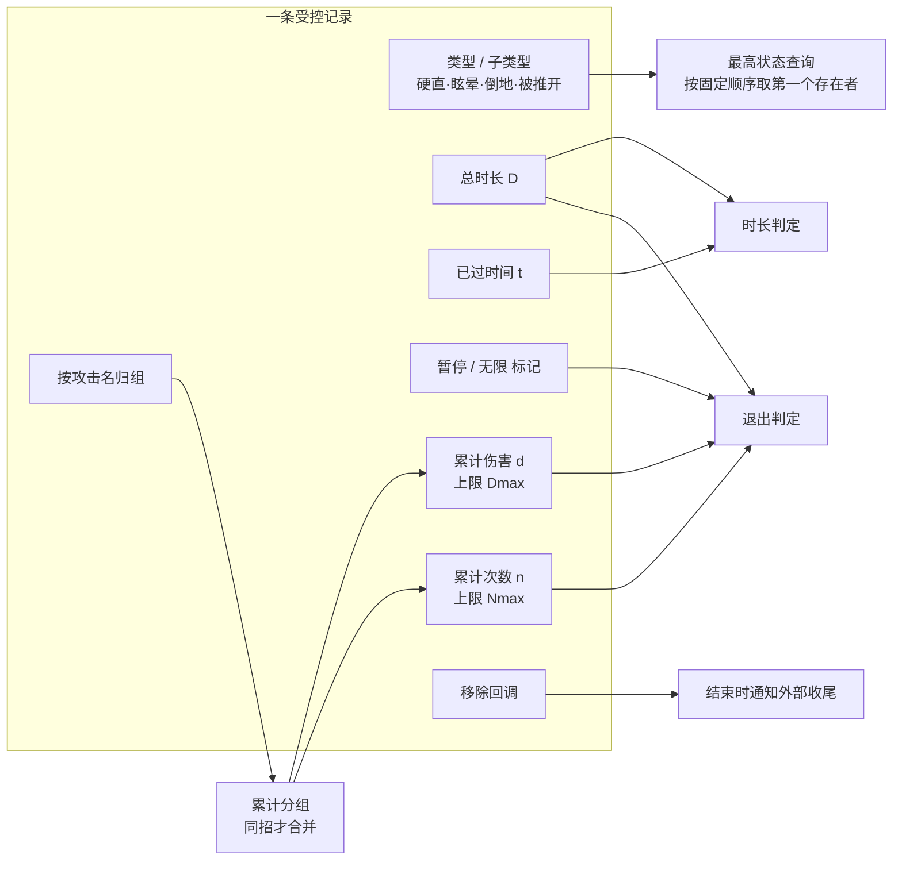
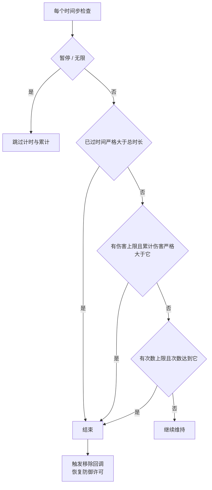
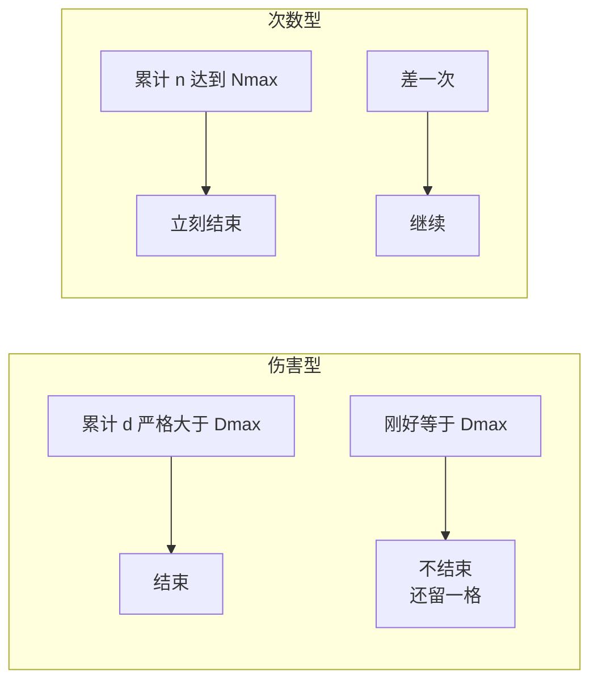
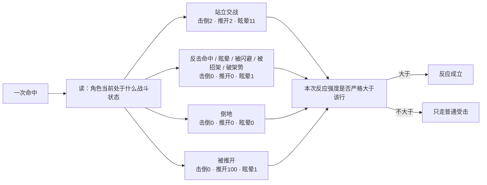
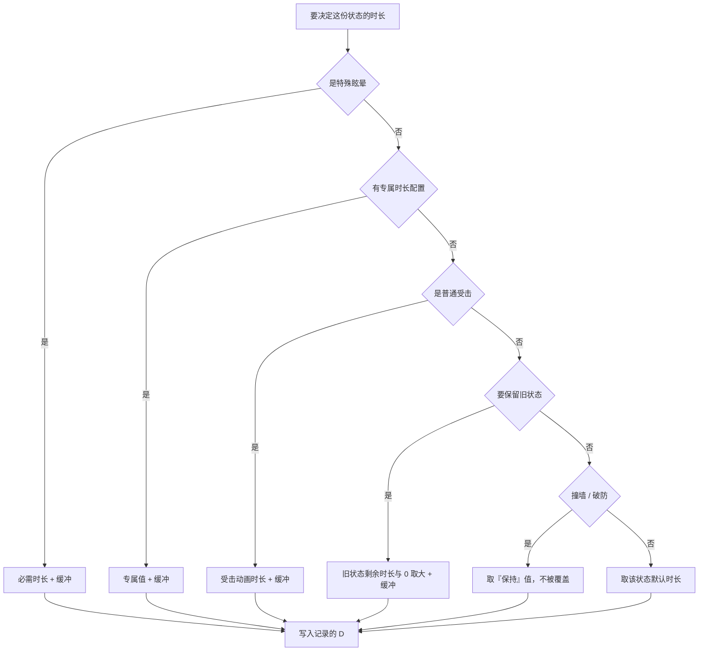
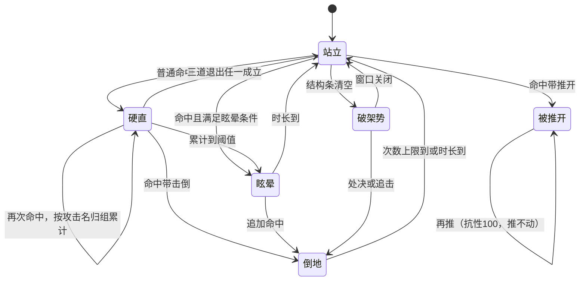
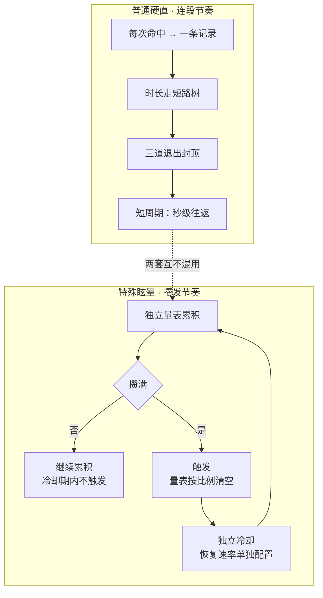
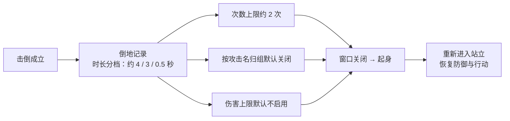
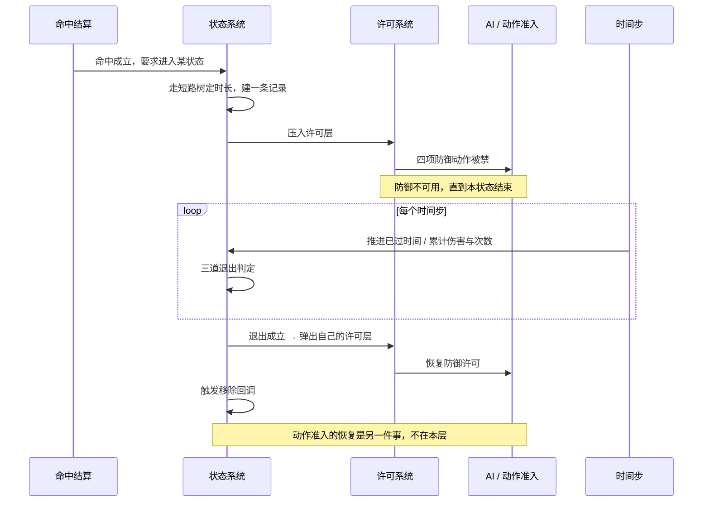

# 05 受击状态与节奏 · 被打之后，一个人会怎样

> 承接 [[04命中建模与交互]]。命中已经落定，结果要"挂到角色身上"。
>
> 这一节想说的不是"状态系统有哪些字段"，而是一个判断：**受击状态系统从来不是在描述"敌人现在的样子"，它是在记账——记玩家买到了多少时间，以及这笔时间什么时候被收回。**
>
> 一旦接受这个判断，整层设计的重心就变了：**真正被设计的是"退出条件"，不是状态本身。**

---

## 一、三个命题

在拆图之前，先把这一层的三个核心判断摆出来，后面每一节都是它们的展开：

1. **数据结构的选择，决定了玩法能问出什么问题。** 布尔开关只能回答"他是不是硬直了"；一旦玩家想问"还能接几下"，布尔就废了。**所以"记录式"不是为了代码好看，是为了让连段这个问题成立。**
2. **状态的设计 = 退出条件的设计。** 时长、伤害上限、次数上限，三个字段都在回答同一件事：这份控制什么时候结束。**谁有权结束它，比它长什么样重要得多。**
3. **这套系统最终保护的不是"弱者"，是"回合"这个制度。** 被连击的一方永远有一条回到回合的路——不是因为要照顾他，而是因为**没有回合，就没有攻防，只剩输出**。

---

## 二、为什么不能是布尔：数据结构决定你能问什么问题

最省事的受控是"是否硬直"的布尔开关。它一碰到连段就废了。

**每个字段都在回答一个"玩家会问的问题"：**

| 字段 | 它让哪个问题成为可能 |
|---|---|
| 总时长 D / 已过 t | "这一下还能撑多久？" |
| 累计伤害 d / 上限 Dmax | "我一直打，他会不会提前倒？" |
| 累计次数 n / 上限 Nmax | "我还能接几下？" |
| 按攻击名归组 | "换招能不能续上？同一招连打会不会断？" |
| 暂停 / 无限 | "有没有打不断的控制？" |

**这就是"数据结构决定问题"的含义：** 玩家能问的问题，取决于系统存了什么。存了剩余量，才能设计"保留旧状态剩余时长"；存了累计与上限，才能设计"打够就提前结束"。

> 反过来说：**如果你的受击系统只有一个布尔，那你永远只能设计"打/不打"，设计不出"节奏"。** 这是很多战斗系统做不深的第一道坎，而且它不在美术、不在数值，在最初选了什么结构。

---

## 三、真正被设计的是"退出条件"：三种退出 = 三种策略的合法边界

三道守卫看起来是"技术上的三重保险"，其实每一条都在回答一个设计问题：**哪种打法算合法？**

| 退出条件 | 它允许什么 | 它禁止什么 |
|---|---|---|
| 时间到 | 慢慢打、磨着打 | 无限拖 |
| 伤害到 | 集中输出、压着打 | 一招吃到底 |
| 次数到 | 数得清地连 | 无限连 |

**关键判断：三道守卫不是"防作弊"，是"划定三种策略各自的边界"。**

- 只有时间退出 → 高伤连段可以一直压，因为没有"打够就断"的机制。
- 只有次数退出 → 轻招磨血会被次数卡死，重招反而占便宜。
- 只有伤害退出 → 低伤连段可以无限连。

三条同时存在，才让"轻招、重招、磨血、爆发"这些不同打法各有活路，也各有上限。

> 这一层最反直觉的地方：**"限制"不是用来压制玩家的，是用来让多种打法同时成立的。** 没有限制，只有一种打法能活——那才是真正的贫乏。

---

## 四、余量的哲学：为什么伤害留一格，次数不留

图上最容易看漏的一处，是比较符号不一样：

- 时间和伤害是**严格大于**才结束——"刚好打满上限"这一下不算结束，还能再撑一格；
- 次数是**达到**就结束——打满 N 次立刻断。

**这不是随手写的，是两种控制哲学：**

- **伤害型留余量**，因为伤害是连续的、模糊的，玩家感觉不到"还差 1 点"。留一格，让"差一点"的连段还能成立——**鼓励玩家压着打**。
- **次数型不留余量**，因为次数是离散的、可数的。玩家数得清"这是第三下"，所以断点必须干脆——**给玩家一个可计算的承诺**。

> 设计含义：**余量的有无，决定了玩家敢不敢赌。** 一个模糊的上限（伤害）适合宽容，一个清晰的上限（次数）必须严格。把这两个反过来，玩家会觉得"数着打反而更不可靠"，信任就崩了。

---

## 五、抗性表不是"防御力"，是"此刻什么手段有效"的说明书

玩家会发现：站着的人很难被打晕，倒地的人随便追加，已经被推开的人再推推不动。如果抗性是"一条会被逐拳扣掉的条"，这三种差异解释不了。

**读这张表的正确方式：数字不是在说"他多硬"，是在说"此刻这种手段对他还剩多少效力"。**

- 站立眩晕 11 → 常规拳脚根本晕不了，**眩晕在这个状态下是"关闭"的**，必须打出特定重招才"重新打开"。
- 倒地全 0 → 任何反应都成立，**倒地是"全开"的窗口**。
- 被推开 100 → 推不动，**推开在"已经被推开"这个状态下是"关闭"的**。

**这三个数字合起来在说一件事：状态越糟，越容易被进一步控制；控制到一定程度，就该给反制空间。**

而"反击命中 / 被闪避 / 被招架 / 破架势"共用一行（0/0/1），也不是实现上的巧合——它们在设计上同属**"攻防已分出结果、正处在惩罚窗口"**这一类。**一行代表一个设计类别。**

> 设计含义：抗性表的本质是**一张"当前状态下哪些手段被关闭"的清单**。它让"同样的招，在不同时机效果完全不同"成为可能——而这正是"读时机"有意义的物理基础。

---

## 六、短路树的顺序，是价值排序

同一句"硬直"，时长可能来自六个地方。写成常量必然顾此失彼：要么全都一样长（没层次），要么每处单独写（没法维护）。

**这条链的顺序不是性能优化，是一份优先级宣言——它写下了设计者认为"哪种叙事更重要"：**

- **特殊眩晕排第一**，等于宣布"重控制必须比普通硬直更长"。如果它排在后面，会被普通受击的动画时长截胡——**重控制就失去了存在感**。
- **保留旧状态排在动画之后**，等于宣布"续上比重新给一段更符合连段语义"。玩家打到一半，敌人不该因为换了动画就把之前的硬直清空。
- **撞墙/破防用"保持"而不是"计算"**，等于宣布"这两件事的时长要被钉死，任何后续规则都不许覆盖"。
- **缓冲量加在多数分支上**，等于承认"手感层需要容错"——差一帧不该让输入失效。

**先命中即停的价值不只是"规则不打架"，更是"为什么这一下特别久"永远可解释**——顺着树就能找到它命中了哪一条。**可解释，才敢调；不可解释，只能试。**

---

## 七、转移图：哪些转移被承认，就是哪些叙事被承认

**三处值得单独看，每一处都是一个判断：**

1. **`硬直 → 硬直` 是自环，不是禁止。** 被连着打时状态不"重置成新状态"，而是**在原记录上累计**。这条自环宣布："连段不是反复进入硬直，是同一条寿命被不断续上或提前掐断。"**这句话定义了整套连段的手感。**
2. **`被推开 → 被推开` 推不动。** 这条自环其实是被抗性表（100）挡住的，不是转移规则写死的。**设计上"再推没意义"，所以让它在数据层不可能**——这是一种很值得学的做法：**用数据让错误操作自动失效，而不是靠规则去禁止。**
3. **所有回到 `站立` 的边，都必须经过退出判定。** 没有"直接恢复"的旁路。**这是"被连击可控"的结构保证**——不是靠谁记得恢复，是靠图上根本没有那条边。

---

## 八、两套节奏：连段和攒发，是两个时间尺度

如果所有控制走同一套时长，"打满一套才触发"的重控制就没法区别于普通硬直。

- **普通硬直是"秒级往返"**：玩家在连段里不断试探"还能接几下"，是即时博弈。
- **特殊眩晕是"分钟级攒发"**：打满一套才爆发，是策略目标。
- **它们不共用时长、不共用冷却**（量级：最大约 150、冷却约 3、恢复速率约 -20）。这些数字说明它是**独立运转的第二套系统**，不是普通硬直的放大版。

**为什么必须分成两个尺度：** 只有一个时间尺度，战斗就只有一个节奏，玩家只能"一直打"。两个尺度并行，玩家同时有短期目标（把硬直续上）和长期目标（把特殊眩晕攒满）——**"层次感"不是美术给的，是时间尺度给的。**

---

## 九、倒地：一个被单独对待的窗口，也是保险丝

倒地不是"更长的硬直"，它有自己的一套规矩。

**三个"默认"值，三个设计意图：**

- **次数上限 2**：倒地可以追打，但只有两下。**"击倒"是收益，不是必胜。**
- **归组默认关闭**：不同攻击各自计数，不合并——所以"两下"是硬的，**玩家不能用换招绕开**。
- **伤害上限不启用**：倒地不靠"打够伤害"结束，只靠次数和时长。因为倒地本来就是补刀窗口，**用伤害封顶会让补刀失去意义**。

> 这一节的判断：**倒地的"有限"不是削弱，是保险丝。** 没有它，"打倒→踩到死"是唯一最优解，整个地面系统就废了。有了它，倒地变成"赚一波节奏"而不是"结束战斗"。

---

## 十、顺序：规则再对，顺序错了也会出事

前九节讲"规则"，这一节讲"顺序"。

**三个硬约束，每个都能说出"不这样会怎样"：**

1. **先建记录，再压许可层。** 反过来会有一个"防御已被禁、但状态还不存在"的窗口——玩家在这一帧里既不能防也不能被打断。
2. **退出必须先弹许可层，再收尾。** 否则会出现"状态已结束、防御仍不可用"的卡死。
3. **动作准入的恢复不在本层。** 本层只管"防御许可"，"能不能重新出招"由动作系统另管。**分清边界，才不会把两个系统搅在一起——而边界不清，是复杂系统最常见的死因。**

---

## 十一、这一节收成一句话

| 层 | 判断（不是描述） |
|---|---|
| 数据结构 | 布尔只能问"是否硬直"，记录才能问"还能接几下"——结构决定问题 |
| 设计对象 | 真正被设计的是退出条件，不是状态形态 |
| 三道退出 | 不是防作弊，是让轻招/重招/磨血/爆发四种打法各有活路 |
| 余量 | 伤害留一格（宽容模糊）、次数不留（严格可数）——余量决定玩家敢不敢赌 |
| 抗性 | 不是防御力，是"此刻哪些手段被关闭"的清单 |
| 短路树 | 顺序即价值排序：哪种叙事优先，写在树的第几层 |
| 转移图 | 哪些转移被承认 = 哪些叙事被承认；缺边比禁令更可靠 |
| 两套节奏 | 秒级连段 × 分钟级攒发 = 层次感的时间来源 |
| 倒地 | "有限"是保险丝，不是削弱 |
| 顺序 | 边界不清是复杂系统最常见的死因 |

**这一层的设计价值：** 它把"被打"从一个瞬间事件，变成了**一个有长度、有上限、有守卫、可解释的过程**。而它最终保护的是"回合"这个制度——**让被连击的一方永远有一条回到回合的路，攻防才成立。**

下一站：一个人被打之后会怎样已经清楚，那么一群敌人怎么决定"谁该出手" → [[06敌方AI与群斗]]。

## 范式指路

- 状态怎么刻划、时长怎么定、怎么退出 → [[../B-范式/03状态守卫决策轴]]

---

上一级 [[00全貌与导航]] · 下一步 [[06敌方AI与群斗]] · 返回 [[../00阅读入口|04方法论入口]]