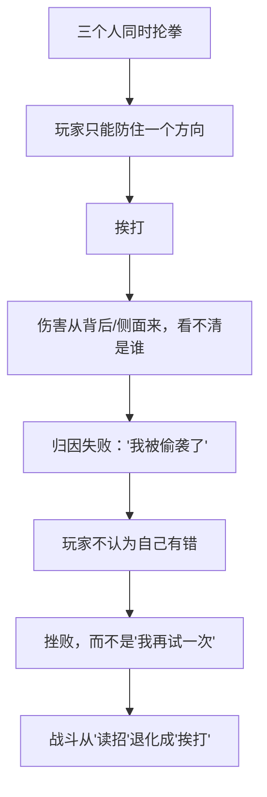
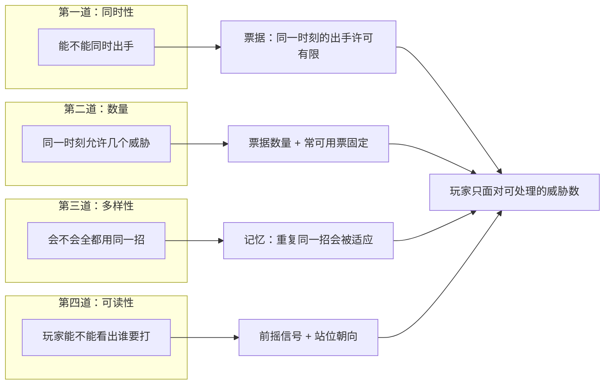
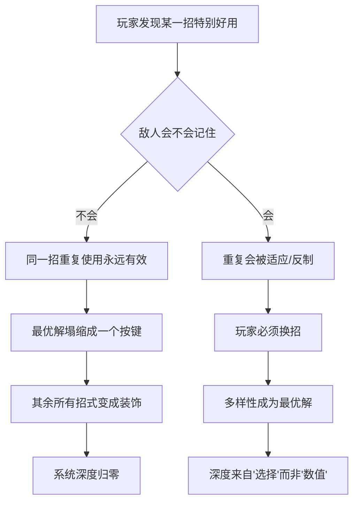
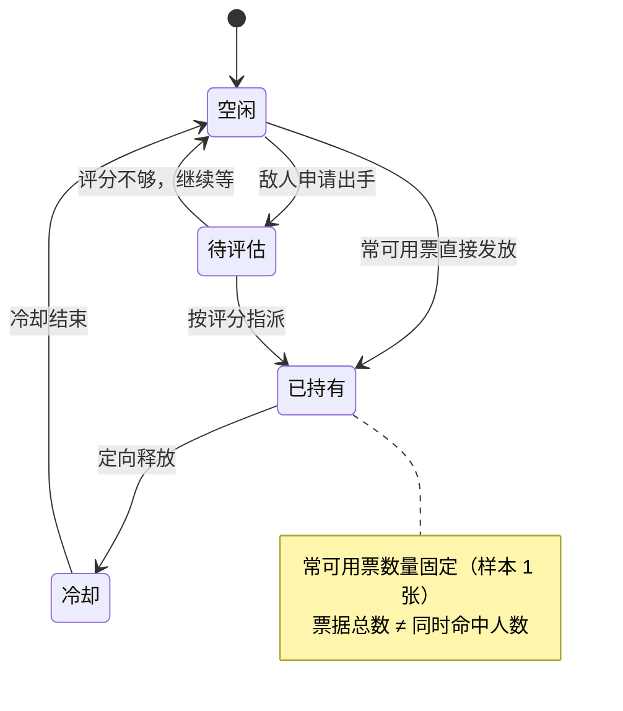
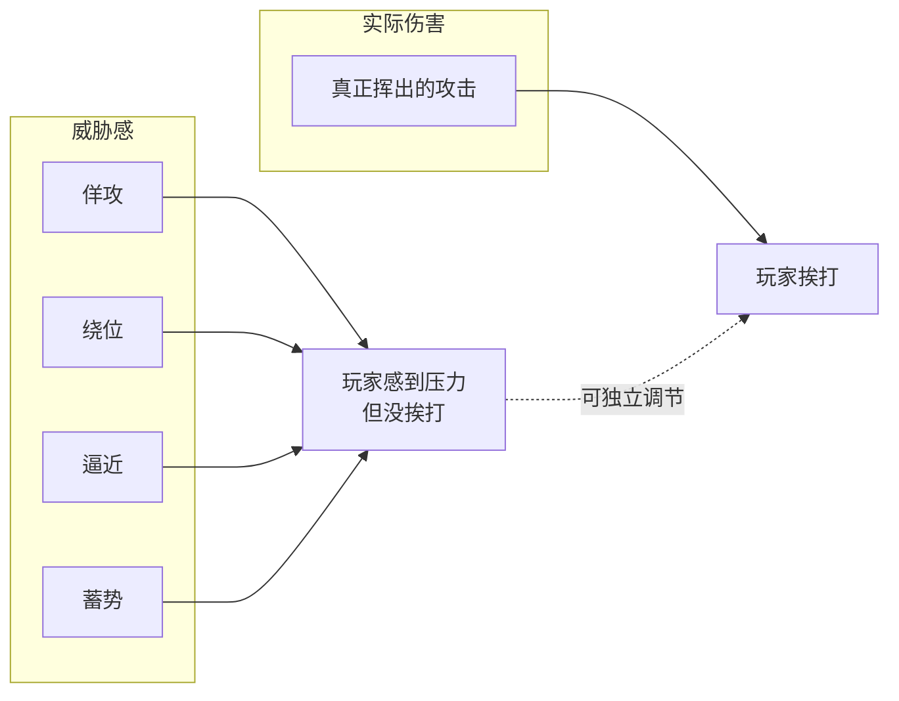
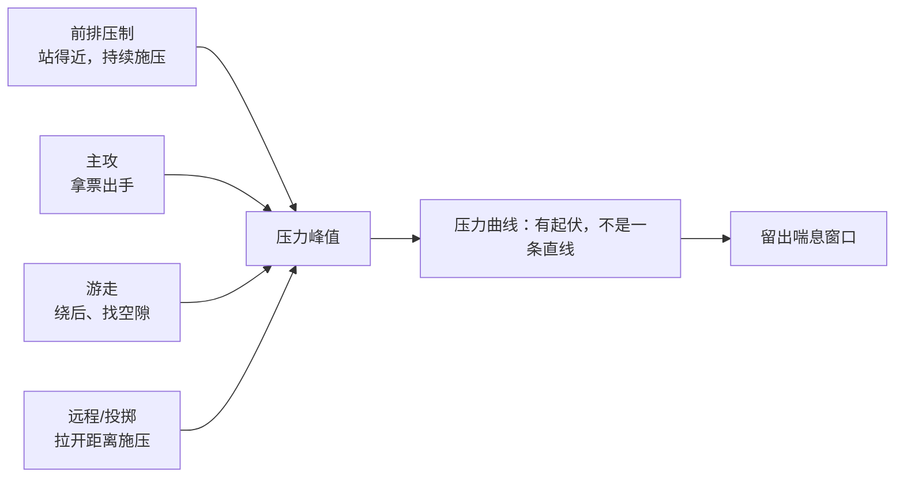
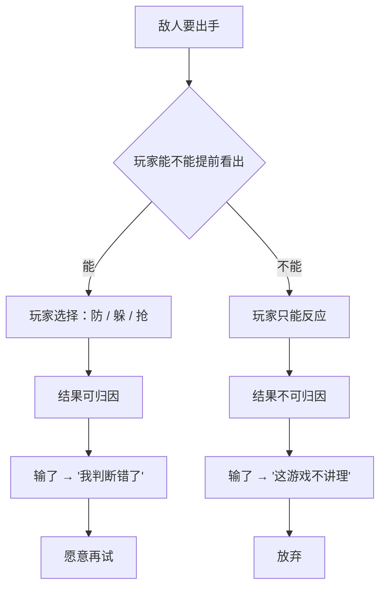

# 06 敌方AI与群斗 · 谁有权出手

> 并行线，与 [[10掌控局面与正反馈]] 互为镜像：**10 讲玩家怎么把压力降下来，06 讲系统怎么把压力给出去。**
>
> 这一节的核心判断只有一句：**一对多战斗里，AI 的第一职责不是"变聪明"，是"限流"。**
>
> 大多数人设计敌人 AI 时先问"敌人该怎么打"，这个问法一开始就错了。真正的第一问是：**怎么保证玩家在同一时刻只需要处理一个威胁？** 答不出这个，AI 越聪明，玩家越憋屈。

---

## 一、先把灾难推演到底

不加任何限制，一群敌人会怎样？一路推到底：

**关键在于 E：归因失败。** 玩家不怕输，怕的是"我不知道为什么输"。一旦失败无法归因到自己的操作，学习回路就断了——而学习回路是这类战斗系统唯一的乐趣来源。

所以 06 这一整层的设计目标可以一句话说清：**让每一次失败都能被归因到"我没防住"，而不是"我不知道谁打的"。**

> 这句话是全节的公理。后面每一条规则，都是从这个公理推出来的。

---

## 二、四道关：每一道挡的是一类灾难

限流不是一道闸，是四道，各挡一种"灾难"。

四道关缺一不可，而且**各自失效的后果不同**：

| 缺哪一道 | 会怎样 |
|---|---|
| 缺同时性 | 三人一起上，防不过来，归因失败 |
| 缺数量 | 虽然不同时，但轮得太快，仍是持续挨打 |
| 缺多样性 | 敌人只会一招，玩家找到一个答案就通关 |
| 缺可读性 | 玩家防不住不是技术问题，是信息不足 |

---

## 三、记忆：不是为了"像人"，是为了让多样性成为最优解

如果敌人不记招，会发生什么？

**这一节的判断：记忆系统的存在理由不是"让 AI 更像人"，是"防止系统塌缩"。**

一个不记招的 AI，无论它的决策树多复杂，最终都会被玩家压缩成一个最优解。**记忆是把"单招最优"这个陷阱堵死的唯一手段**——它让"换招"从可选项变成必需项。

> 可迁移的结论：**任何有"招式"的系统，都需要一个"重复会失效"的机制**，否则复杂度都是假的。

---

## 四、票据：不是"限制人数"，是"威胁预算"

票据系统最容易被误解成"同时只能有 N 个人打你"。这个理解太浅了。

**四个设计点，每个都能说出"不这样会怎样"：**

1. **常可用票固定少量（样本 1 张）。** 保证永远有一个人能出手——否则玩家会觉得"敌人集体发呆"，压迫感消失。**这是下限。**
2. **待评估票按评分指派。** 谁更该上，由局势算，不是轮流坐庄。**这是质量。**
3. **释放后必须冷却。** 否则同一张票被反复抢，节奏会抖。**这是稳定。**
4. **票据数 ≠ 同时命中人数。** 拿到票的人可能还在前摇、可能被玩家打断。**票据管的是"许可"，不是"结果"。**

> 所以票据真正的语义是：**威胁预算的发钞机。** 它控制的是"同一时刻允许多少个不可忽略的威胁存在"，而不是"几个人在挥拳"。这两个数在体感上差很远。

---

## 五、压力 ≠ 攻击：这是让群斗有张力而不变成围殴的关键分离

如果"威胁"只能由"攻击"产生，那想加压力就只能加攻击，结果必然是围殴。

**这一刀切得非常关键：把"威胁感"和"实际伤害"分成两个可独立调节的量。**

- 想加张力但不想加伤害 → 加佯攻、加逼近、加绕位。
- 想加难度但不加挫败 → 加"看起来要打"的动作，不加"真的打"的频率。

> 如果两者绑死，设计空间就只剩一个旋钮（攻击频率），而这个旋钮一拧就是围殴。**分离之后才有"压迫感"这个中间档位。**

---

## 六、分工轮转：压力曲线的调音器

一群敌人不该是"同质的一堆"，而该是"有角色的几个"。

**轮转的意义不是"公平"，是"曲线"。** 如果所有人同时施压，压力是一条顶到天的直线，玩家只能一直防，直到防不住。有角色、有轮转，压力才有峰谷，玩家才有"我扛过这一波了"的成就感。

> 这一条和 [[10掌控局面与正反馈]] 的第⑤层直接对应：**系统给压力，玩家减压力，两边都在争同一条压力曲线。**

---

## 七、可读性：失败必须能归因

最后一道关，也是最容易在"AI 做得聪明"的兴奋里被忘掉的一道。

**这一节要反驳一个常见直觉：** "敌人越难预测越有挑战性"——错。**挑战性来自"可预测但难应对"，不来自"不可预测"。**

- 不可预测 → 玩家只能靠反应速度，高手和新手差距缩小，深度反而下降。
- 可预测但难 → 玩家有判断空间，读对了有回报，读错了有教训，**学习曲线才立得住**。

> 可迁移的结论：**难度应该加在"应对成本"上，不该加在"信息缺失"上。**

---

## 八、这一节收成一句话

| 层 | 判断（不是描述） |
|---|---|
| 第一职责 | AI 不是要"聪明"，是要"限流"——保证玩家只面对可处理的威胁数 |
| 公理 | 玩家不怕输，怕"不知道为什么输"——一切设计服务于可归因 |
| 四道关 | 同时性 / 数量 / 多样性 / 可读性，各挡一类灾难，缺一不可 |
| 记忆 | 不是"像人"，是防系统塌缩：没有"重复会失效"，复杂度都是假的 |
| 票据 | 不是限人数，是"威胁预算"——管的是许可，不是结果 |
| 压力≠攻击 | 分离"威胁感"与"实际伤害"，才有"压迫感"这个中间档 |
| 分工轮转 | 不是公平，是让压力有峰谷，玩家才有"扛过去了"的成就感 |
| 可读性 | 难度加在"应对成本"，不加在"信息缺失" |

**这一层的设计价值：** 它把"一群敌人"从"数量问题"变成了"**预算问题**"——什么时候给压力、给多少、给谁，都是可调的量。而这一切都指向同一个公理：**让失败可归因。**

下一站：压力给得出、降得下，那么这些设计靠什么数据支撑 → [[07数值成长与平衡]]。

## 范式指路

- 敌人回合怎么分配、AI 决策怎么建模 → [[../B-范式/00索引]]（待建轴）

---

上一级 [[00全貌与导航]] · 相关 [[10掌控局面与正反馈]] · 下一步 [[07数值成长与平衡]] · 返回 [[../00阅读入口|04方法论入口]]