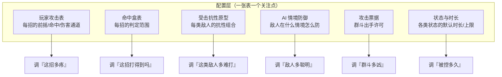
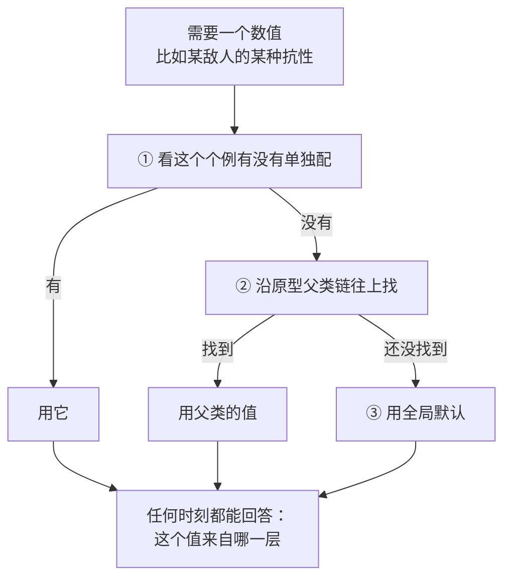
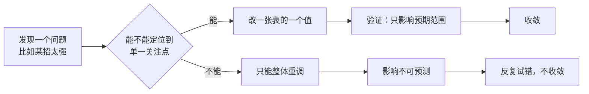
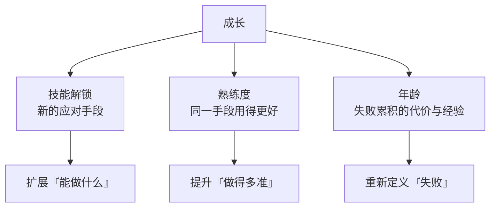

# 07 数值成长与平衡 · 数值不是"配表"，是可解释的因果

> 承接 [[06敌方AI与群斗]]。玩法都定了，但它们共用**一个数值世界**：伤害多少、硬直多久、抗性多高、敌人多强。
>
> 这一节要反驳一个默认假设：**"数值工作 = 把数字调到平衡"。**
>
> 平衡是动态的、永远在变的；真正决定一个数值系统能不能长期维护的，不是"平衡不平衡"，是**"可不可解释"**。可解释才能收敛，不可解释只能反复试。

---

## 一、数值住哪：按"关注点"分表，不按"对象"堆

最省事的做法是把数字写在逻辑旁边。招式一多就崩：想统一调"所有轻击的架势伤害"，得满世界找。

**"一张表一个关注点"是这套组织的灵魂：**

- 调伤害去攻击表，调判定去命中盒表，调敌人脾气去 AI 情境表——**不需要在代码里翻**。
- 更重要的是：**每张表的修改者、修改频率、验证方式都不同**。攻击表是战斗策划天天动的，抗性原型是偶尔动的，票据是关卡策划调的。**分开之后，改动不会互相踩。**
- 规模上这些表是"几百行"级别（攻击约 117 行、命中盒约 855 行、抗性原型约 52 套、AI 情境约 38 套、票据约 50 条）。**这个量级说明它是真的在用的配置，不是摆设。**

> **判断：分表的依据不是"数据长什么样"，是"谁会改它、多久改一次、怎么验证"。**
>
> 按对象分表（一个敌人一张表）看起来整齐，但会导致"改一个通用规则要动五十张表"。**按关注点分表，才是按"变更的边界"分表——而变更边界，才是系统真正的模块边界。**

---

## 二、查一个值：来源可追，才敢改

**三层查找（个例 → 父类 → 默认），最大的价值不是省配置，是"来源可追"。**

- 一个值不对劲，能立刻回答："它是从哪继承来的？还是有人单独覆盖了？"
- 原型链上有一百多个父类（样本约 245 个父类），**这条链的存在让"五十多套敌人"不需要写五十份配置**，同时保留"这一套要特别一点"的余地。

> **判断：数值系统的可维护性，取决于"一个值能不能说出自己的来历"。**
>
> 如果一个数字你只能看到结果、看不到来源，那它一旦出问题，你唯一的办法是"试着改改看"。**能改 vs 敢改，差别就在这里。**

**而且覆盖要显式**：原型给默认，个例要不一样就单独写，**不修改默认值**。这样"我改了这个人"和"我改了所有这类人"永远是两件不同的事。

---

## 三、收敛：可解释才能局部改，局部改才能收敛

**这一节的判断：平衡不是"调"出来的，是"收敛"出来的。而收敛的前提是"局部性"——一次改动只影响一个关注点。**

- 分表 + 来源可追 = 改动局部化。
- 局部化 = 每次改动的影响可预测。
- 影响可预测 = 能一步步逼近目标，而不是每次推倒重来。

> 很多项目的数值困境不是"调不准"，是"每次调都不确定影响了什么"。**那不是数值问题，是结构问题。**

---

## 四、成长：让玩家"更会用系统"，而不是"数值更强"

**三条成长线的方向是一致的：都不改变"读招"这件事本身。**

- **技能解锁**扩展的是"应对手段"（多一张牌），不是"数值强度"。
- **熟练度**提升的是"用得准"（读得更准、接得更稳），不是"伤害更高"。
- **年龄**是把失败变成经验：每死一次老一岁，但招式永久保留。

> **判断：成长如果只加数值，会破坏"读招"这个核心。** 因为一旦玩家能靠数值碾压，读招就变成了可选项。**好的成长是"扩展玩法空间"，不是"降低玩法难度"。**
>
> 而年龄机制更进一步：**它把"失败"从惩罚变成了进度**——这直接改变了玩家面对失败的态度（见 [[09战斗生态]]）。

---

## 五、这一节收成一句话

| 层 | 判断（不是描述） |
|---|---|
| 分表依据 | 不是数据长什么样，是谁会改它、多久改、怎么验证 |
| 来源可追 | 一个值能说出自己的来历，才"敢改"而不只是"能改" |
| 覆盖 | 原型给默认、个例显式覆盖，不修改默认——"改一个人"与"改一类人"永远分开 |
| 收敛 | 平衡不是调出来的，是收敛出来的；收敛的前提是局部性 |
| 成长 | 扩展玩法空间，不降低玩法难度——否则读招变成可选项 |

**这一层的设计价值：** 它把"数值"从一堆数字，变成了**一套有来源、有边界、可局部修改的因果结构**。而可解释性，才是长期维护的真正前提。

下一站：系统都对了，玩家怎么**看见**它在发生 → [[08反馈呈现与视听]]。

## 范式指路

- 数值怎么组织、怎么收敛 → [[../B-范式/00索引]]（待建轴）

---

上一级 [[00全貌与导航]] · 下一步 [[08反馈呈现与视听]] · 返回 [[../00阅读入口|04方法论入口]]