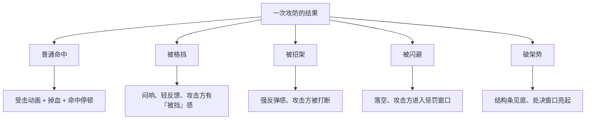
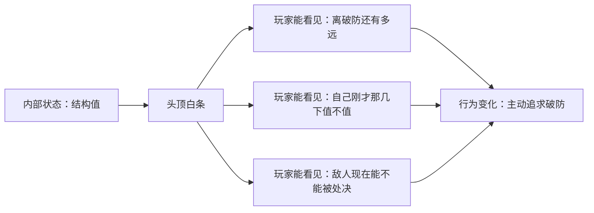
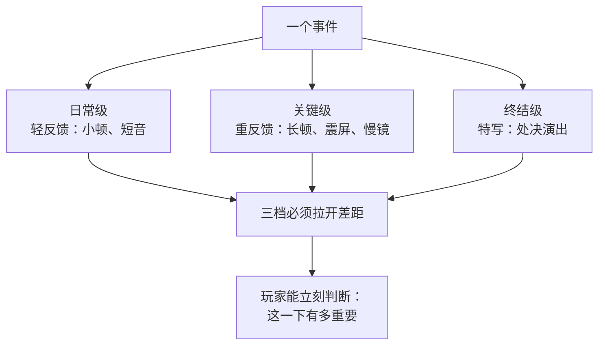
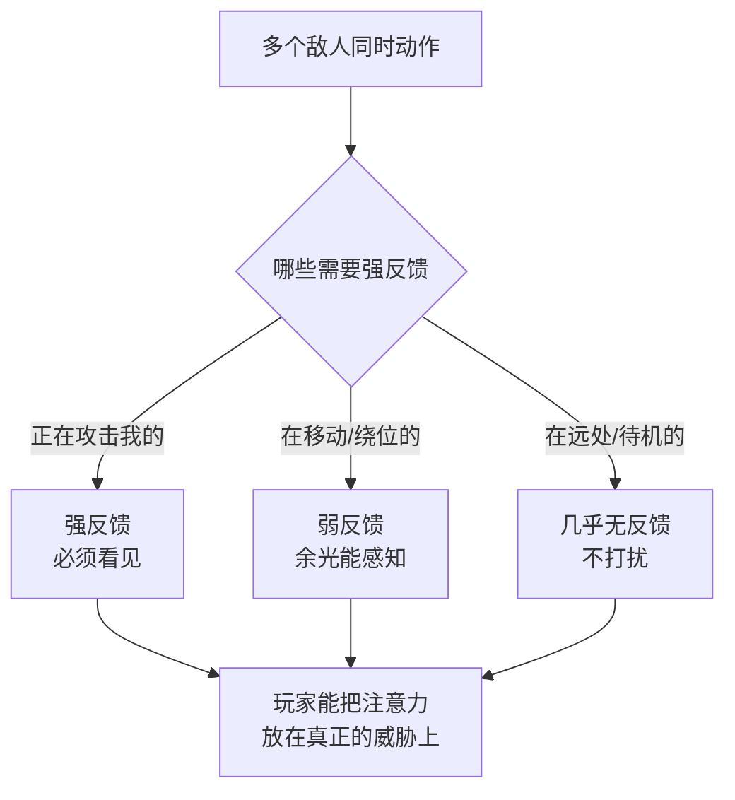

# 08 反馈呈现 · 看不见的系统等于不存在

> 承接 [[07数值成长与平衡]]。系统搭好了，但玩家看不见就等于不存在。
>
> 这一节要立一个判断：**反馈不是"表现层"，它是系统的一部分。**
>
> 理由很硬：玩家能感知的只有反馈。系统的规则、数值、状态机，对玩家来说全部是**通过反馈推断出来的**。**反馈错了，系统在玩家心里就是错的——哪怕代码是对的。**

---

## 一、第一原则：按"结果"分流，不按"伤害"分流

如果所有命中都闪一下、掉一格血，玩家读不出自己赢在哪、输在哪。

**为什么必须分流：**

- 这五种结果的**意义完全不同**：一个是赚了伤害、一个是白打、一个是被反制、一个是差点送命。
- 如果反馈只按"伤害多少"分级，那"被格挡"和"打中但伤害低"在玩家眼里就分不出来——**而这两件事在策略上是相反的**（一个是失败，一个是成功但收益小）。

> **判断：反馈的分类必须跟着"玩法结果"走，不能跟着"数值大小"走。**
>
> 因为玩家需要知道的不是"我扣了多少"，是"**我刚才做对了还是做错了**"。数值大小回答不了这个问题，结果分类才能。

---

## 二、结构条：这套系统最重要的一次可视化决策

如果只能保留一个可视化，应该是结构条。

**为什么它是"最重要的决策"：**

- 它把**内部状态变成了公共信息**。没有它，"打结构"就是玩家看不见的暗账——玩家只会感觉"打了好久怎么还没破"。
- 它让"破防"从**偶然**变成**目标**。玩家看见条在掉，就会主动想办法把它打空。
- 它是**进度的可视化**：一场战斗的"进度条"不是血条，是结构条。

> **判断：可视化的价值不是"让玩家看到数据"，是"让玩家形成目标"。**
>
> 一个看不见的量，玩家不会为它做计划；一个看得见的量，玩家会为它调整行为。**所以"要不要显示"这个问题，本质是"要不要让玩家为它做计划"。**

---

## 三、反馈要克制：给多了，等于没给

**三档反馈的意义不是"层次丰富"，是"可判断"。**

- 如果每一击都有震屏和慢镜，玩家很快就会**对所有反馈脱敏**——那时反馈就不再有信息量。
- 拉开档次，玩家才能在瞬间判断："这一下是日常，还是关键？"

> **判断：反馈的稀缺性，就是它的信息量。**
>
> 这条对所有"强调"都成立：**当你什么都强调，就等于什么都没强调。** 克制不是省事，是让重点能被读出来。

---

## 四、群斗里，反馈的任务不是"都告诉你"，是"让你能取舍"

一对多时，屏幕上的信息量会爆炸。如果所有敌人都给足反馈，玩家会被淹没。

> **判断：群斗反馈的设计目标不是"信息完整"，是"注意力可分配"。**
>
> 这不是"少给信息"，是**按威胁等级分配信息**。玩家需要的是"我知道现在该看谁"，不是"我知道所有人在干什么"。
>
> 而这也回到了 [[06敌方AI与群斗]] 的公理：**失败必须可归因。** 如果玩家因为"没看见"而挨打，那就是反馈失职，不是玩家失误。

---

## 五、这一节收成一句话

| 层 | 判断（不是描述） |
|---|---|
| 反馈的地位 | 不是表现层，是系统的一部分——玩家只能通过反馈推断规则 |
| 分流依据 | 跟"玩法结果"走，不跟"数值大小"走 |
| 结构条 | 最重要的可视化：把内部状态变成公共信息，把破防从偶然变成目标 |
| 可视化 | "要不要显示"= "要不要让玩家为它做计划" |
| 稀缺性 | 反馈的稀缺性就是信息量；什么都强调=什么都没强调 |
| 群斗 | 目标不是信息完整，是注意力可分配 |

**这一层的设计价值：** 它把"反馈"从"美术和音效的工作"，提升为**系统可读性的设计**。玩家不是在看特效，是在**读系统**。

下一站：单场战斗成立了，怎么变成几十小时的完整体验 → [[09战斗生态]]。

## 范式指路

- 反馈怎么分流、信息怎么压缩 → [[../B-范式/00索引]]（待建轴）

---

上一级 [[00全貌与导航]] · 下一步 [[09战斗生态]] · 返回 [[../00阅读入口|04方法论入口]]