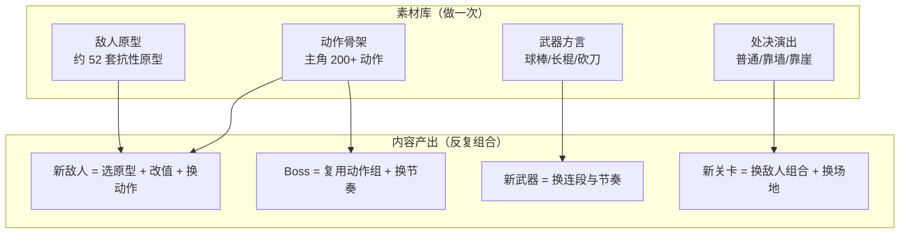
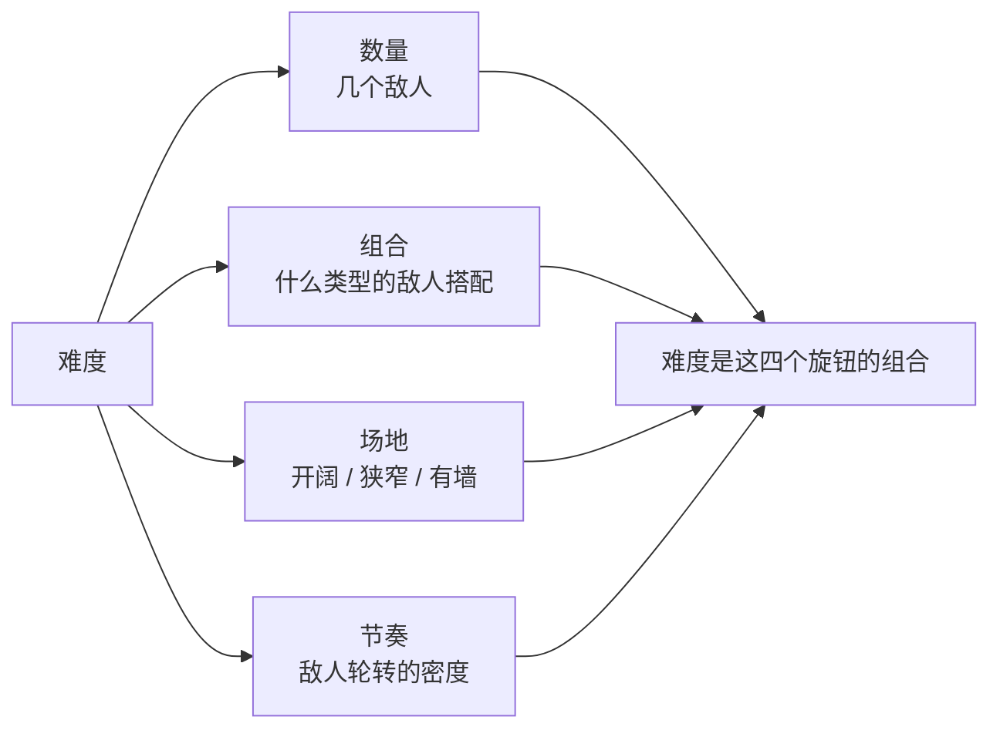
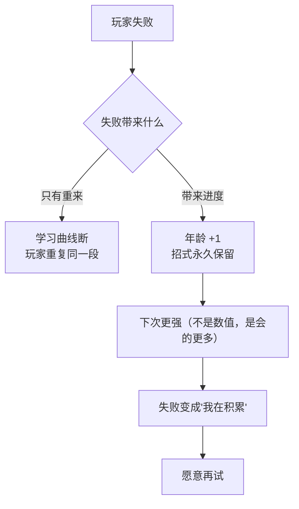
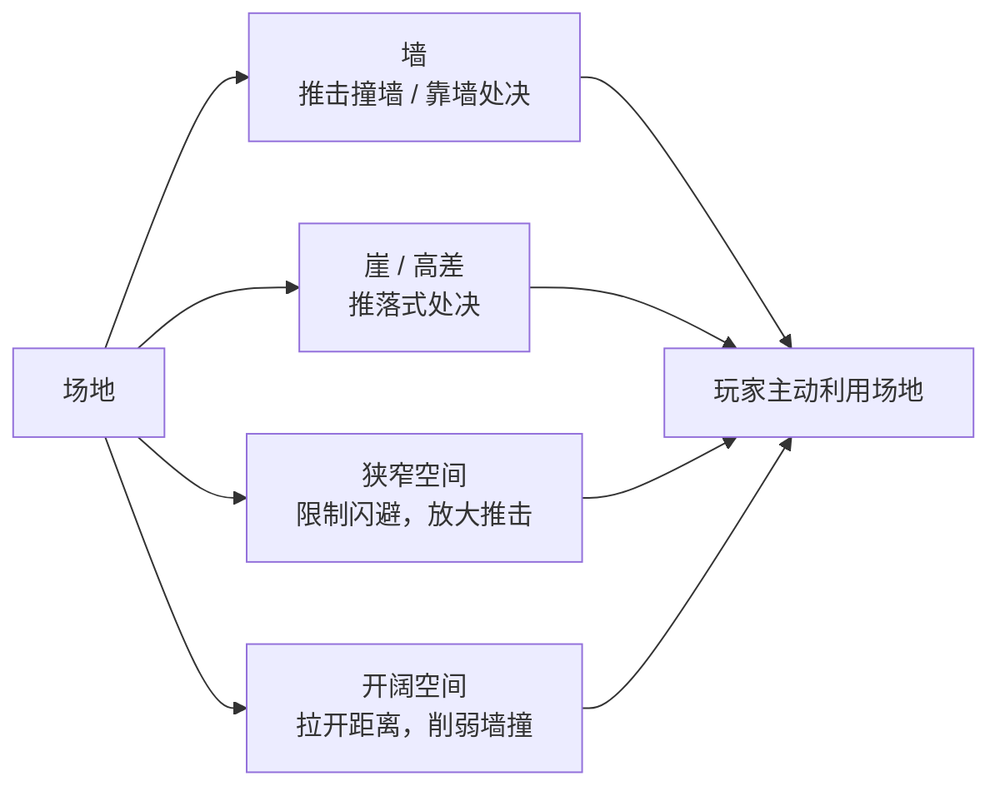
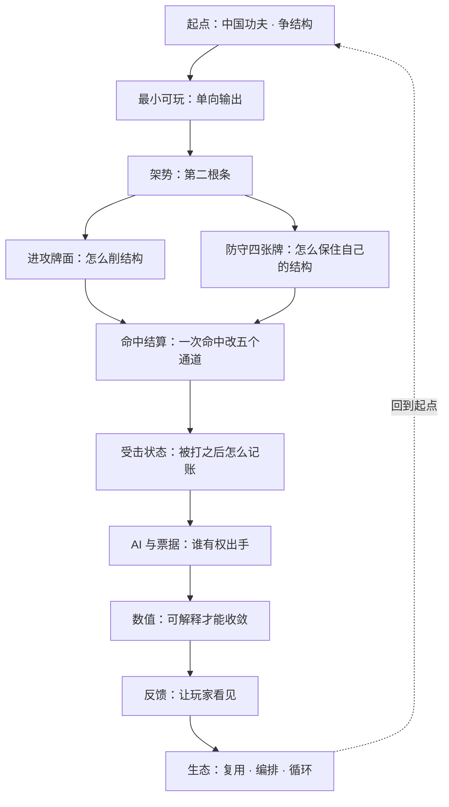

# 09 战斗生态 · 把单场战斗抬成完整体验

> 承接 [[08反馈呈现与视听]]。前八步让"一次攻防、一场战斗"成立。这一层讲：敌人怎么组、关卡怎么排、内容怎么复用、单场怎么循环成几十小时。
>
> 这一节要立三个判断：
>
> **① 复用不是为了省钱，是为了让所有内容共享同一套语言。**
> **② 难度是编排出来的，不是调数值调出来的。**
> **③ 失败必须变成进度，否则学习曲线会断。**

---

## 一、复用：换组合，不换素材

要做几十场战斗，靠"每个敌人从零做"成本会先崩。

**复用的真正价值不是"省成本"，是"共享语言"。**

- 所有敌人共用同一套动作骨架、同一套抗性原型、同一套处决规则——**玩家学一次，处处适用**。
- 如果每个敌人从零做，每个敌人都有自己的规则，玩家就永远在重新学习——**学习成本会随内容量线性增长，最后把玩家压垮。**

> **判断：复用首先是"玩家侧的学习复用"，其次才是"团队侧的成本复用"。**
>
> 这两个动机指向同一个做法，但优先级不同：如果为了省成本而牺牲一致性，玩家会付账；如果为了语言一致而稍微多花成本，是值得的。

**Boss 杨复用序章 Boss（主角父亲）的动作组**——这是复用里最漂亮的一笔：**复用也可以是叙事。** 同一套动作，在序章是"父亲教你"，在终章是"你与父亲对峙"，**动作本身变成了叙事符号**。

---

## 二、难度：编排出来的，不是调数值调出来的

**四个旋钮，没有一个是"敌人血量翻倍"。**

- 数量：三个普通敌人 vs 一个精英，压力类型完全不同。
- 组合：一个远程 + 两个近战，逼玩家在"追远程"和"防近战"之间选。
- 场地：狭窄地形让推击撞墙更常见，难度下降；开阔地形让墙撞消失，难度上升。
- 节奏：敌人轮转快 = 压力持续；轮转慢 = 有喘息。

> **判断：数值难度是"线性增长"，编排难度是"结构变化"。**
>
> 血量翻倍，玩家感受到的是"打得更久"；换组合，玩家感受到的是"要换打法"。**前者消耗耐心，后者产生学习。**

---

## 三、失败变进度：这是整个循环能不能闭合的关键

**年龄机制的设计很妙：它不是"复活惩罚"，是"复活投资"。**

- 每死一次老一岁，但**已经学会的招式永久保留**。
- 所以失败不是"回到原点"，是"带着更多东西回到起点"。
- 这直接把玩家对失败的态度从"我又白打了"改成"我又攒了一点"。

> **判断：失败必须转化成某种进度，否则学习曲线会断。**
>
> 因为学习曲线的前提是"玩家愿意再来一次"。而愿意再来一次的前提是"这次不是白费"。**如果失败只带来重来，玩家会在第 N 次失败时放弃——不是因为他学不会，是因为他觉得不值得。**

---

## 四、环境：让场地成为战斗的一部分

**场地不是"背景板"，是"结算的参与者"**（见 [[04命中建模与交互]] 的墙撞）。

- 墙：推击撞墙 → 额外结算；靠墙 → 专属处决。
- 崖：推落式处决。
- 空间宽窄：直接改变闪避和推击的价值。

> **判断：当场地能改变结算，玩家就会主动"用场地"。** 这时候关卡设计才真正参与战斗设计——否则关卡只是"在哪儿打"，不是"怎么打"。

---

## 五、整棵树回看：因果是一条链

**九个环节不是并列的模块，是一条因果链：** 每一个都在回答前一个留下的问题。

> **这就是"从零设计"的样子：不是先画一张系统架构图，再往里填内容；而是从一个意图出发，每一步解决上一步暴露的冲突，最后长成一个系统。**
>
> 而这也是为什么它可迁移——**你不需要照抄 Sifu 的答案，你只需要照抄"问题是怎么被逼出来的"这个顺序。**

---

## 六、这一节收成一句话

| 层 | 判断（不是描述） |
|---|---|
| 复用 | 首先是玩家侧的学习复用，其次才是团队侧的成本复用 |
| 复用进阶 | 复用也可以是叙事（同一套动作在不同语境下换意义） |
| 难度 | 编排产生学习，数值只消耗耐心 |
| 失败 | 必须转化成进度，否则学习曲线会断 |
| 环境 | 场地能改变结算，关卡才真正参与战斗设计 |
| 整树 | 不是模块并列，是一条"问题逼出下一步"的因果链 |

**这一层的设计价值：** 它把"单场战斗"抬成了"完整体验"——**而靠的不是加内容，是让内容共享语言、让难度来自编排、让失败变成进度。**

## 范式指路

- 内容怎么复用、难度怎么编排 → [[../B-范式/00索引]]（待建轴）

---

上一级 [[00全貌与导航]] · 相关 [[10掌控局面与正反馈]] · 返回 [[../00阅读入口|04方法论入口]]