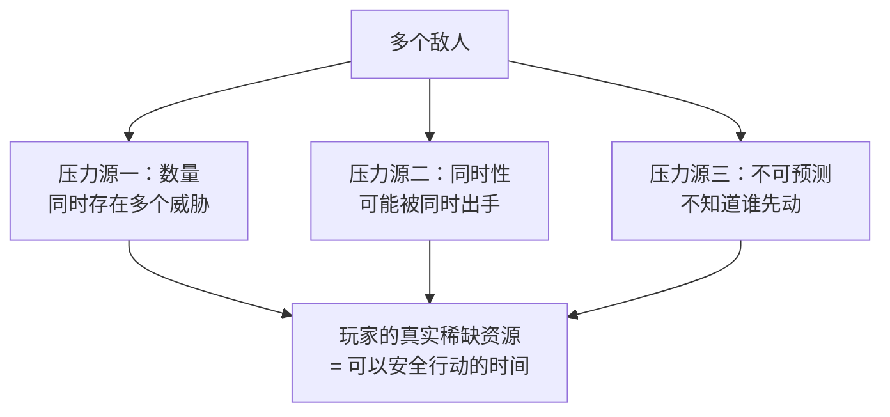
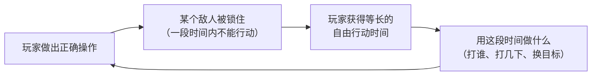
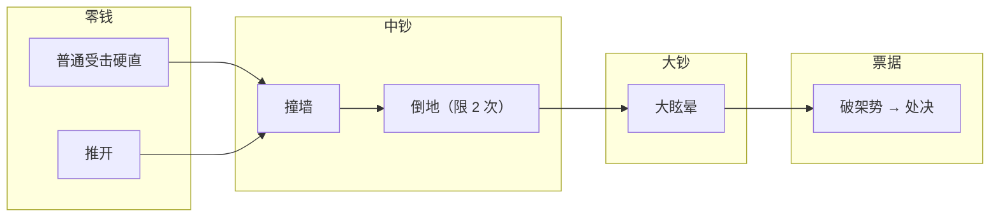
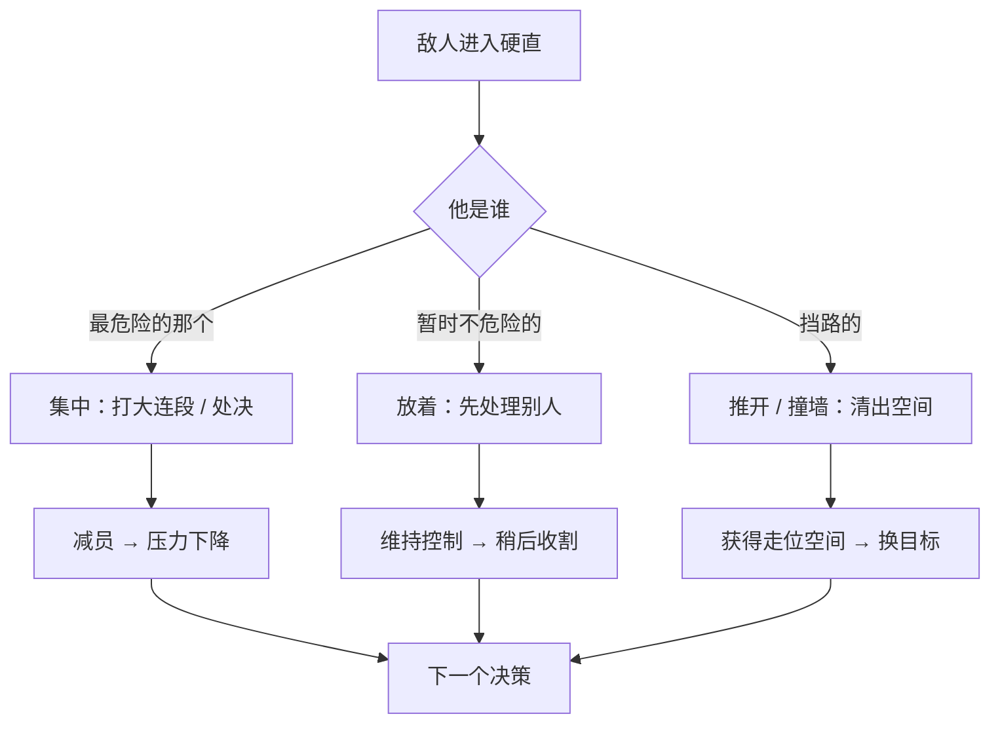
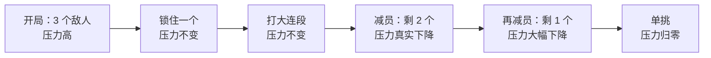
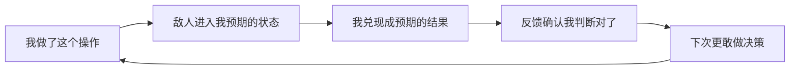
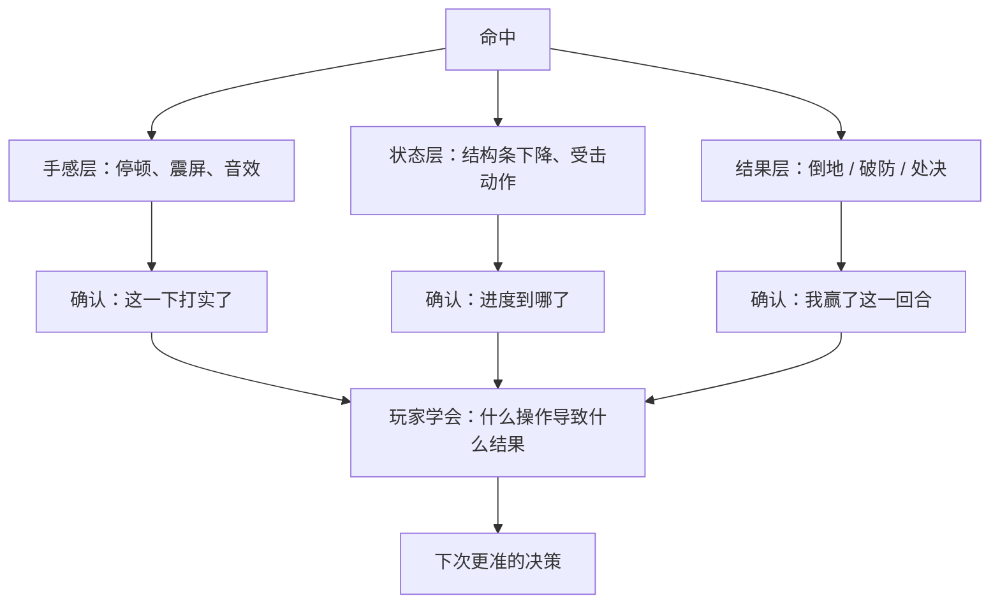

# 10 掌控局面与正反馈 · 硬直是货币，减员是降压

> 前面九节讲的是"系统怎么搭"。这一节讲**为什么这些零件必须同时存在**——它们合起来在解决一个玩家能直接感受到的问题：**面对一群敌人，我怎么觉得这个局面在我手里。**
>
> 这一节的写法不一样：先摆问题，再讲每个能力的**存在理由**，最后反证"少一个会怎样"。

## 〇、三个命题

1. **一对多缺的不是血，是"可以安全行动的时间"。** 血量只是这条时间线的记账方式——所以核心问题不是"让玩家更能扛"，是"让玩家能自己制造安全时间"。
2. **硬直不是惩罚，是货币。** 它是玩家用操作买来的时间，而且有不同面额，面额之间还能兑换。
3. **掌控感来自"因果可预测"，不来自"数值够强"。** 玩家觉得局面在手里，是因为他相信"我这样做，就会那样"——不是因为他打得更疼。

---

## 一、一对多的真问题：稀缺的不是血，是时间

一对一的时候，玩家和敌人是公平交换：你打他一下，他打你一下。一对多不是"血量除以人数"，是**结构变了**——你只有一双手，对面有三双手。

**关键判断：玩家真正缺的不是血量，是"可以安全行动的时间"。**

血量只是这条时间线的记账方式——血量掉光，本质是"你没有安全时间了"。所以一对多的核心设计问题不是"怎么让玩家更能扛"，而是：

> **怎么让玩家能主动地、反复地，为自己制造出安全时间？**

一旦这样问，答案就只剩一个方向：**让敌人可以被"锁住"。**

---

## 二、硬直 = 时间货币

敌人被锁住的每一秒，都是玩家自由行动的一秒。所以硬直不是"惩罚敌人"的效果，是**玩家花操作买来的时间**。

**这个视角一换，很多设计就说得通了：**

- 为什么硬直要有**明确的视觉信号**（结构条、受击动作）？因为玩家得知道自己"买到了多少时间"。
- 为什么不同硬直**时长差很多**？因为它们是不同面额的货币。
- 为什么硬直**不能无限叠加**（倒地次数上限 2、倒地免疫控制）？因为无限货币等于没有经济。

---

## 三、六种面额：硬直不是一种，是一套货币体系

Sifu 的硬直不是一个"硬直值"，是**六种面额**，各有各的获取条件、额度限制和兑现方式：

| 硬直 | 面额（锁多久） | 怎么获得 | 额度/限制 | 兑现成什么 |
|---|---|---|---|---|
| 普通受击硬直 | 最小（零钱） | 打中就行 | 可反复 | 续连段、抢下一拍 |
| 推开 | 小 | 推击类招式 | 可反复 | 脱身、撞墙、接推后招 |
| 撞墙 | 中 | 推击 + 场地 | 需要墙 | 额外一次命中结算 |
| 倒地 | 中（约 4 秒） | 击倒专招、墙撞、范围技能 | **每人 2 次上限** | 地面连打、减员 |
| 大眩晕 | 大 | 特殊积累打满 | 稀有（抗性 11） | 大连段、处决前奏 |
| 破架势 | 直接兑现 | 结构条打空 | 一次性 | **处决** |

**为什么必须是"多种面额"而不是一种：**

- 只有一种硬直，玩家就只有两个选择：打，或者不打。**控制精度为零**。
- 六种面额，玩家实际在选的是：**我要锁他多久？锁在哪儿？锁完接什么？**——这才是"操作空间"。
- 而且面额之间有**兑换关系**：推开可以换撞墙（需要场地），撞墙可以换倒地，倒地可以换减员，破架势直接换处决。**一套能互相兑换的货币，才撑得起连招设计。**

> 设计含义：**硬直系统的丰富度，决定了一对多的操作上限。** 这不是"多加几种状态"，是"多给玩家几个控制精度的档位"。

---

## 四、每个硬直，都是一条岔路

这是整套设计里最关键的一层：**硬直不是一个状态的终点，是一个决策的入口。**

**每一岔路口都对应一个具体设计：**

- **打大连段**：需要硬直够长（大眩晕的价值就在这里），需要连段有终点奖励（段末可接处决）。
- **先放着**：需要硬直**不会自动消失得太快**，也需要玩家能"记住"他在哪（这就是群体可读性的作用）。
- **推开清空间**：需要推开有位移效果、需要墙能兑现。

**如果硬直只是"敌人不能动"而没有后续选项**，那玩家在硬直期间是**没事可做的**——这恰恰是最糟的手感：明明赢了，却没有下一步。Sifu 的每个硬直都自带"下一步选项"，所以玩家永远在决策中。

---

## 五、减员是唯一真实的降压

**这条曲线解释了很多设计：**

- **闪避和格挡不降低压力**——它们只是"不被伤害"。这就是为什么纯防守流在 Sifu 里不成立：你防得再好，三个敌人还是三个敌人。
- **所以系统必须让"硬直 → 大连段 → 减员"这条路走得通、走得爽。** 硬直要给足时间，大连段要有伤害，处决要一击必杀——这些不是"爽点设计"，是**让压力能够下降的唯一通道**。
- **反过来，系统也要限制"同时出手的敌人数"**（敌人不是一拥而上，而是按票据轮转，同时能打的通常只有一两个）。这不是"AI 笨"，是**把压力峰值钳住**，让玩家有操作空间去打那条减员路线。

> 一句话：**一对多的设计，本质是在设计"压力曲线"，而不是在设计"敌人有多强"。**

---

## 六、掌控感来自"可预测的因果"，不是来自"强"

玩家觉得"这个局面在我手里"，不是因为角色数值高，是因为这条链**每次都成立**：

这条链上任何一环不可预测，掌控感就崩：

| 环节 | 如果不可预测 | 玩家感受 |
|---|---|---|
| 操作 → 状态 | 硬直时机随机、看不出敌人在干什么 | "我打中了但不知道他会不会倒" |
| 状态 → 结果 | 处决会失败、大连段会被打断 | "赢了却不敢兑现" |
| 结果 → 反馈 | 没有明确信号告诉你打对了 | "我好像做对了？" |

**所以那三条设计要求是硬的：**

1. **硬直可预期**：结构条、受击动作、命中停顿——都是"你现在买到了多少时间"的读数。
2. **兑现可靠**：处决不会失败，大连段有明确终点。玩家敢把资源投进去。
3. **代价可算**：玩家知道"打三下安全、打五下危险"，因为前摇曲线是稳定的（见 [[02玩家进攻与输入]]）。

---

## 七、正反馈不是奖励，是因果闭环的确认

很多人把"打击感"当成特效问题。其实反馈的作用是**闭合因果链**：

- **手感层**回答"打实了吗"；
- **状态层**回答"还差多少"；
- **结果层**回答"这一回合谁赢了"。

三层都给，玩家才建立起"操作 → 结果"的稳定预期。**只给特效不给状态读数，玩家会觉得"打得很爽但不知道在干什么"；只给状态读数不给手感，玩家会觉得"像在填表"。**

> 所以正反馈的设计目标不是"让玩家爽"，是**让玩家学会这套系统**。爽是学会之后的结果。

---

## 八、反证：少一环会怎样

| 缺少的东西 | 直接后果 | 玩家体验 |
|---|---|---|
| 没有硬直，只有伤害 | 一对多变成被围殴，只能跑 | 无力感 |
| 只有一种硬直 | 只有一种解法，群斗变重复劳动 | 枯燥 |
| 硬直没有后续入口 | 打完就断，节奏碎 | 空转 |
| 硬直不能减员 | 压力永不下降 | 绝望 |
| 硬直不可预测 | 玩家不敢投入资源 | 保守、只敢蹭 |
| 同时出手人数不限制 | 被三四个人同时打 | 不公平 |
| 反馈只给特效 | 打得爽但学不会 | 停在新手水平 |

**这张表就是这一节的论证方式：每一个能力的存在，都能用"去掉它会怎样"来证明它不是可选项。**

---

## 九、这一节收成一句话

| 层 | 设计决定 |
|---|---|
| 核心问题 | 一对多稀缺的不是血，是"可以安全行动的时间" |
| 硬直的本质 | 玩家花操作买来的**时间货币**，不是惩罚效果 |
| 面额体系 | 六种硬直 = 六个控制精度档位，且能互相兑换 |
| 硬直的第二身份 | 每个硬直都是一条岔路（打 / 放 / 推），自带下一步选项 |
| 压力的唯一出口 | 减员；防守只止损不降压，所以必须让"硬直→大连段→减员"成立 |
| 系统级钳制 | 限制同时出手人数，把压力峰值钳住 |
| 掌控感的来源 | 可预测的因果链，不是数值强度 |
| 正反馈的本质 | 闭合因果链、让玩家学会系统；爽是学会的结果 |

**这一节的设计价值：** 它把前面九节的零件重新解释了一遍——结构条、硬直、推击、倒地、票据、反馈，**不是九个独立机制，是一条"买时间 → 减员 → 降压 → 更敢决策"的循环**。这也回答了最初的问题：**为什么这些设计要一起存在。**

---

上一级 [[00全貌与导航]] · 返回 [[../00阅读入口|04方法论入口]]