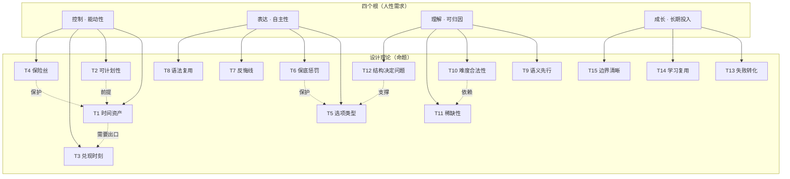

# 00 理论地图 · 这套知识库里真正想沉淀的东西

> 这一层是知识库的**顶层**。
>
> 前面几层回答的是不同的问题：
>
> - **A-设计树** 回答"Sifu 是怎么一步步长成这样的"——它是**证据**。
> - **B-范式** 回答"同一个决策还有哪几种取法"——它是**取法**。
> - **C-设计理论**（本层）回答"**为什么非得有这么个东西**"——它是**知识**。
>
> 如果只停在 A，你得到的是一份优秀的案例拆解；停在 B，你得到的是一张选项表。**只有到 C，你得到的才是能带走、能迁移、能用来判断对错的东西。**

---

## 一、为什么要单独一层理论

一个具体的机制，几乎总能说出"它有什么用"。但那不是知识，是说明书。

知识必须能回答三个问题：

1. **它服务的是人的哪个需求？**（答不出，它可能只是装饰）
2. **去掉它会怎样？**（答不出，就不知道它的边界）
3. **换一个题材、换一个品类，这条还成立吗？**（答不出，它就只是 Sifu 的地方性知识）

这三个问题，就是本层每一篇的骨架。

---

## 二、四个根：游戏体验的四个人性需求

所有设计理论，最后都能追溯到人为什么需要它。梳理下来是四个根，两两相对：

| 根 | 一句话 | 反面（缺失时玩家会） |
|---|---|---|
| **控制**（能动性） | 我需要确认"我的行动能改变世界" | 感到无力、被摆布、放弃 |
| **表达**（自主性） | 我需要"用我的方式"做事 | 感到在走唯一正解、像在执行 |
| **理解**（可归因） | 我需要明白"为什么输、为什么赢" | 感到不讲理、运气主导 |
| **成长**（长期投入） | 我需要感到"我变强了、投入没白费" | 感到重复、疲劳、流失 |

**这四个根不是并列的功能，是四种心理需求。** 一个系统如果四个都不服务，它就是纯装饰——不管它多精巧。

> 判断一个机制该不该存在，最快的办法：**把它分别塞进这四个根里问一遍"它服务谁"，一个都塞不进去，就砍掉。**

---

## 三、十五条命题：从根到机制

下面是本层要沉淀的核心命题。每条都能独立成篇，也都能回溯到某个根。

### 根一 · 控制（能动性）

| # | 命题 | 一句话论证 | 反证（去掉会怎样） |
|---|---|---|---|
| T1 | **控制 = 把敌人的时间变成资产，且每种面额都有买入价** | 硬直不是"让敌人停住"，是给玩家可支配的时间；面额、汇率、买入价三者必须联动 | 廉价的大面额 → 吞掉其他所有手段 |
| T2 | **可计划性优先于强度** | 玩家能利用的是"可预测的量"，不是"大的量"；不可预测的强等于没有 | 时长随机 → 玩家无法安排后续 → 控制感消失 |
| T3 | **掌控感需要一个"兑现时刻"** | 处决/终结演出不是奖励动画，是"我安排的一切在此刻结算"的仪式 | 没有兑现 → 控制感一直是账面数字，没有落地 |
| T4 | **每个强收益都要有保险丝** | 任何"必胜循环"都会杀死博弈；倒地限次数、资源冷却都是保险丝 | 无上限 → 找到循环即通关 → 博弈死亡 |

### 根二 · 表达（自主性）

| # | 命题 | 一句话论证 | 反证（去掉会怎样） |
|---|---|---|---|
| T5 | **选项的类型不同才有选择** | 只是"大小不同"的选项等于一个选项（永远选最大）；类型不同才有取舍 | 四张防守牌变成四档减伤 → 玩家只选最划算的 |
| T6 | **最安全的选项必须赔得最重** | 保底选项若代价最低，会吞掉所有其他策略；要维持多样性，必须让保底最贵 | 格挡无代价 → 全场按住防 → 其他三张牌作废 |
| T7 | **动作的重量来自"多早允许反悔"** | 前摇只是长度；真正决定"这招重不重"的是输入开放线在动作里的位置 | 全有或全无 → 所有招一样重 → 手感无差别 |
| T8 | **新内容应该复用旧语法** | 武器/新招式换的是"方言"不是"语言"，玩家学一次能用到处 | 每样新内容一套规则 → 学习成本线性爆炸 |

### 根三 · 理解（可归因）

| # | 命题 | 一句话论证 | 反证（去掉会怎样） |
|---|---|---|---|
| T9 | **语义先于数值** | "被招架"不是"伤害打折"，是攻守易位；用乘法表达不同性质的事，只能做出"防住了但没变化" | 一条流程×系数 → 防守没有质变 |
| T10 | **难度合法性 = 可归因 × 一致性 ÷ 重来成本** | 三根支柱缺一不可；很多游戏只做了可归因，却让重来成本高得离谱 | 可归因做满但重来太贵 → 玩家"知道错在哪，懒得再试" |
| T11 | **反馈的稀缺性就是信息量** | 什么都强调等于什么都没强调；分档才能让重点被读出来 | 每击都震屏 → 全部脱敏 → 反馈无信息 |
| T12 | **数据结构决定能问出什么问题** | 布尔只能问"是否"，记录才能问"还能接几下"；结构决定了玩法深度的上限 | 单布尔硬直 → 只能设计"打/不打" |

### 根四 · 成长（长期投入）

| # | 命题 | 一句话论证 | 反证（去掉会怎样） |
|---|---|---|---|
| T13 | **失败必须转化成进度** | 愿意再来一次的前提是"不是白费"；失败只带来重来，学习曲线会断 | 死了白死 → 第 N 次失败即流失 |
| T14 | **复用首先是"学习复用"** | 内容复用的第一价值是玩家学一次处处适用，其次才是团队成本 | 每个敌人一套规则 → 玩家永远在重学 |
| T15 | **系统之间的边界比系统内部规则更重要** | 边界不清会制造中间态与防御性代码，系统从此改不动 | 职责混在一起 → 一处改动处处塌 |

---

## 四、理论之间不是并列，是有层级的



**几条关键的依赖关系：**

- **T2 是 T1 的前提**：不可预测的时间资产无法被支配，所以"可计划"必须先于"面额"。
- **T1 需要 T3 作为出口**：攒下来的时间资产如果没有兑现时刻，控制感始终停留在账面。
- **T4 保护 T1**：面额再丰富，没有保险丝就会被单一最优解吞掉。
- **T6 保护 T5**：选项再多样，保底选项太便宜就没人用其他选项。
- **T12 支撑 T5**：没有能"问出更多问题"的数据结构，选项类型根本做不出来。
- **T10 依赖 T11**：可归因要求信息清晰，而清晰来自反馈的稀缺性。

> 这张图的用法：**改一个机制时，先找到它挂在哪条理论上，再顺着依赖关系看它会不会破坏上游。** 很多"改了 A 崩了 B"的问题，本质是没看依赖。

---

## 五、每篇理论文档的模板

```markdown
# T{n} 命题名

## 命题
（一句话，可争论，能被反驳）

## 论证：从现象到需求
L1 现象 → L2 意图 → L3 需求 → L4 理论根

## 反证：去掉它会怎样
（至少一个具体的失败场景）

## 适用边界
（什么条件下成立，什么条件下不成立）

## 检查表
（设计师能直接拿去问自己的 3–5 个问题）

## 案例：Sifu 的取点
（指向 A 层具体节点）

## 下游：它约束了哪些决策
（指向 B 层具体决策轴）
```

---

## 六、待写清单

| 优先级 | 命题 | 理由 |
|---|---|---|
| ★★★ | T1 时间资产 | 控制类系统的总纲，A 层 02/05/10 都挂在它下面 |
| ★★★ | T10 难度合法性 | 群斗设计的公理，A 层 06 的核心 |
| ★★★ | T5 选项类型 | 一切"选择"系统的通用检验，A 层 03 的核心 |
| ★★ | T2 可计划性 | T1 的前提，解释"为什么可预测比强重要" |
| ★★ | T9 语义先行 | 解释命中建模为何要分五通道 |
| ★★ | T6 保底惩罚 | 解释四张防守牌为何必须代价不同 |
| ★★ | T13 失败转化 | 解释年龄机制的存在理由 |
| ★ | 其余 | 按需补 |

---

## 七、写作纪律（防止写成漂亮话）

从 T1/T10 的第一稿复盘出三条硬纪律，后续每篇都要过：

1. **反证必须是"临界点"，不是"不做设计"。**
   "只有一种硬直会怎样"是稻草人——没人是真的不做设计。要写"六种面额但兑换率太接近会怎样""可归因做满但重来成本太高会怎样"。**反证的位置在"做对了但过了一点"，不在"完全没做"。**
2. **必须给"可测预测"。**
   理论如果不能被检验，就只是信仰。每条命题后面要能写出"如果它成立，应该观察到 X"。测不出，说明这条只是描述，不是理论。
3. **必须有"对战斗策划意味着什么"的翻译段。**
   术语（能动性、归因、心流）是给理论用的；策划拿走的必须是**能直接执行的动作**（问什么问题、按什么顺序调参、审表时看哪一栏）。

---

## 八、这一层怎么用

1. **设计时**：从根出发——"我这个系统要服务哪个根"，再往下选命题，最后才落到机制。
2. **审查时**：拿检查表逐条问；答不出的机制就是装饰。
3. **争论时**：把分歧翻译成"我们在争哪条命题"，而不是"这个功能好不好"。

---

上一级 [[../00阅读入口|04方法论入口]] · 下游 [[../B-范式/00索引|B-范式]] · 证据 [[../A-设计树/00全貌与导航|A-设计树]]