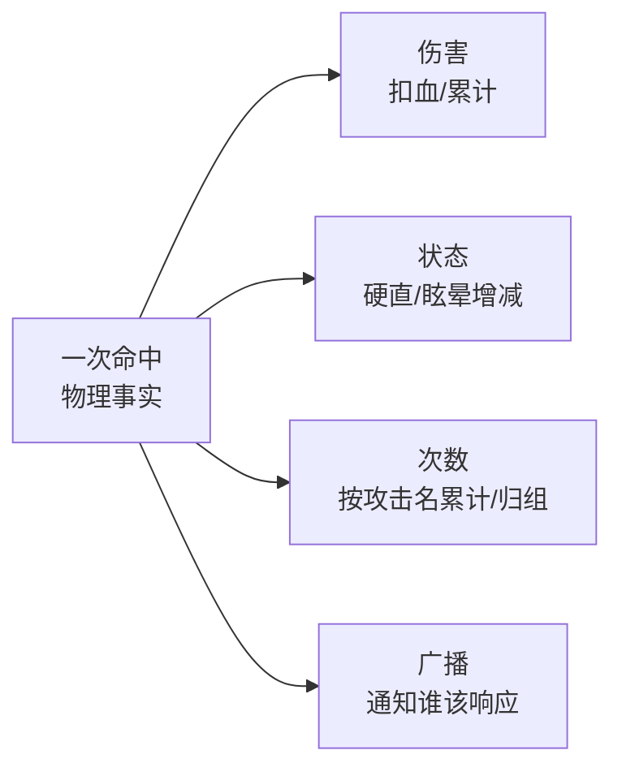
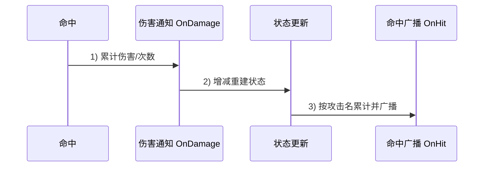

# 设计议题：交互事件阶段固化

> **方法篇。** 从《师父》实现里抽象设计思路，不解释具体机制。对应细节见文末落点。

## 一、这个问题从何而来（成因）

一次"命中结算"里，改变的东西很多：伤害要不要扣、状态要不要变、次数要不要累计、广播要不要发。这些作用**属于不同的关注点**，却要在**同一次物理事件**里共同完成：

伤口、节奏、计数、反馈——它们是**各自独立演变出来的元素**，只是恰好都由"这一下命中"触发。若系统不把这趟"一次命中 → 多笔副作用"的次序和归属定死，每次命中会走向哪里就不可预测，平衡无从谈起，出了错也无从排查。上文 [[并发控制与许可仲裁|并发]] 讲的是"多个来源争一个对象";这一篇讲"**一件事向后带出多笔副作用**"——它们是并发问题的镜像：一个对象被多点约束 vs 一个触发点冒出多笔落点。

## 二、这个设计问题是什么

1. 一笔命中 → 多类副作用，怎么让它们**各归其位、不越权**？
2. 这些副作用的**先后次序**怎么固定，让行为可复现？
3. 一次结算的输入该**取"本次命中数据"还是"角色当前全局状态"**？

## 三、成熟实现怎么做的（《师父》）

三要点：

1. **每个事件"读什么、改什么"可分**：伤害通知只管伤害/次数，状态更新只管增删重建状态，命中广播只管归组累计并通知。各管各的，不越权。
2. **顺序固化非散落**：普通生命伤害这条局部路径固定为 **伤害通知 → 状态更新 → 命中广播** 三步。
3. **输入用"本次交互数据"，不用角色当前全局状态反推**；且每次事件对**当时存在的每份记录**逐条按守卫更新，谁满足谁被改，缺守卫就跳过，不整体拍平。

## 四、这套思路好在哪

| 成因带来的需求 | 散落副作用 | 事件阶段固化 |
|---|---|---|
| 副作用归属可定位 | 谁触发谁改，乱了难查 | 每事件读/写界定清楚，出错能指到环节 |
| 行为可预测 | 次数随代码穿插，不可复现 | 同一路径固定事件序，结果稳定 |
| 可独立调平衡 | 伤害、状态、计数互相纠缠 | 解耦，各改各的互不牵连 |
| 抗多状态并存 | 遍历所有记录逻辑散落 | 事件到哪遍历哪些，天然支持并存 |

## 五、提炼出的设计决策程序

1. **先问成因：是不是"一个触发点带出多笔副作用"？** 是 → 固化事件;只是单向数值累加 → 不必硬拆事件流。
2. **把一次结算拆成一串具名事件**，定义"接收者 / 读取什么 / 修改什么"。
3. **副作用挂到正确的环节**，不提前不放错（伤害归伤害、状态归状态、广播归广播）。
4. **固化局部调用序**，同一条主路径每次走同一顺序。
5. **输入用本次交互数据，不用角色当前全局状态反推**；对当时存在的记录逐条按守卫更新，不做整体重置。

## 六、适用边界

- 适用于**一次交互 → 一串副作用**的结算型场景（命中/闪避/招架）。纯单向数值累加不必拆成事件流。
- 事件序固化的是**同一条已核对路径**：不声称覆盖所有命中类型;设计时区分"模型里定的顺序"与"运行实际发生的其他量"。
- **成因不强就不上**：若一次触发只改一处，没并发问题，别为它上整套事件流。

## 七、在《师父》里的具体落点（回指）

- 事件接口表、E2→E3→E4 局部顺序：见 [[01机制/状态与眩晕/连续受击与反击追击的系统链|系统规格]] 第 2 节。
- 每次事件逐记录更新、守卫跳过：同规格第 5 节 U1–U7（OnDamage 0x1965280、OnHit 0x19653B0）。
- 信号线索：系统索引 S28。

---

上一篇：[[并发控制与许可仲裁]] · 下一篇：[[04（待建）状态建模与守卫]] · 返回 [[00阅读入口]]

## 成熟实现怎么做的

《师父》把一次交互**固化成一串事件，每类事件有明确的接收者、读取的数据、修改的东西**，并且把局部调用序固定下来。几个要点：

1. **每个事件"读什么、改什么"分开。** 例如一次命中里：伤害通知只管累计伤害/次数；命中结果更新只管增删重建状态;命中通知只管按攻击名累计次数。各管各的，不越权改状态。
2. **顺序固化，不是散落。** 已接通的一条普通生命伤害路径局部顺序是 **伤害通知 → 状态更新 → 命中广播** 三步。顺序写死，副作用挂在该挂的环节。
3. **处理以"本次交互的数据"为输入，不依赖角色身上永久状态。** 一次命中结果（命中类型、破架势标记等）作为事件输入驱动转移，而不是从"角色现在处在什么状态"反推。
4. **是"多份状态各自被遍历更新"，不是只动一个最高状态。** 每个事件到达时，对**当时存在**的每份状态记录按其守卫更新，缺哪个守卫就跳过哪个，不整体拍平。

## 这套思路好在哪

| 好处 | 说明 |
|---|---|
| 行为可预测 | 同一次交互每次走同一事件序，结果稳定 |
| 副作用可定位 | 谁触发、读谁、改谁都写清，出问题能指到环节 |
| 可独立调平衡 | 伤害、状态、累计解耦，各改各的互不牵连 |
| 抗叠加 | 事件到哪遍历哪些记录，天然支持多状态共存 |"局部同步顺序 ≠ 实战帧序"的边界也要认清：这条调用顺序是已核对的局部路径，不等于所有命中类型共用的统一时序。

## 提炼出的设计决策程序

1. **把一次交互拆成一串具名事件**，每个事件定义清楚"接收者 / 读取什么 / 修改什么"。
2. **把副作用挂到正确的环节**，不提前、不放错。伤害归伤害事件，状态归状态事件，广播归广播事件。
3. **固化局部调用序**，让同一条主路径每次走同一顺序。
4. **输入用"本次交互的数据"，不用"角色当前永久状态"反推**——一次结算不依赖看当下的全局样貌。
5. **每个事件对当时存在的记录逐条更新，按守卫跳过**，不整体重置。谁满足条件谁被改。

## 适用边界

- 这套适用于"一次交互 → 一串副作用"的**结算型**场景（命中、闪避、招架等）。纯单向的数值累加不必硬拆成事件流。
- 事件序固化的是**同一条已核对路径**，不要声称它覆盖所有命中类型——设计时区分"模型里定的顺序"与"运行中实际还会发生的其他量"。

## 在《师父》里的具体落点（回指）

- 事件接口表、E2→E3→E4 局部顺序：见 [[01机制/状态与眩晕/连续受击与反击追击的系统链|系统规格]] 第 2 节。
- 每次事件逐记录更新、守卫跳过：同规格第 5 节 U1–U7（OnDamage 0x1965280、OnHit 0x19653B0）。
- 信号线索：系统索引 S28。

---

上一篇：[[并发控制与许可仲裁]] · 下一篇：[[04（待建）状态建模与守卫]] · 返回 [[00阅读入口]]