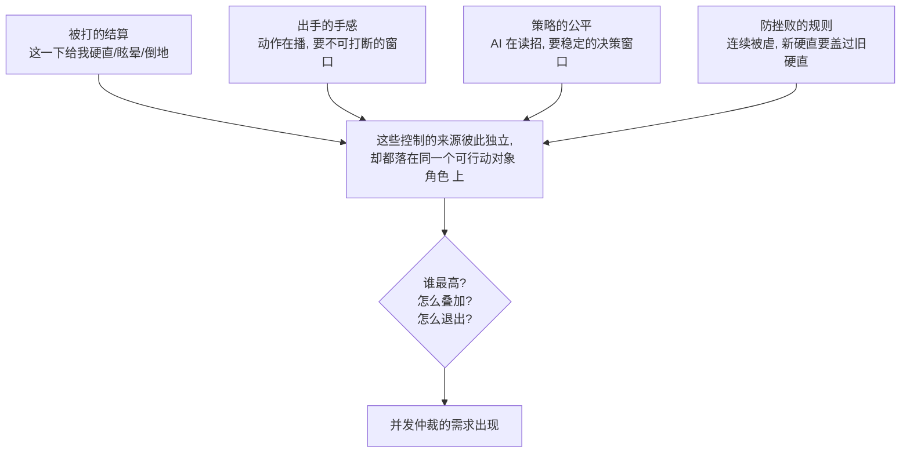
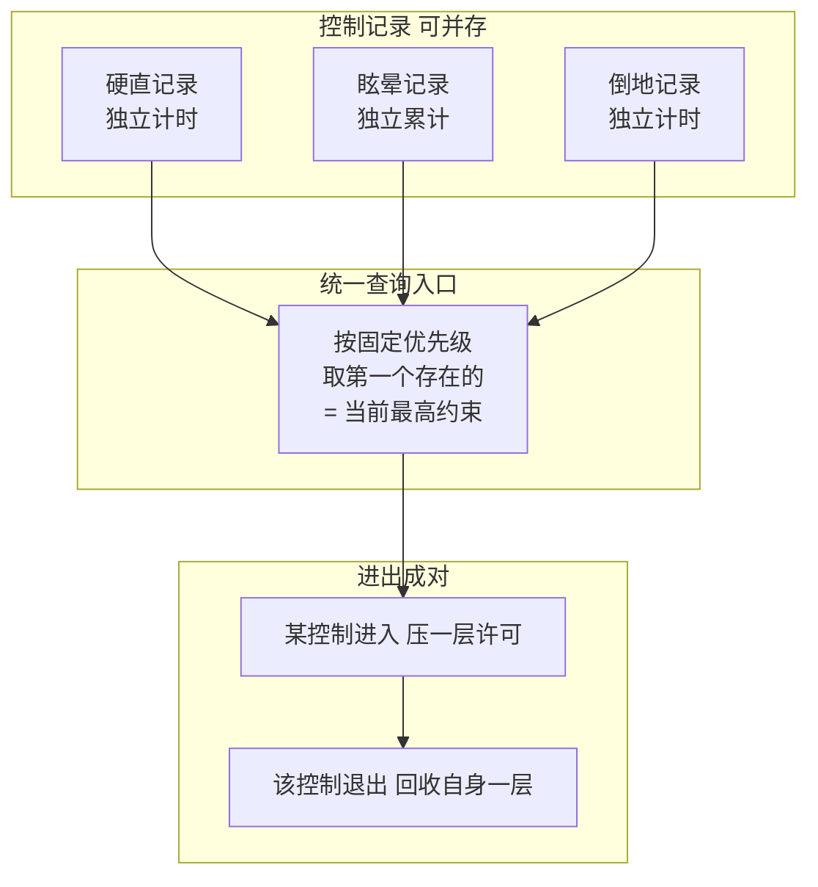

# 设计议题：并发控制与许可仲裁

> **方法篇。** 本文不解释某个具体机制，而是从《师父》这套成熟实现里抽象出可复用的设计思路。对应机制细节见文末落点。

## 一、这个问题从何而来（先别急着解）

很多方案一上来就写"加个并发仲裁"，但更该先问：**多个控制源不是一开始就存在的，是被什么催生出来的？**

战斗画面里，一个角色"能不能动"，其实被好几个互不相干的需求同时照看：

这些诉求**各自独立、增量地发展**，最后又**共享同一个操作对象**。所以"多个来源同时要约束一个对象"不是设计者特意造的，而是——**只要你的玩法是多个独立元素迭加、且共享同一对象，它就必然出现**。区别只在两条路：

- **有意识仲裁**：把控制建模成可并存的一组，用统一规则问"现在最高的是谁、怎么进退"。
- **被动炸开**：到处散落全局 if，谁改谁撞，最后不可维护。

> 成因决定解法形状：既然来源是**并存**的，解法就该让控制**并存**；既然来源**各自独立退出**，解法就该**成对进出、各自回收**。后面所有选择都长在这个成因上。

## 二、这个设计问题是什么

把成因落到可解决的问题上，就是三点：

1. 多个控制可同时存在 → 系统怎么**叠加**而不互相顶掉？
2. 动作/AI 需要"现在最高约束是谁" → 怎么**一次查到**？
3. 每个控制各自到时/达标退出 → 怎么**逐个解**而不误伤别的？

## 三、成熟实现怎么做的（《师父》）

它用一套"**多记录共存 + 栈式许可 + 固定查询优先级**"来仲裁，三个关键选择：

三个要点：

1. **不设唯一状态，而是多份记录并存。** 一个角色同时可有硬直、眩晕、倒地等几份记录，各自独立计时/累计、各自退出，不会"新建一个就顶掉另一个"。
2. **查询时按固定优先级"选一个"。** 动作系统、AI 要问"现在最高约束是谁"时，走同一入口，从集合里按写死的顺序取第一个存在的。注意它只是**查询顺序**，不代表互斥，也不代表退出顺序——其余记录仍在集合里被各自更新。
3. **进入压层、退出回收，严格成对。** 每份记录进来就压一层许可上下文，走人就回收自己那一层，句柄一一对应。叠加时各层都在，退出时只解开自己的，不误伤别的控制。

## 四、这套思路好在哪

| 成因带来的需求 | 单状态＋全局 if | 多记录＋栈式许可（本实现） |
|---|---|---|
| 控制并存而不互顶 | 难表达"既被压住又被额外控制" | 天然支持，每份独立 |
| 逐个退出不误伤 | 每个开关退出条件自己管，易漏 | 压入/弹出严格成对，句柄回收 |
| 一次查到最高 | 靠散落的 if 分支 | 一处固定优先级查询 |
| 新增一种控制 | 全局逻辑越改越乱 | 加一份记录＋一层即可，不动仲裁 |

## 五、提炼出的设计决策程序

1. **先问成因：是不是"多源共享一对象"？** 多个独立元素迭加取约束同一角色 → 是，走下面；只是单一开关 → 直接一个标志位，不必上这套。
2. **把控制建模成"可并存的记录集合"**，每条带自己的类型、优先级/句柄、计时与累计。一句话：控制是集合，不是枚举。
3. **定义"当前最高约束"的固定查询顺序**，集中一处，让动作、AI 都来查这个入口，不各写各 if。
4. **进入→压层许可，退出→回收自身一层**，严格成对；凡被外部控制/放开，都走许可层，不直接改标志位。
5. **退出用守卫而非拍平**：哪层到时间/累计就解哪层，不做"恢复到无控制"的整段重置。

## 六、适用边界

- 这套为**"多源叠加、按序进退"**的交互控制设计。单一控制、简单 flag 用它会重。
- **多记录共存是查询结果，不是"互斥不存在"**——集合里并存不代表系统把它们当一回事，查询只挑最高那份。
- "删掉一份记录 ≠ 把角色复原"，集合里可能还有别的控制，别写"删即复原"的假设。
- **成因不强，方案就多余**：若你的玩法是单控（如纯 QTE 只有一个状态），不该为它上满这套。

## 七、在《师父》里的具体落点（回指）

- 状态集合多记录共存、固定查询顺序：见 [[01机制/状态与眩晕/连续受击与反击追击的系统链|系统规格]] 第 1、3 节（GetHighestActiveFightingState 0x195C370）。
- 许可上下文建立与回收：同规格第 6 节 A1（Push 建层）/A5（Pop 回收）；E6 显式 Push/Pop 入口。
- 信号线索：系统索引 S01/S03/S21（`notes/` 下 `recovery-` 相关底稿）。

---

上一篇：[[00阅读入口]] · 下一篇：[[04（待建）交互事件阶段固化]] · 返回 [[00阅读入口]]