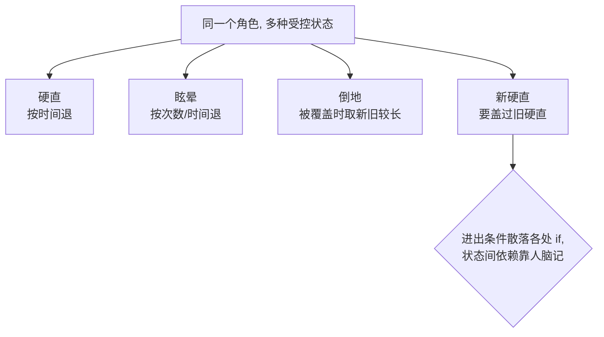
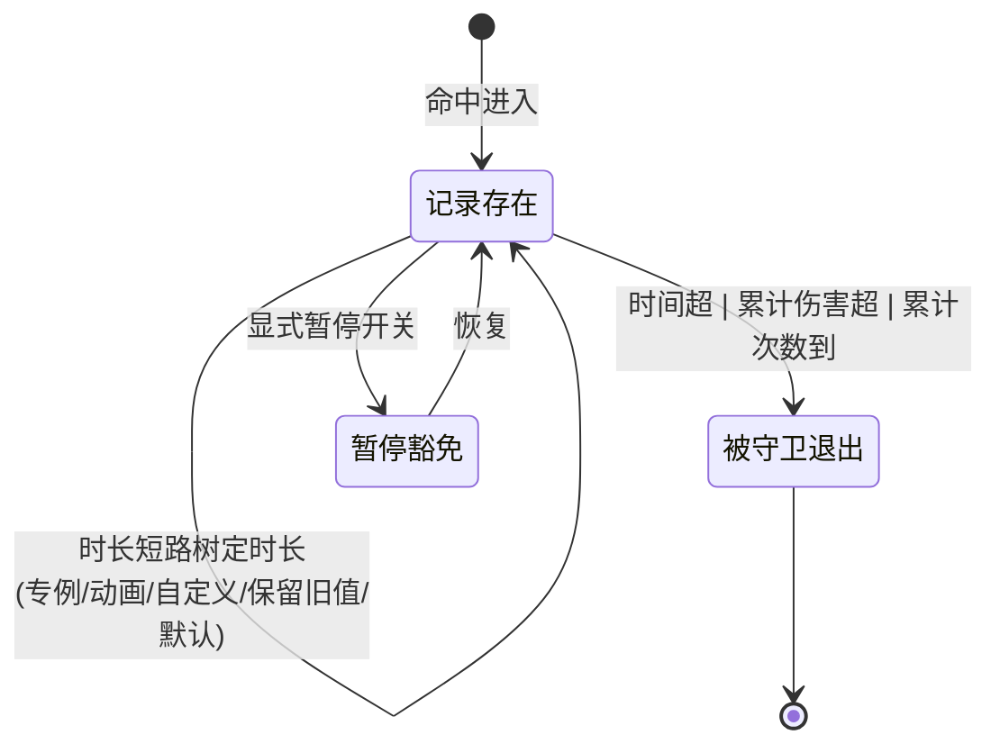

# 设计议题：状态建模与守卫

> **方法篇。** 从《师父》实现里抽象设计思路，不解释具体机制。对应细节见文末落点。

## 一、这个问题从何而来（成因）

"被打一下会不会动、怎么动、被压多久"，是战斗手感的核心。但角色身上**受控状态的进出依赖互不相同**：有的按时间退、有的按累计伤害退、有的按被打击次数退，还有的新硬直要盖过旧硬直、倒地时遇到新眩晕要对比谁长：

这些状态是**随玩法增量各自长出来的**：眩晕是为了防挫败加的、倒地是为了强反馈加的、新硬直覆盖是为了连段手感调的。当它们积累够了，光"当前是什么"不足以表达——因为它们会**并存、会覆盖、会各自的到期**。若进出条件散成各处 if，状态何时换/多久换/换谁的依赖会失序，手感不可预测、难调。

## 二、这个设计问题是什么

1. 各状态**进出条件互不相同** → 怎么统一规范化，让状态可比、可维护？
2. 状态间有**覆盖/延续依赖**（新盖旧、倒地遇眩晕取较长）→ 怎么显式表达，不靠人脑记？
3. 状态是**有时间之身**的 → 怎么把"还能撑多久"量化成可判的守卫？

## 三、成熟实现怎么做的（《师父》）

它用"状态记录自带寿命与上限 + 进入按时长短路树 + 退出走三道守卫"来管状态生命周期：

三要点：

1. **状态记录自带"剩余时间"与"上限"**：一条记录含总时长、已过时间、累计伤害上限、累计次数上限；"还能撑多久"在记录内就算清。
2. **进入时的"时长怎么定"是一棵有序短路树**：特殊眩晕用必需时长 → 有动画用动画加冻结 → 启用自定义就用自定义 → 保留当前状态就取旧值较大 → 默认兜底时长。**先中即停**，规则确定、可调。
3. **退出三道守卫，逐条判**：时间超过、或累计伤害超过、或累计次数到顶，任一成立即退。时间/伤害**严格大于**，次数**达到即可**；外加"暂停/无限"两个显式豁免开关。

## 四、这套思路好在哪

| 成因带来的需求 | 散落 if | 状态记录＋守卫树 |
|---|---|---|
| 进出规范化 | 各状态各写各判，不可比 | 统一时长树＋退出守卫 |
| 状态间依赖 | 靠人脑记"谁覆盖谁" | 保留当前状态/取较大值显式表达 |
| 可调平衡 | 改时长要找一堆地方 | 改配置/树序一处到位 |
| 停机/无限 | 到处塞特判 | 两个显式开关 |

## 五、提炼出的设计决策程序

1. **先问成因：这些受控状态是否会并存/覆盖/各自到期？** 是 → 走守卫建模;只是无持续期的简单标记 → 不必套守卫树。
2. **把受控状态建模成一条记录**，自带剩余时间与必要累计上限。
3. **给"该状态持续多久"定义一棵有序时长短路树**：专例→动画→自定义→保留旧值→默认，先中即停。
4. **退出统一走三道守卫**（时间/伤害/次数），明确各自是"严格大于"还是"达到即可"。
5. **需要覆盖保持连续的**用"取较长时间的较大值"显式表达跨状态依赖；暂停/无限做成记录上的显式开关，不散落成各处例外。

## 六、适用边界

- 适用于**时序驱动、要可预测可调**的受控状态；无持续期的简单标记不必套守卫树。
- 时长树/守卫把"进出"管死了，但**不等于某输入必然制造到某状态**——建模描述的是规则，不是输入清单。
- "删掉一份记录 ≠ 把角色复原"。成因不强（单状态无覆盖）就别上满。

## 七、在《师父》里的具体落点（回指）

- 状态记录字段、时长短路树 D1–D9：见 [[01机制/状态与眩晕/连续受击与反击追击的系统链|系统规格]] 第 4 节（ApplyFightingStateFromImpact 0x1A46990）。
- 三道退出守卫 U4–U7、暂停/无限豁免：同规格第 5 节（TickComponent 0x196A130）。
- 跨状态保留当前时长：同规格 D5/D8/D9 子树。
- 信号线索：系统索引 S02/S29。

---

上一篇：[[交互事件阶段固化]] · 返回 [[00阅读入口]]

## 成熟实现怎么做的

《师父》用它那套**状态记录 + 守卫式退出**把"状态生命周期"管起来，要点：

1. **状态记录自带"剩余时间"与"上限"。** 一条记录有总时长、已过时间、累计伤害上限、累计次数上限等字段；"还能撑多久"在记录里就算清楚。
2. **进入时的"时长怎么定"是一棵有序短路树。** 同一份状态实际该多久，按判断顺序逐个试：特殊眩晕用必需时长、有动画用动画加冻结、启用自定义就用自定义、保留当前状态就取旧值与新值较大、默认走到兜底时长计算。**先中一个就不再往下试**，规则确定、可调。
3. **退出用三道守卫，逐条判。** 时间超了、或累计伤害超了、或累计次数到顶，任一成立即退出该记录。时间/伤害要严格大于，次数是达到即可——不同退出面用不同比较，明确写死。
4. **守卫之外有"暂停/无限"两个豁免开关。** 某些状态可暂停自动退出或无限持续，这是显式开关，不是对规则的例外散落。

## 这套思路好在哪

| 需求 | 散落 if | 状态记录＋守卫树 |
|---|---|---|
| 进出规范化 | 各状态各写各判，不可比 | 统一的时长树＋退出守卫 |
| 状态间依赖 | 靠人脑记"谁覆盖谁" | 保留当前状态/取较大值显式表达 |
| 可调平衡 | 改一个时长要找一堆地方 | 改配置/树序一处到位 |
| 停机/无限 | 到处塞特判 | 两个显式开关 |"每次进出的时长来源、旧值合并是否都要保留"这条边界要认清：不是所有状态都需要"保留当前状态时长"这种复杂树，多半是被覆盖后还想要连续性才需要。

## 提炼出的设计决策程序

1. **把每个受控状态建模成一条"记录"**，自带剩余时间与必要的累计上限。延续时间由记录自己算。
2. **给"该状态持续多久"定义一棵有序的时长选择树**，顺序短路：专例 → 动画时长 → 自定义 → 保留旧值 → 默认。先中即停。
3. **退出统一走三道守卫**：时间超过、累计伤害超过、累计次数达到。明确每个是"严格大于"还是"达到即可"。
4. **需要"覆盖时保持连续"的状态**，用"取旧值剩余时间与新人物的较大值"来表达，明确写清这条跨状态依赖。
5. **暂停/无限做成记录上的显式开关**，不散落成各处的例外。

## 适用边界

- 这套适用于**时序驱动、要求可预测可调**的受控状态。一次性、无持续期的简单标记不必套守卫树。
- 时长树与退出守卫把"进出"管死了，但**不等于某套输入必然制造到某个状态**——建模描述的是规则，不是输入清单。
- "删除一份记录 ≠ 把角色复原"。

## 在《师父》里的具体落点（回指）

- 状态记录字段、时长短路树 D1–D9：见 [[01机制/状态与眩晕/连续受击与反击追击的系统链|系统规格]] 第 4 节（ApplyFightingStateFromImpact 0x1A46990）。
- 三道退出守卫 U4–U7、暂停/无限豁免：同规格第 5 节（TickComponent 0x196A130）。
- 跨状态保留当前时长：同规格 D5/D8/D9 子树。
- 信号线索：系统索引 S02/S29。

---

上一篇：[[并发控制与许可仲裁]] · 上一篇：[[交互事件阶段固化]] · 返回 [[00阅读入口]]