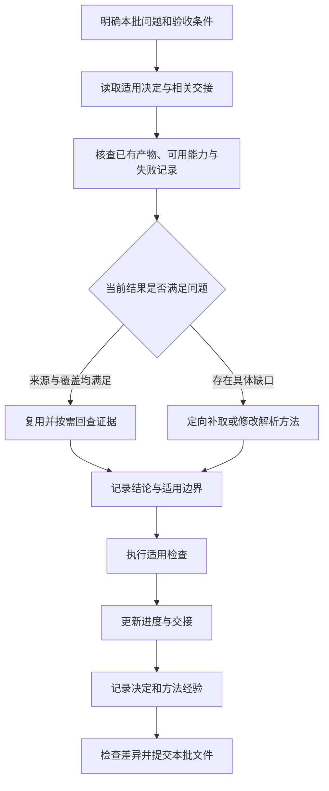

---
aliases:
  - 项目导览
  - 解包研究工作流
---

# 项目工作流与规则

这份导览解释项目怎样推进、哪些记录值得信任、换对话后怎样接手。研究工作区是 `E:/ProgrameFiles/SifuResearch`，你正在浏览的 Obsidian 仓库是其中的 `Sifu/`。规则、决定和执行底稿保存在研究工作区；本页是面向你的阅读入口，不替代原始证据。

更新：2026-11-05。适用当前研究流程；各机制的最新进度以对应进度页为准。

## 规则怎样分层

根 [AGENTS.md](../AGENTS.md) 只维护始终生效的边界与任务入口。项目目标和材料导航在 [PROJECT.md](../PROJECT.md)；开展机制研究时读取 [研究流程](../notes/research-workflow.md)，解释或编写机制文档时读取 [机制表达](../notes/mechanism-writing.md)，审查或修改规则时读取 [规则维护流程](../notes/rule-maintenance.md)。各流程按任务加载，规则讨论可直接进行。

根目录用于入口和必要配置。批次规格、任务和验收清单归入 `notes/batches/<批次ID>/`，运行产物按批次保存，其他文件归入各自职责目录。具体归属和迁移检查以 [工作区目录约定](../notes/workspace-layout.md) 为准。

## 先从这里阅读

| 想了解什么 | 入口 |
|---|---|
| 项目机制阅读首页 | [[00索引/首页]] |
| 系统模型、事件与状态转移 | [[01机制/状态与眩晕/连续受击与反击追击的系统链|战斗状态与事件：系统规格]] |
| 已完成什么、当前缺口 | [[00索引/研究进度与问题]] |
| 提取、解析、逻辑、实测分别到哪一步 | [[00索引/解包与解析进度]] |
| 系统之间如何联系 | [[00索引/系统线索与关系图]] |
| 术语及证据能支持什么 | [[00索引/术语与证据说明]] |

## 我们要产出什么

以开发者角度逐步恢复数据模型、事件接口、条件、字段更新和跨模块副作用。机制正文集中维护，配置、专题与详细取证作为附录。玩法现象可用于检验模型，但不足以单独证明内部因果。

研究保留四个独立阶段：

| 阶段 | 达到什么 | 仍不能声称什么 |
|---|---|---|
| 已提取 | 目标文件在本地，可核来源与哈希 | 字段已读懂或资源实际启用 |
| 已解析 | 在说明的边界内读出对象、字段或引用 | 父级默认值、消费者与完整语义都已恢复 |
| 已接通逻辑 | 有配置和代码证据支持特定条件及执行关系 | 实战必走这条路径，或时序／最终数值已确认 |
| 已实战验证 | 指定构建与场景已观察并记录结果 | 对所有敌人、难度和状态都成立 |

## 一批研究怎样完成

开工时 agent 先建立批次，写清目标、写入范围和完成条件。已有产物满足需要就复用；只缺一项就定向补齐。输入、解析器或研究范围没有变化时，不重复已知无效尝试。

关键结论、失败和转向在过程中及时记录。无法闭合的问题可以结束本批，但必须留下具体对象／函数、已有证据、缺少什么和下一步成功条件；本批结束不等于整个系统研究完成。

## 任务执行前先查现有能力

需要解析、生成、转换、验证或操作应用时，agent 先明确输入、交付物与验收条件，再查当前工具、已安装技能、插件，以及项目脚本、模板和既有经验。候选要核实格式、版本、依赖和输出；使用技能前读取实际说明，不能只凭名字认定适用。

优先复用或组合操作工具、流程技能、模板及验证能力。已有能力有明确缺口时才扩大查找、适配或自行实现，并记录具体原因。简单编辑不例行全网检索，输入和环境未变时也不每轮重找。

查过的范围、选择理由、失败边界和重新查找条件留在交接及能力记录；发现候选、安装、执行和验证成功分别陈述。详细步骤在研究工作区 `notes/capability-discovery.md`，决定见 ADR-0006。

Codex 与 Trae 的入口和技能名称不同：历史交接中的 Codex 技能名只作记录，当前以本轮实际可用工具为准；映射见 `notes/capability-discovery.md` 的“客户端能力映射”。

## 换对话时靠什么接续

新对话按“项目入口 → 适用 ADR → 相关交接与最新进度 → 必要底稿／原始证据”恢复当前问题的上下文。不要求你重新复述全部背景，也不假定新对话完整记得旧聊天。

重复处理前要核查输入构建／哈希、工具或脚本版本、输出完整性及覆盖范围。交接是导航，不是完整事实；决定关键机制时仍须按需回查原始资产或代码。避免无目的全库重读，同时保留必要复核。

## 每类记录各管什么

下列路径相对研究工作区 `E:/ProgrameFiles/SifuResearch`，并非都位于 Obsidian 仓库内。

| 记录 | 作用 | 何时更新 |
|---|---|---|
| `AGENTS.md` | agent 每批遵守的执行规则与入口 | 协作要求改变 |
| `adr/` | 你决定了什么、理由、适用范围及取代关系 | 你明确作出决定，agent 主动记录 |
| `notes/handoffs/` | 本批做了什么、失败、断点、下一步、写入范围 | 开工、中途关键节点、收尾 |
| `notes/tool-capabilities.md` | 工具输入条件、能力、失败特征与证据 | 新工具、升级、格式变化或新限制 |
| `notes/retrospectives/` | 实际方法经验、代价及迁移边界 | 有代表性的成功、失败或方法调整 |
| `notes/` 主题底稿 | 推导、反例、结论定位与修订原因 | 新证据或解释变化 |
| `inventory/`、`exports/`、`logs/` | 机器清单、结构化输出和原始工具日志 | 提取、解析、静态分析或检查 |
| `Sifu/` | 面向阅读的机制、实现、配置与进度 | 有证据支持的内容变化 |
| `.git/`、`notes/version-control.md` | 已提交版本历史及纳入范围 | 适用检查通过后提交本批改动 |

## 你作出决定后会发生什么

agent 不等你再次提醒，在当前对话记录 ADR 并关联执行位置。明确决定直接标已接受；讨论中的建议保持提议，用户没说的理由明确留空或注明未说明。接受决定不等于验证效果。

同一决定的澄清合并，实质改变时新增后继记录，保留旧记录与取代关系。单次操作的细节写交接，改变后续做法的选择写 ADR；机制事实则写证据底稿。

目前 ADR 已涵盖主动记录决策、持久记录续接，以及工具矩阵／复盘／版本管理与本页导览的建立。最新索引在研究工作区 `adr/README.md`。

## 怎样积累到未来项目

工具矩阵回答“当前输入该选什么工具、会在哪里失败”；复盘回答“实际什么做法有效、代价和条件是什么”；ADR回答“为什么选择这样做”。三者互相链接，不重复保存同一套结论。

每条可复用经验都保留输入假设、失败边界和实际案例。当前 UE 包结构、PDB可用性、脚本路径及敌人样本只是实例。迁移到其他项目先做代表样本验证；尚未跨项目验证的经验保持“可复用候选”。

第一份方法复盘已从历史解析缺口整理“先分类、再定向重试”；其中未重新验证的历史内容和未知成本已明确标注。

## 验证和纠错纪律

### 机制怎样讲清楚

玩家与敌人同时出现时，明确写出谁执行动作、谁做判定、读取谁的状态、结果作用于谁；主语切换时重新点名。攻击方／防守方需映射到当前事件中的玩家或敌人，不能让“自身”“角色”“目标”在双方间含糊切换。

共性规则明确标“玩家与敌人共用”或实际适用范围，可以统一用已定义的“当前角色实例”讲述，再分别说明双方参数、覆写和专属分支。共用计算不等于数值或最终行为相同；只核实一方时保留该范围，不推成双方通用。具体事件仍交代谁对谁做什么。

先说明当前讨论哪个阶段、在什么前提下成立，再直接讲该阶段已证实的规则。确有不同处理路径时，列出各路径的条件、结果与执行次序，不用一句“不一定”替代解释。

回答与文档默认按“范围与前提 → 已知规则 → 相关分支 → 具体未解项”组织。已知且相关的因素完整列出；真正未知写清已知到哪里、缺什么、影响什么和下一步查什么。agent 在回答或发布前逐处复核不确定措辞，避免用假设性例外模糊已知结论。

不确定性分清三类：分支规则已知但当前输入未给定，具体判定规则尚未恢复，或运行时取值／时序尚未观察。逐项说明缺什么、影响哪条结论、下一步查什么。没有定位原因时明确保留该缺口，不用想象中的因素凑齐分类；局部未知不模糊整条已知链。

例如讨论普通硬直已应用后的处理，就讲它的更新、持续与退出；招架等因素只有在证据表明参与所讨论阶段时才引入。攻击是否产生普通硬直则另按前置分类条件展开。这是表达组织方式，具体阶段关系以机制取证为准。

完整规范在研究工作区 `notes/mechanism-writing.md`，选择理由见 `adr/0004-以条件分支表达机制与未知.md`。

- 自动检查验证其覆盖的链接、文件、哈希、语法、解析边界或数据一致性；不能代替实战观察与因果取证。
- 配置、代码、推断和实测分别陈述；父级默认值、实例覆写、难度及状态条件没有核清时保留未知。
- 新证据推翻旧解释时保留修订原因，查找并更新受影响的正文、配置、实现、进度及生成脚本。
- 多个对话先检查写入范围，独立产物按批次分开；修改共享文件前重读并合并，不覆盖其他对话的工作。
- 原游戏和存档只读；覆盖研究输出前核范围并保留必要原件。规则变化时本页同步更新。
- 严格只读复核按 `notes/research-workflow.md` 第 4 节的临时目录流程执行，不覆盖 `inventory/`、`exports/`；临时结果需要长期保留时再按批次落盘。

## Git 保存到哪里、保存多少

项目已建立本地 `main` 分支，首个提交保存初始化时的当前状态。后续 agent 在适用检查通过后显式暂存并提交本批文件，交接留下提交入口；首次基线不会恢复以前不存在的版本历史。

纳入范围以 `.gitignore` 为准，主要保存规则、决定、复盘、源码、知识库文本与发布页面、手工图，以及作为检查配置的知识库布局清单。解包文件、解析数据、自动生成的概览／批次清单／验证报告、日志、历史备份和 Obsidian 插件配置留在本地，不进入提交。

来源清单和哈希仍用于核查与复用，但不因有用就必须入 Git。Git主要保存人的选择和难以重新获得的编辑成果；可重建的解析数据与原始证据按本地清单管理。

本地提交不会自动上传。当前未配置远程备份；Git也不能重建被忽略的原始数据。版本历史、资产完整性和异地备份是不同问题。

## 你平时需要做什么

直接说明研究目标、优先级或你作出的决定即可。agent 负责定位旧记录、登记批次、维护 ADR、取证、适用验证、复盘与版本提交，并在收尾说明完成内容和缺口。

你只是提问、没有明确要求改文件时，agent 先说明方案与影响并征询意见，确认后再动手；只读分析、检索和解释不受此限。

浏览时从本页了解流程，再进入首页或进度。只有确实需要你在游戏或 Obsidian 内观察时，agent 才应写明应用、操作与预期结果。当前建立这些管理机制不需要你执行额外配置。

招式命名按[ADR-0005](../adr/0005-先核查游戏正式招式名再应用.md)：先查询游戏实际正式称呼，区分单招、整套连招与技能；12批查询结果先单独保存；该阶段已完成，徒手进入下述0008执行阶段。

徒手命名进入[ADR-0008](../adr/0008-补全徒手节点并应用名称标注.md)执行阶段：官方名用于气泡和详情，保留操作称呼；专注另页，补点与连线分别按证据验收。
