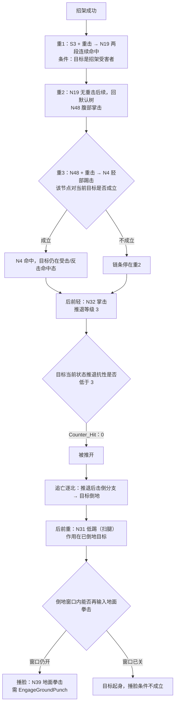

# 连招解释修正：招架起手 → 重123 → 推掌 → 追亡逐北 → 扫腿 → 捶脸

## 1. 问题

用已解析的玩家招式树与敌人抗性配置，解释同一套连招在 Grunt（小混混）、BigGuy（胖子）、FlashKick（腿姐）身上的差异；并纠正上一轮三处错误：

1. 把「重1」当成默认重击第一段（腹部掌击）。
2. 认为胖子不能被推掌，因为其常态推退抗性为 4。
3. 认为扫腿负责把敌人打倒，捶脸是扫腿的后续。

## 2. 完成条件

- 「重1／重2／重3」各自对应哪个节点、哪条输入，能指到配置行。
- 说明抗性必须按敌人**当前状态**读取，而不是固定读常态一行。
- 说明倒地由哪一招造成，扫腿作用在什么状态。
- 给出胖子「没有重3」「不能捶脸」和腿姐「多一次背身扫腿」的解释，并标明哪些是配置已解析、哪些是推断。
- 先交付文本解释；是否回写知识库文档由用户确认。

## 3. 已核对事实

| 事实 | 证据 | 状态 |
|---|---|---|
| 招架受害者起手 S3 + 重击 → N19「2·连续命中」，条件为「目标是招架受害者」 | `Sifu/03配置/玩家攻击/输入衔接图-徒手.md` 第 329 行；节点定义第 764 行 | 已解析 |
| N19 使用 `MainChar_PicHead_DoubleHit_FR`，两段命中 `PicHead_HB01/HB02`，只有轻击后续、没有重击后续 | 同文件第 764-780 行 | 已解析 |
| 默认重击入口是 N48 腹部掌击；N48 + 重击 → N4 胫部踢击；N4 + 重击 → N5 咽喉拳击 | 同文件默认回退入口与 N48 定义第 1267 行 | 已解析 |
| 掌击 N32 的 `PalmStrike_HB01` 推退等级为 3 | `Sifu/03配置/玩家攻击/MainChar_HitBoxData-5b12fa.md` H005；属性等级分组 | 已解析 |
| 三种敌人在 `Counter_Hit` 的推退抗性都是 0；BigGuy 只在 `InFight` 为 4 | 三份 `*_ResistanceDB` 顶部矩阵 | 已解析 |
| 追亡逐北是「推退后击倒分支」，输入为对被推开的对手使用重击 | `notes/player-move-names-12.md` 第 19-21 行；`输入衔接图-徒手.md` 第 337 行 S5 + 重击 → N26 | 已解析 |
| 扫腿 N31 的动作位于 `BareHands/Knockdown/`，正/背两组姿态槽分别用 `KD_LowKick_FL`、`KD_LowKick_BR` | `输入衔接图-徒手.md` 第 964-986 行 | 已解析 |
| 捶脸 N39 地面拳击需要 `EngageGroundPunch` 技能标签，目标须处于倒地姿态 | 同文件第 1112-1134 行 | 已解析 |
| 倒地持续时间：BigGuy 3.7 秒；Grunt 4.0 秒；FlashKick 4.0 秒 | `inventory/object-and-table-properties.csv` 第 74171、149513、129882 行 | 已解析（配置值） |
| 三者倒地累计次数上限均为 2，累计伤害上限均关闭 | 同 CSV 第 74201、149543、129912 行等 | 已解析（配置值） |
| 受击/倒地时长绑定动画，各原型使用不同动画请求 | `Sifu/03配置/受击恢复/受击与恢复配置.md` 的 BigGuyHittedDB 等 | 已解析 |

## 4. 修正后的链路

关键点：重1 是招架分支的专用反击，不是默认重击；重2、重3 是回到默认树后的两段重击。

## 5. 三敌差异

| 环节 | Grunt 小混混 | BigGuy 胖子 | FlashKick 腿姐 |
|---|---|---|---|
| 重1（招架反击 2 段） | 成立 | 成立 | 成立 |
| 重2（腹部掌击） | 成立 | 成立 | 成立 |
| 重3（N48→N4 胫部踢击） | 成立 | **不成立** | 成立 |
| 推掌（推退 3 对 Counter_Hit 0） | 成立 | 成立 | 成立 |
| 追亡逐北（放倒） | 成立 | 成立 | 成立 |
| 扫腿（对倒地目标） | 一次 | 一次 | 一次，且可再接一次背身槽扫腿 |
| 捶脸（地面拳击） | 成立 | **不成立** | 成立 |
| 倒地持续时间配置 | 4.0 秒 | 3.7 秒 | 4.0 秒 |
| 倒地累计次数上限 | 2 | 2 | 2 |

### 胖子「没有重3」

- 不是抗性表：三人在 `Counter_Hit` 的倒地、推退、眩晕抗性数值一致。
- 也不像「目标已恢复防御」：重2 之后推掌仍能把胖子推开，说明他当时仍在推退抗性为 0 的受击/反击命中态。
- 因此断点在「第三次重击这个节点/招式对胖子是否成立」这一层，最可能是 N4 或 N48→N4 的节点条件覆写按目标类型/体型改变了选择，或该招式本身对大体型目标不成立。
- 置信度：中。N31/N39 等的条件覆写是 1067 字节未解码块，尚无字段级证据；需解码或逐帧验证。

### 胖子「不能捶脸」

- 三者倒地累计次数上限同为 2、累计伤害上限关闭，所以不是「次数用完」。
- 配置上最直接的差异是倒地持续时间：胖子 3.7 秒，小混混与腿姐 4.0 秒。
- 追亡逐北放倒 → 扫腿消耗一段倒地时间 → 捶脸需要窗口仍然开着。胖子短 0.3 秒，扫腿后先起身，地面拳击的「目标处于倒地姿态」条件不再成立。
- 边界：3.7/4.0 是配置值，实际时长绑定动画；不能当作实战精确秒数。

### 腿姐「多一次背身扫腿」

- 扫腿 N31 有两组姿态槽：正面槽用 `KD_LowKick_FL`（命中行 `LowKick_HB01`），背身槽用 `KD_LowKick_BR`（命中行 `LowKick_BT_HB01`）。
- 腿姐倒地后与玩家的相对朝向使同一次「后前重」落到背身槽，于是多打出一次背身扫腿，然后仍有 4.0 秒窗口接捶脸。
- 置信度：姿态槽存在与命中行归属为已解析；「腿姐倒地动画导致落到背身槽」为推断，槽位选择由未解码的条件覆写控制，需实战或逐帧验证。

## 6. 未闭合

1. N4 对胖子不成立的确切条件（节点覆写未解码）。
2. N31/N39 的 1067 字节条件覆写，倒地姿态/朝向判定未恢复。
3. 倒地窗口的实战精确剩余时间（受动画绑定影响）。

## 7. 写入范围

本批仅新增 `notes/20261102-连招解释修正/spec.md` 与 `tasks.md`；不改动既有知识库文档。是否把修正后的解释回写到相关机制页或此前新建的文档，待用户确认路径与范围。
