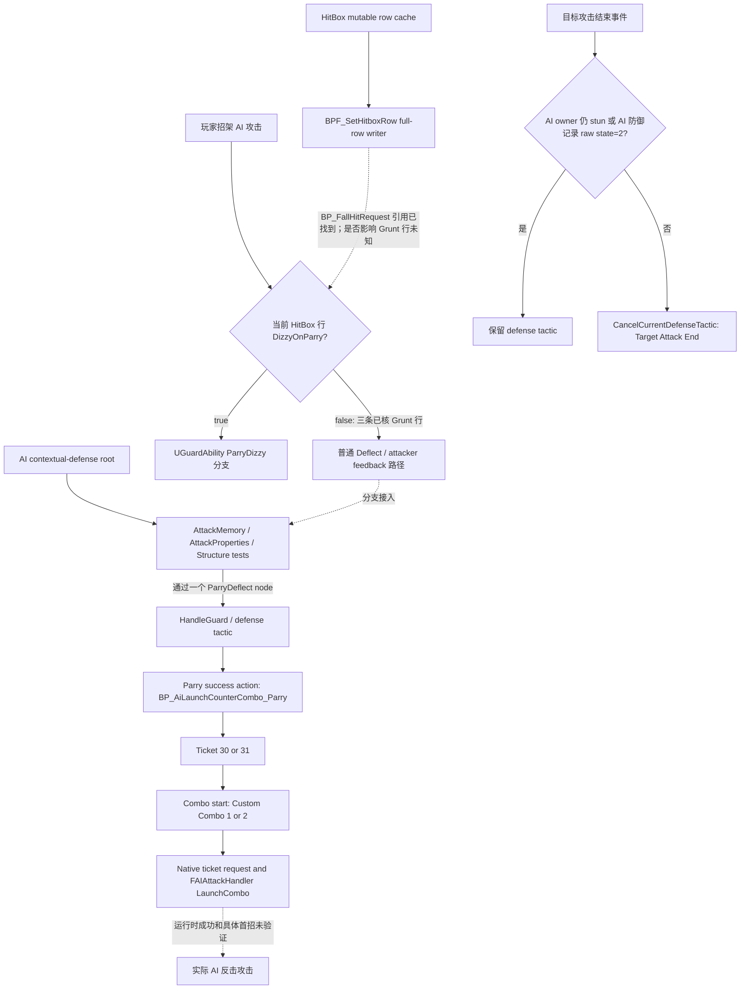

# 招架分支与 AI 反击追击：静态补证

> 状态：本地资产已提取并解析；关键原生调用路径已由匹配 PDB 的反汇编接通；未做运行时验证。范围是普通 Grunt 与 Advanced Grunt 的 Cooked 资产和本机构建原生代码。结论不得外推到所有敌人、所有难度或每次战斗。

## 结论摘要

| 结论 | 证据等级 | 当前可说到哪里 |
|---|---|---|
| 普通 Grunt Hook、BaseballHook、Uppercut 三行命中配置都可招架，但序列化 `m_bDizzyOnParry=false` | 已解析 | 对应攻击配置都引用 Grunt 命中表中的指定行。故这些招架不满足 `UGuardAbility::OnHitDefense` 中“当前命中行要求招架眩晕”的分支条件。 |
| 招架反馈和 AI 对玩家招架的反击是不同的链路 | 原生逻辑 + 资产配置 | 普通行数据不把每次招架变为 `ParryDizzy`；Grunt 防御图的 3 个成功 `ParryDeflect` 节点分别配置了可选反击动作。动作要经过各自测试节点，不能把“节点存在”写成“每次招架都会反击”。 |
| Grunt 的自定义反击分支由受击记忆、攻击属性及一条架势阈值分支筛选 | 已解析，执行顺序由原生代码接通 | Base / Advanced 各有 3 条带 `m_ActionsOnSuccess` 的 ParryDeflect 路径：BackFrontPush、BackFrontKD，以及通用 Hit + `Structure < 0.4`。AttackMemory 的 `HitTypes` 原始枚举值仍未映射成人类语义。 |
| AI 反击动作以自定义攻击票据启动 combo | 资产 + 原生逻辑已接通 | 两个 Grunt 配置把节点动作实例的票据覆写为 `NewEnumerator30/31`；同一 Combo 资产将其映射到 `Custom Combo 1/2`，转移概率序列化为 100%。实际首个攻击节点和是否通过运行时票据请求尚未验证。 |
| AI 防御策略会在目标攻击结束事件中检查 AI 自身状态 | 原生逻辑已接通 | `OnTargetAttackEnded` 从传入的 `UAIFightingComponent` 的 `+0xB0` 取得其 owner，再检查该 AI owner 的 HitComponent `IsStun` 和防御记录 raw 状态字节 2；不满足保留条件时调用 `CancelCurrentDefenseTactic("Target Attack End")`。这不是玩家受控保持 AI 追击的证据。 |
| 避闪路径与招架路径并不对称 | 配置 + 原生逻辑 | Grunt 资产中 Avoid 节点没有自定义成功动作；Advanced 有一个额外 Avoid 节点会置 `AI.Grunt.FirstAvoid` 并 flush `AI.Grunt.FirstParry`。原生 Avoid Apply 会激活 pending avoid windows。它不能被描述成与 Parry 共用同一个反击动作。 |
| 当前不能排除运行时命中行被完整覆写 | 原生写入口 + 包名引用扫描 | `BPF_SetHitboxRow` 可把整行复制进 HitBox 缓存，理论上可以改 `m_bDizzyOnParry`；Cooked 包名只在 `BP_FallHitRequest` 发现该函数引用，图字节码和实际参数尚未解码。没有找到 Grunt 攻击/防御包中的直接引用，故不能据此声称 Grunt 行实际被覆写，也不能声称缓存绝不被改写。 |

## 1. 攻击实际引用与命中行

三项攻击均来自 Grunt 徒手攻击资产。`AttackDB.m_Attack.m_HitBoxes` 保存对 `Grunt_HitBoxData` 的行引用和动画帧区间；行配置是静态 Cooked DataTable 解析值。

| 攻击资产 | 命中行 | 命中帧（动画帧，含端点） | 可招架 | 招架眩晕 | 普通命中：生命 / 架势 / stun 帧 | 防御命中：生命 / 架势 / stun 帧 | Deflect：生命 / 架势 / stun 帧 |
|---|---|---:|---|---|---|---|---|
| `Grunt_Hook` | `Hook_HB01` | 22–26 | 是 | 否 | 15 / 18 / 20 | 0 / 15 / 20 | 0 / 12 / 20 |
| `Grunt_BaseballHook` | `BaseballHook_HB01` | 42–45 | 是 | 否 | 30 / 36 / 25 | 0 / 30 / 25 | 0 / 24 / 20 |
| `Grunt_Uppercut`（包括 RollUppercut 配置引用） | `Uppercut_HB01` | 22–27 | 是 | 否 | 30 / 36 / 25 | 0 / 30 / 25 | 0 / 24 / 20 |

以上 impact 数字受每个 impact 子结构的 `m_bUseDamage`、`m_bUseStructureDamage` 和 `m_bUseNbFrameStuned` 启用位约束；这是配置值，不是最终运行时数值。三行 `m_bDizzyOnAvoid=true`、`m_PlayAvoidedOrder=true`，因此不能把避免攻击与招架眩晕混为一谈。

Base Combo 和 Advanced Combo 都实际引用这三种 AttackDB，但节点索引不同：

| 攻击 | Base Combo 节点 | Advanced Combo 节点 |
|---|---:|---:|
| Hook | 1 | 1 |
| RollUppercut / Uppercut | 3 | 8 |
| BaseballHook | 12 | 18 |

详细序列化引用、行值、资源哈希见 [`inventory/followup-parry-ai-assets.json`](../inventory/followup-parry-ai-assets.json)；提取器见 [`scripts/followup_parry_ai_extract.py`](../scripts/followup_parry_ai_extract.py)。

## 2. 招架眩晕与普通招架反馈的分流

`UGuardAbility::OnHitDefense` 读取当前 HitBox 行；进入 `ParryDizzy` 模板分支需要 `CanDeflect` 为真且当前行 `m_bDizzyOnParry` 为真。反汇编定位见 [`UGuardAbility::OnHitDefense`](../logs/followup-parry-ai-hitbox/UGuardAbility__OnHitDefense-0x1a025f0.asm.txt)。本节第 1 表中的三条 Grunt 行第二个条件为 false，因此不能用这个条件解释它们普通招架后的反击机会。

这并不表示招架没有反馈或不影响攻击者。正常 deflect 的 Impact、`OrderDeflected` / `Deflected` 状态服务以及被反击者自身的攻击 AI，是分离的事件和对象路径；完整主链见 [`parry-system-chain.md`](parry-system-chain.md)。Grunt 的 AI 防御图也有独立的 ParryDeflect 成功节点及成功动作。当前证据支持“分流存在”，不支持“所有招架都启动同一种眩晕”或“所有招架必定选中 AI 反击”。

### 完整行覆写的边界

`FHitBox::GetMutableRow` 会为 HitBox 准备可变行缓存；`UHitboxHelper::execBPF_SetHitboxRow` 调用该入口后对整行赋值，反汇编在 [`UHitboxHelper::execBPF_SetHitboxRow`](../logs/followup-parry-ai-hitbox/UHitboxHelper__execBPF_SetHitboxRow-0x1c7fda0.asm.txt)。Cooked 包元数据的函数名引用扫描只在 `Sifu/Content/DB/Hit/BP_FallHitRequest.uasset` 找到 `BPF_SetHitboxRow`。该资产图字节码未解析，且 native 还有其他写入口，所以目前只能说“存在通用整行写入机制；没有证据证明 Grunt 招架使用它”。`UDefenseComponent::FilterImpact` 的两处缓存写入落在 impact 区域，不是本次目标布尔位；具体见 [`UDefenseComponent::FilterImpact`](../logs/followup-parry-ai-hitbox/UDefenseComponent__FilterImpact-0x1958750.asm.txt)。

## 3. AI 选择条件与成功动作

`AIContextualDefense` 的 root 节点经 `PickContextualDefense` / `TestNodeForContextualDefense` 遍历；序列节点先执行本序列的 tests，成功后才递归 linked nodes。对应代码见 [`PickContextualDefense`](../logs/stun-ai-defense/UAIContextualDefense__PickContextualDefense-0x1895070.asm.txt)、[`TestNodeForContextualDefense`](../logs/stun-ai-defense/TestNodeForContextualDefense-0x189cf50.asm.txt)、[`UAIInfluence_TestSequence::RunTests`](../logs/followup-parry-ai-logic/UAIInfluence_TestSequence__RunTests-0x18f30a0.asm.txt)。测试实现见 [`AttackMemoryInfluenceTest`](../logs/followup-parry-ai-logic/UAttackMemoryInfluenceTest__RunTest-0x18ef840.asm.txt) 和 [`AttackPropertiesInfluenceTest`](../logs/followup-parry-ai-logic/UAttackPropertiesInfluenceTest__RunTest-0x18efdc0.asm.txt)。

| 成功节点 | Base / Advanced 索引 | 序列化筛选条件 | 成功动作配置 |
|---|---|---|---|
| 资产 / 分支 | 序列化父链（外层 → 内层 → 成功节点） | 每层实际测试（逐层列出） | 成功动作 |
|---|---|---|---|
| Base / Push | `AIInfluence_TestSequence_8` index 31 → `AIInfluence_TestSequence_5` index 34 → `DefenseInfluenceNodeParryDeflect` index 36 | 外层：`AttackMemoryInfluenceTest_10` index 32，BackFrontPush、memory 10、hit count 1、raw HitTypes 3；`AttackPropertiesInfluenceTest_9` index 33，同一 BackFrontPush。内层：`AttackMemoryInfluenceTest_0` index 35，BackFrontPush、memory 3、hit count 1、raw HitTypes 2。 | `BP_AiLaunchCounterCombo_Parry`；实例 ticket `NewEnumerator30`；动作 `m_ConditionsArray` 为空。 |
| Advanced / Push | `AIInfluence_TestSequence_8` index 31 → `AIInfluence_TestSequence_9` index 34 → `DefenseInfluenceNodeParryDeflect` index 36 | 外层：`AttackMemoryInfluenceTest_5` index 32，BackFrontPush、memory 10、hit count 1、raw HitTypes 3；`AttackPropertiesInfluenceTest_0` index 33，同一 BackFrontPush。内层：`AttackMemoryInfluenceTest_10` index 35，BackFrontPush、memory 3、hit count 1、raw HitTypes 2。 | 同一动作类；实例 ticket `NewEnumerator30`；动作条件数组为空。 |
| Base / KD | `AIInfluence_TestSequence_10` index 38 → `DefenseInfluenceNodeParryDeflect` index 43 | `AttackMemoryInfluenceTest_11` index 39，BackFrontKD、memory 10、hit count 1、raw HitTypes 3；`AttackPropertiesInfluenceTest_10` index 40，同一 BackFrontKD。 | 同一动作类；实例 ticket `NewEnumerator31`；条件数组为空。 |
| Advanced / KD | `AIInfluence_TestSequence_10` index 38 → `DefenseInfluenceNodeParryDeflect` index 43 | `AttackMemoryInfluenceTest_6` index 39，BackFrontKD、memory 10、hit count 1、raw HitTypes 3；`AttackPropertiesInfluenceTest_1` index 40，同一 BackFrontKD。 | 同一动作类；实例 ticket `NewEnumerator31`；条件数组为空。 |
| Base / 通用 Hit + 架势 | `AIInfluence_TestSequence_35` index 44 → `AIInfluence_TestSequence_0` index 50 → `DefenseInfluenceNodeParryDeflect` index 52 | 第一层：`AttackMemoryInfluenceTest_9` index 45，Attack.Type.Hit、memory 2、hit count 1、raw HitTypes 2；`AttackPropertiesInfluenceTest_6` index 46，同一 Attack.Type.Hit。第二层：`StructureInfluenceTest_0` index 51，Inferior 0.4。 | 同一动作类；实例 ticket `NewEnumerator30`；条件数组为空。 |
| Advanced / 通用 Hit + 架势 | `AIInfluence_TestSequence_35` index 44 → `AIInfluence_TestSequence_0` index 53 → `DefenseInfluenceNodeParryDeflect` index 55 | 第一层：`AttackMemoryInfluenceTest_25` index 45，Attack.Type.Hit、memory 2、hit count 1、raw HitTypes 2；`AttackPropertiesInfluenceTest_28` index 46，同一 Attack.Type.Hit。第二层：`StructureInfluenceTest_1` index 54，Inferior 0.4。 | 同一动作类；实例 ticket `NewEnumerator30`；条件数组为空。 |

Base 与 Advanced 必须按各自资产的实际节点引用阅读。Push 路径都是两层序列：两份资产的外层 memory 10 / raw mask 3，内层 memory 3 / raw mask 2；序列对象名称不同（Base `_5`，Advanced `_9`），测试对象也各自属于该包。修正一条旧摘录：曾把 Advanced 内层记录写成 memory 10 / raw mask 3；当前包内对象 `AttackMemoryInfluenceTest_10`（index 35）实际为 3 / raw mask 2，10 / 3 属于外层 `AttackMemoryInfluenceTest_5`（index 32）。动作条件数组为空，不代表节点无条件执行：动作挂在测试通过的 ParryDeflect 节点上。`m_HitTypes` 的枚举数值 2 / 3 尚未映射，故只保留 raw 值。

两个 Combo 资产把 `NewEnumerator30`、`NewEnumerator31` 分别连到 `Custom Combo 1`、`Custom Combo 2` 的 start entry，转移概率为 100%、input transition 为 `None`。Cooked enum 符号资源缺失；目标节点映射仍是不透明字节，不能确定 combo 的首个 AttackDB。Advanced 两个 ticket 的转移带 `ComboAIConditionMCDomination`；Base 的 ticket31 有此引用、ticket30 没有。票据请求 / combo 启动由 [`UAILaunchAttackTriggerableAction::LaunchCombo`](../logs/followup-parry-ai-launch/UAILaunchAttackTriggerableAction__LaunchCombo-0x1858080.asm.txt) 进入 `FAIAttackHandler::LaunchCombo`；其存在不证明某场战斗里请求成功或动作被实际执行。

### 避闪分支对照

Base 有 Avoid 节点索引 29、26；Advanced 有 29、26、52。对应 Avoid 资产节点没有 `m_ActionsOnSuccess`。Advanced 索引 52 关联 `AI.Grunt.FirstAvoid`，并 flush `AI.Grunt.FirstParry`；它的 reachable test sequence 检查 `AI.Grunt.FirstParry`（memory limit 5、hit count 1、raw HitTypes 4）。各分支结构和未解 enum 见 inventory JSON。

原生 [`UDefenseInfluenceNodeAvoid::Apply`](../logs/followup-parry-ai/UDefenseInfluenceNodeAvoid__Apply-0x1879c40.asm.txt) 在节点 Apply 成功时通知防御组件激活 pending avoid windows；`OnNonDismissedHit` 会根据目标防御 handler / status 条件改变 hit dismiss reason，详见 [`UDefenseInfluenceNodeAvoid::OnNonDismissedHit`](../logs/followup-parry-ai-logic/UDefenseInfluenceNodeAvoid__OnNonDismissedHit-0x1893f50.asm.txt)。raw reason 0x0B 和相应状态字段的枚举名未恢复。该路径能说明 Avoid 窗口是一个显式中间因素，但不等于 Avoid 本身配置了 parry counter action。

## 4. 成功防御战术何时结束

`UDefenseInfluenceNodeParryDeflect::Apply` 先调用父级 contextual node 的 Apply；只有节点通过后才走所属 FightingCharacter 的 HandleGuard / tactic 后续。成功节点是在策略选择和执行过程中形成的，不是只看 `m_bParriable` 一个布尔值。对应 [`UDefenseInfluenceNodeParryDeflect::Apply`](../logs/followup-parry-ai/UDefenseInfluenceNodeParryDeflect__Apply-0x1879d80.asm.txt)。

`UDefenseInfluenceNodeParryDeflect::OnTargetAttackEnded` 是目标攻击结束事件的回调，但反汇编中的 `IsStun` 对象不是玩家目标：

1. 参数 `rdx` 是 `UAIFightingComponent`；该组件用于取得 AI defense handler。
2. `mov rbx,[rbx+0xB0]` 从该 `UAIFightingComponent` 取得其 owner（AI 自身）。
3. 后续从该 owner 的 `+0x1328` 取得 HitComponent 并调用 `IsStun`。
4. 若 AI owner 仍处于 stun，回调直接保留当前 tactic。若 AI owner 未 stun，则扫描该 AI defense handler 的记录数组；找到 raw 状态字节 2 时保留 tactic，否则调用 `CancelCurrentDefenseTactic`，reason 为 `Target Attack End`。

证据：[`OnTargetAttackEnded`](../logs/followup-parry-ai-logic/UDefenseInfluenceNodeParryDeflect__OnTargetAttackEnded-0x1894b90.asm.txt)。因此这段代码说明 AI 自身的 stun / defense-record 状态影响攻击结束事件中的 tactic 清理；它没有证明玩家受控状态保持 AI 的追击机会。raw 记录 2 的枚举语义以及事件由哪个对象、何种攻击结束调用，仍未完全确定。

避免把状态服务名称当成 AI 格挡的全局开关。`GenericNone` 或 `Avoided` 等服务需要结合具体对象、priority、上下文 push/pop 和 wrapper 实现解释；AI 调用包装层会选取自己的上下文层，不应把玩家 controller 的 context-stack 行为直接套到 NPC。与 Hitted 服务调查合并时应复核同一版本的调用点和服务实例。

## 5. 当前因果图

图中的虚线表示存在关联入口但具体运行时因果尚未证实。普通 Deflect / attacker feedback 与 AI contextual defense 是两侧参与对象不同的路径，不据此声称一次招架必然选择某个 Grunt 反击。

## 6. 解包、解析、逻辑接通与验证状态

| 项目 | 状态 | 证据 / 缺口 |
|---|---|---|
| 攻击、HitBox 行及 Grunt Base / Advanced defense / Combo 资产 | 已提取、已解析 | 来源路径、UEXP/UAsset 哈希、行与对象字段在 inventory JSON。 |
| ParryDeflect 节点到动作实例、ticket 和 Combo start label | 已解析 | 成功动作实例的序号及 CDO 值、票据与 start entry 是序列化引用。首招 target-node map 仍 opaque。 |
| AI 条件测试到节点遍历、ParryDeflect Apply、AI owner stun 检查及攻击结束事件清理 | 原生逻辑已接通 | 使用匹配 exe/PDB 的 RVA 反汇编；不是运行时 trace，也未证明玩家受控保持 AI 追击。 |
| 当前 `m_bDizzyOnParry` 行值 | 已解析 | 3 条 Grunt 资源行 false；未从实战缓存采样。 |
| 缓存整行覆写机制 | 原生入口已接通，资产引用部分已解析 | `BPF_SetHitboxRow` native thunk 可 full copy；图字节码、具体调用输入、其他写路径未完全遍历。 |
| 游戏内哪条防御分支胜出、动作是否成功、时长/动画帧同步 | 未验证 | 需要最小运行时观测；本任务未启动游戏。 |

## 7. 下一项最小取证

1. 有界解析 `BP_FallHitRequest` 图字节码，确认 `BPF_SetHitboxRow` 是实际可达节点、输入行来源是否为 Grunt 攻击、执行条件是什么。若不引用 Grunt 行，只能收窄该特定写入口的适用范围，不能排除其他 native writers。
2. 解析 `Custom Combo 1/2` 的 opaque `m_TargetNodes` map 与 `ComboAIConditionMCDomination` CDO，建立 ticket 到首个攻击节点的引用链。
3. 对 `m_HitTypes`、防御记录 byte 2、Avoid dismiss reason 0x0B 做枚举/布局回溯；优先查 cooked names、PDB 类型或已知序列化调用点，避免凭数值命名。
4. 在不改变游戏或存档的前提下，后续若用户授权运行时观测，录制单个普通 Grunt 的玩家招架：当前 AttackDB/HitBox 行、defense node、ticket 请求结果、目标 attack-end 回调、stun 和防御记录状态、动作首个 AttackDB/动画通知。否则保留静态结论，不把“潜在条件”写成实测原因。

## 证据入口

- 机器可读清单及资产哈希：[`followup-parry-ai-assets.json`](../inventory/followup-parry-ai-assets.json)
- 唯一分组反汇编清单：[`main`](../inventory/followup-parry-ai-disassembly.json)、[`logic`](../inventory/followup-parry-ai-logic-disassembly.json)、[`HitBox`](../inventory/followup-parry-ai-hitbox-disassembly.json)、[`launch`](../inventory/followup-parry-ai-launch-disassembly.json)
- 相邻主链：[`parry-system-chain.md`](parry-system-chain.md)

研究边界：静态分析；未启动游戏，未改游戏、存档、LIAN 或 Obsidian vault。