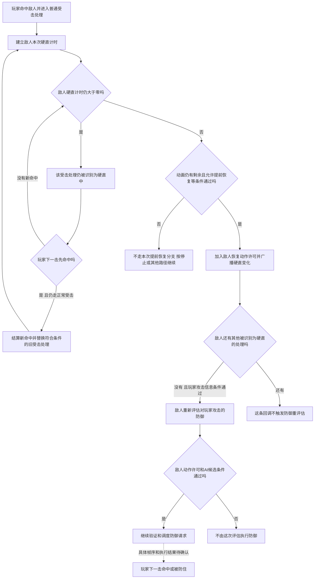

# 连续受击与反击追击的系统链

[[00索引/首页|首页]] · [[01机制/受击与追击案例|先看具体案例]] · [[02实现/连续受击与反击追击的系统链|简要实现与证据]]

**核心问题仍是：玩家连续攻击时，敌人在什么条件下可以防住下一击？** 目前已接通普通硬直计时引发防御重新评估的一条路径，以及眩晕阻止敌人防御的路径；尚未证明某套玩家连招在普通受击下必连或必断。

本文固定玩家出招、敌人受击。玩家自己受击不在此混讲。“受击处理”是内部OrderHitted对象，管理计时、动画与相关逻辑，不只是播放动画。

## 先分清三个问题

| 判断 | 看什么 | 不能替代的判断 |
|---|---|---|
| 玩家可以出招吗 | 输入、姿态、技能与动作衔接窗口 | 出得来不保证打得中 |
| 玩家下一击能命中吗 | 距离、朝向、位移、命中时刻与敌人防御 | 一次命中不保证后续都能命中 |
| 玩家能连续压制吗 | 敌人是否能在下一击前恢复并有效应对 | 输入图有连线不等于不可防御的连续命中 |

## 玩家这一击命中后，有哪些不同处理

| 分支 | 判断对象与结果 | 如何影响后续追击 | 当前边界 |
|---|---|---|---|
| 韧性抵抗 | 敌人当前韧性严格高于本次攻击采用的强度值，且相关条件通过 | 非致命、未破防的对应应用分支可绕过正常受击处理；敌人可能没有按普通挨打方式被打断 | 不能说免伤；膝击+4／旋踢+2与动画通知已定位；实际命中结果仍需核 |
| 普通受击 | 本次命中进入正常受击处理 | 敌人有独立硬直计时；到期可能开放恢复动作并重新评估防御 | 不是直接套眩晕的3秒或命中上限 |
| 推开／击倒／眩晕 | 玩家攻击的对应等级与敌人当前状态抗性等条件比较通过 | 敌人反应、位置和后续状态改变，追击条件也改变 | 不同效果不能统一翻译成更长的普通硬直；还受状态优先顺序等条件影响 |
| 架势崩溃等特殊反馈 | 敌人架势与命中／招架反馈满足对应条件 | 进入另外的受控与恢复路径 | 与普通招架、普通受击分别解释 |

这些分支是关键处理的概览，不是全部代码判断的执行顺序。精确条件回查实现篇；具体数值见[[03配置/受击案例配置对照]]。

## 普通硬直怎样走向防御重新评估

下面只展开“已经进入普通受击处理”的路径。框内的“敌人”始终是挨打的杂兵。

| 读图时容易误解的点 | 正确理解 |
|---|---|
| 硬直结束是否必须等动画播完 | 不必须；提前恢复分支明确要求动画还有剩余时间 |
| “提前恢复条件”是什么 | 硬直计时≤0、尚未添加该恢复层、恢复层资源存在、命中非致命、受击动画容器允许中断且没有要求到期中断动画等；不满足时不能强行走同一箭头 |
| 第二击怎样影响第一击 | 正常无前置请求会安排取消旧动画绑定处理、排入新处理；旧恢复层与服务随生命周期回收，新处理按本次结果计时。不是无条件累加时长 |
| 为什么能重新评估防御 | 初始化确实订阅了敌人自身的硬直变化通知；回调会检查敌人是否仍硬直，并读取玩家的攻击信息，再条件性调用防御评估 |
| 能否据此说硬直未结束绝不防御 | 不能。玩家攻击状态变化、动作许可变化也有防御评估入口；普通受击下所有入口的共同阻断尚未闭合 |
| 恢复许可是否等于立刻格挡 | 不是。还要预测玩家来袭、检查敌人动作许可与攻击准备状态、筛选候选并验证执行 |

证据：实现E23及[[02实现/受击与追击案例]]。这是一条已接通的条件路径，不能冒充“整个普通连打脱离原因已经解决”。

## 为什么眩晕后的追击要单独解释

| 环节 | 普通受击 | 敌人已经进入当前Grunt配置的眩晕 |
|---|---|---|
| 核心控制 | 普通受击处理的计时、恢复与相关动作条件 | 持续眩晕状态及它推入的高优先级动作限制 |
| 已确认的防御影响 | 硬直结束可触发防御重新评估；未证明所有提前评估都被禁止 | 有效眩晕上下文只保留少数非防御动作，AI检查的格挡、招架、躲避四项均不可用 |
| 后续命中影响 | 本次结算可产生新的受击处理 | 同时还可能更新眩晕的时间／累计伤害／归组命中数等 |
| 机会结束 | 需核对计时、许可、来袭与AI执行的完整时序 | 状态被移除会回收该限制；敌人之后是否立刻防御仍需AI选择 |

因此，防御能力不是每次受击后从零创造；敌人已有防御系统，当前条件决定是否允许及是否触发。眩晕的禁止链较明确，普通硬直的所有防御入口还需补齐。其他同／更高优先上下文、具体变体覆写仍需核对。

## 招架与闪避不是同一个入口

| 玩家操作 | 敌人发生什么 | 必须分开的阶段 |
|---|---|---|
| 玩家成功闪避某些敌方招式 | 敌人可携带一段特殊反击判定配置；玩家及时反击命中后，才可能把敌人打入眩晕 | 闪避成功、反击命中、之后眩晕维持分别解释 |
| 玩家成功招架 | 敌人按来袭属性、架势和反馈条件分流；不保证直接眩晕 | 普通反馈、架势崩溃、专用眩晕反馈、玩家后续招式自身制造眩晕分别解释 |

当前三个实际敌方攻击行Hook／BaseballHook／Uppercut均保存DizzyOnParry=false、DizzyOnAvoid=true。不能用专用招架眩晕模板解释所有招架追击；运行时覆写仍需核对。逐例见[[01机制/受击与追击案例]]。

## 当前最重要的未解问题

1. 普通敌人正在硬直时，玩家下一招触发另一条防御评估入口后，哪个实际条件阻止或允许防御执行？
2. N44刺拳接N45双段攻击时，玩家各段实际命中相对敌人恢复处在什么时刻？需要补动作启动、播放速率、受击动画选择与条件覆写，不能直接相减两张表的帧号。
3. 由此才能判定：某次被防住是攻击间有空隙、累计条件改变，还是下一击没有产生同样的受控效果。

下一步先追第1项，再对齐第2项；案例中能确认的部分与未知分开写。保持静态研究，未进行实战窗口验证。
