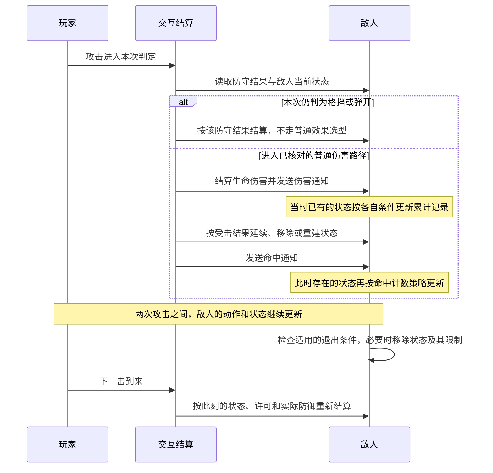
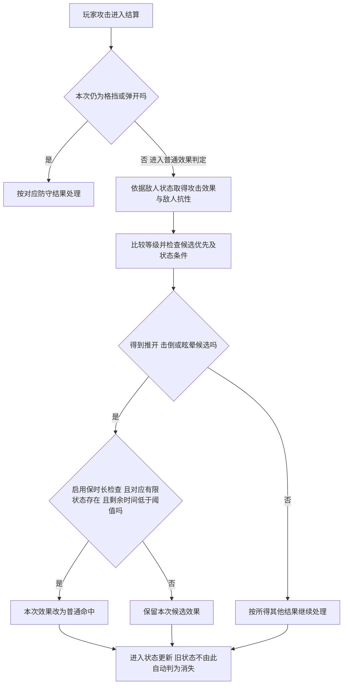
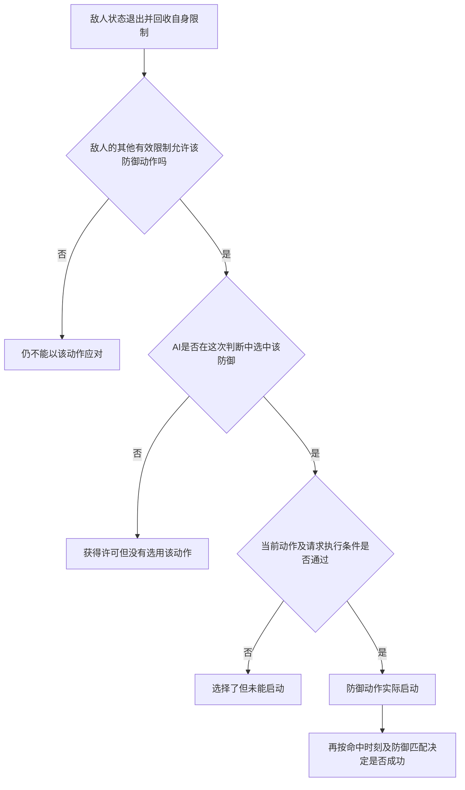

# 连续受击与反击追击的系统链

这篇把玩家攻击、敌人受击、状态变化和敌人防御放在同一条过程中讲。**敌人能否防住下一击，要看下一击到来时：敌人还处于什么状态，这些状态禁止什么动作，以及敌人是否选中并能执行某项防御。** 单看上一拳的硬直帧、一次眩晕的秒数或某个命中上限，都不足以回答。

正文可以从头读完，不需要先读其他主题。这里的“确认”是当前本机构建的静态代码与配置证据，尚未实战验证。许可配置主要核对普通／进阶杂兵；不能直接套到所有敌人。中文状态名用于帮助理解，内部名称集中放在文末辅助入口。

## 一、一次交互中，同时存在什么

先固定主语：**玩家正在攻击，敌人是受击方。** 玩家招架或闪避的部分，会明确写出最初是敌人出招、随后才由玩家反击。

| 要分清的对象 | 它负责什么 | 它不直接证明什么 |
|---|---|---|
| 敌人的受击动作处理 | 管理本次受击动作、普通硬直计时、相关服务及恢复过程 | 敌人正在播受击动画，不等于所有防御都被统一禁止 |
| 敌人的持续状态 | 例如眩晕、倒地、推开；各状态可以保存时间、累计伤害、累计命中及子状态 | 不能把不同状态的时间或上限互相套用 |
| 敌人的动作许可 | 回答当前是否允许尝试格挡、招架、躲避等具体动作；状态可以附加这种限制 | 获得许可，不等于AI已经选择或成功执行动作 |
| 玩家这次攻击的效果 | 生命／架势伤害、普通硬直、攻击强度、推开／击倒／眩晕等级等分别参与判断 | 伤害高，不自动等于硬直长、能推开或能穿防 |

这些对象可以同时存在。例如，敌人一边执行某段受击动作，一边仍保留眩晕状态；眩晕附带的禁防限制也仍可能有效。**换掉受击动作，不必然结束眩晕；一段动画进入恢复，也不必然移除眩晕的限制。**

还要分清三个结果：玩家“可以出招”，不保证下一击“可以命中”；下一击可以命中，也不保证玩家“可以连续压制”。连续压制要求敌人在下一击到来之前，没能作出有效应对，且距离、位置和时序仍允许玩家命中。

## 二、从这一击到下一击：双方同一条时间线

下图是逻辑顺序，不是实测帧表。中间的伤害通知顺序只展开已经接通的普通生命伤害路径；其他反馈不强行套用这条路径。

这条循环的关键是：**下一击读取的是更新后的敌人，而不是第一拳命中前的敌人。** 前一击可能改变敌人的状态，状态又可能改变后一击采用的效果配置、敌人的抗性和防御许可。

## 三、这一击先决定“发生了什么”，再决定“敌人怎样受控”

### 防住与普通命中是不同结算路径

| 条件 | 条件成立时执行什么 | 对后续解释的影响 |
|---|---|---|
| 本次结果仍属于格挡或弹开 | 读取相应防守结果的攻击参数，跳过普通命中的效果等级／抗性选型分支 | 不能以“推开等级高于抗性”证明该攻击会穿过这次防守 |
| 本次进入普通命中效果判定 | 按敌人当前状态选取攻击效果配置及敌人抗性，再检查候选效果与其他条件 | 抗性比较适用于它实际参与的分支，不是所有交互的共同第一步 |
| 本次新发生架势崩溃等特殊结果 | 还存在相应反馈或状态分流；新破架势标记也能影响本次采用的抗性 | 不把普通格挡、普通招架和破架势合成同一种受击 |

格挡后仍可能出现退让、架势变化、伤害或动画反馈。这些表现不自动等于敌人进入了“推开”持续状态。这里的“弹开”保留已定位内部防守结果的含义，不与玩家口语中的所有“招架／防反”互换。

### 普通命中不只比较一项“冲击力”

| 判断项 | 谁与谁比较／由谁提供 | 成立后可以说明什么 |
|---|---|---|
| 攻击效果等级与反应抗性 | 玩家攻击的推开／击倒／眩晕等级，与敌人当前状态对应的同类抗性比较 | 严格高于抗性时形成相应候选；还要经过候选优先和状态条件，不等于必定进入该状态 |
| 攻击强度与韧性抵抗 | 敌人当前韧性与这次攻击采用的强度比较，并检查其他应用条件 | 对应非致命、未破架势等分支可绕过正常受击处理；不是免伤，也不是已证明的逐拳扣韧性槽 |
| 生命与架势伤害 | 按各自启用项、参数和修正结算 | 与普通硬直、持续状态效果分开，不能互相代替 |

敌人当前状态会影响比较双方：它既可能使敌人使用另一组抗性，也可能使玩家这次攻击使用按目标状态覆写的效果等级。因此“同一招”不一定在站立、眩晕和倒地目标身上使用完全相同的判定输入。

图中时间阈值分支说明：**某些“保留当前时长”配置不仅决定秒数，也会改变这次被采用的受击效果。** 改成普通命中后，敌人原有眩晕等状态是否保留，仍由下一步状态更新决定。

## 四、普通硬直与眩晕，为什么会形成不同的追击条件

| 比较项 | 普通受击硬直 | 已核对配置下的持续眩晕 |
|---|---|---|
| 主要跟踪对象 | 本次受击动作处理及其普通硬直计时 | 敌人身上单独保存的眩晕状态及子状态 |
| 防御限制的证据 | 计时到零并满足恢复条件，会加入恢复许可并通知AI；尚未证明计时大于零就封锁所有防御入口 | 状态建立时附加许可上下文，禁止敌人的格挡、招架和两类躲避许可；这份限制被AI防御查询读取 |
| 玩家追击依赖什么 | 后续命中时刻、动作恢复、实际防御许可和执行条件等 | 除这些因素外，还要看持续眩晕附带的禁防限制是否仍有效 |
| 如何结束／改变 | 新受击可能替换旧动作处理；硬直计时与恢复过程继续更新 | 状态可因适用的时间／累计条件退出，也可被显式移除或按新命中重建 |

这解释了为什么眩晕追击不能只用普通受击动画的“恢复帧”来理解：**即使玩家下一击没有紧贴上一段普通硬直的末尾，敌人仍可能因眩晕附带的限制而无法格挡。** 不过，禁止防御不保证玩家必定打中；距离、位移、倒地姿态和玩家动作能否衔接仍各自起作用。

普通硬直这边已经确认的是一条条件路径：敌人的普通硬直计时到零，且动画仍有剩余、动作允许相应恢复等条件通过，系统加入恢复许可并发送通知；AI收到通知后，还要检查自身是否仍被识别为硬直、玩家攻击信息是否满足条件，才由该回调重新评估防御。其他事件也能触发防御评估，因此不能反推此前所有防御入口都关闭。

## 五、再次命中后，到底继承什么

系统没有一条对所有状态通用的“刷新硬直”操作。为了理解连续受击，需要分开问：**这次受击效果是什么、状态是否重建、新时长是多少、旧累计记录继承了哪些。**

| 已核对的分支 | 状态更新怎样做 | 可以得出的规则 |
|---|---|---|
| 敌人已有普通眩晕，后一击判为普通命中，并进入对应延续分支 | 把旧累计命中、累计伤害及子状态带入新建的眩晕元素 | 新建状态不必然清空既有累计；普通命中也不必然结束眩晕 |
| 敌人已有倒地，再次产生击倒，且满足旧状态／破架势标记等特定条件 | 对应分支带入旧累计次数，但不同时带入旧累计伤害 | “保留累计”必须逐字段说，不能理解为复制整份状态 |
| 新建状态元素 | 经过时间从零开始，持续时长按本次实际分支决定 | 计时从零不等于重新获得完整初始时长 |
| 敌人处于特殊眩晕子状态 | 使用单独的时长与累计上限入口，并有不同延续条件 | 不能把普通眩晕上限推广到所有被称为眩晕的情况 |

这里的“新建元素”是实现方式。对玩法更有意义的问题是：**经过这次命中之后，敌人还会受控多久，哪些动作仍禁止，旧累计值还剩多少。** 不能只看到换了动画或重建了记录就说敌人恢复了，也不能只看到新记录就说压制时间完全重置。

### 时间并非一只不会变的倒计时

| 时间记录 | 记录／查询方式 | 中途怎样变化 |
|---|---|---|
| 普通受击硬直时间 | 受击动作处理持有的计时，用于识别普通硬直与恢复 | 后续受击、旧动作取消／替换及已核对的最长硬直策略等分支会参与处理；不是持续眩晕的时长 |
| 眩晕、倒地等状态时间 | 保存持续时长和经过时间，查询剩余时间时做两者相减 | 新命中按条件使用动画时长、攻击自定义时长、旧剩余时间、敌人反应配置或特殊子状态时长；部分状态还有与架势崩溃保持的分支 |
| 敌人攻击被闪避后的反应时间 | 相应反应动作单独保存并更新剩余时间 | 动作到期或被取消可结束；其间的后续命中才可能触发眩晕，不能拿它直接当眩晕时长 |

所以不能按“每一种硬直都只有一个计时器”理解。一名敌人可同时有动作计时和持续状态记录；读到某个秒数时，必须先说明它属于哪项流程。状态时间还可能暂停或标为无限：在已核对的状态更新函数中，这两种标记会跳过该元素的时间累加和累计阈值自动退出检查，其他显式移除仍可发生。

## 六、为什么累计上限不能直接换成“还能打几拳”

普通伤害路径中，伤害通知发生在状态更新之前，命中通知发生在状态更新之后。两类通知的更新规则不同。

| 事件 | 更新敌人的哪份状态 | 累计规则 |
|---|---|---|
| 伤害结算发出的通知 | 通知发生时已存在的状态 | 启用累计伤害限制时加入事件传入伤害；启用累计次数时还会加次数，不按攻击名归组 |
| 中间的状态更新 | 可能延续、移除或重建旧状态 | 决定旧累计值是否以及怎样带入后续状态 |
| 命中处理末尾发出的通知 | 此时实际存在的状态 | 按该状态的计数策略更新次数；启用归组时检查记录的攻击名 |

因此，归组并不是对所有来源统一去重；两个通知也不保证修改同一份状态。状态重建后最后攻击名怎样初始化仍有缺口，不能据此推出某套连招的准确次数。

这一部分确实影响玩法，不只是为了正确播放动画：**这些累计记录会被状态退出检查读取，因而可能结束眩晕等持续受控状态。** 但回调只更新记录，已核对的这一套阈值退出由随后状态更新检查执行，不能说加到上限的回调本身就立即移除状态。

## 七、受控怎样结束，敌人又怎样开始防御

下面只描述状态更新函数中的自动退出路径。暂停或无限元素先跳过整段检查；其他有限、未暂停元素继续判断。

| 条件 | 成立时执行什么 | 边界 |
|---|---|---|
| 经过时间严格大于持续时长 | 移除该状态元素 | 不是所有状态都由普通受击恢复帧决定 |
| 启用了累计伤害上限，且累计伤害严格大于上限 | 移除该状态元素 | 持续攻击也可能推动退出，而不只是延续受控 |
| 启用了累计命中上限，且累计次数达到或超过上限 | 移除该状态元素 | 达到与超过的比较不同；次数不是可直接读取的拳数 |
| 其他流程明确要求移除或替换状态 | 按相应流程处理 | 不要求先等上面三条自动条件成立 |

状态移除时，会回收它自己持有的动作限制。例如眩晕附带的禁防上下文被回收后，敌人不再因为**这一份上下文**被禁止防御。但敌人能否真正防住下一击，还必须继续经过下列判断。

这张图区分需要分别解释的判断，不声称已恢复AI所有防御分支的固定调用顺序。**普通受击期间，从防御评估到实际动作启动的完整执行条件仍未接通**；当前不能把任何一个计时结束事件当作敌人“必然在此刻格挡”的证明。

## 八、招架与闪避反击怎样进入这套系统

两种情况最初都是敌人攻击玩家，随后才换成玩家攻击敌人。它们会给后续交互留下不同记录，不是都在成功防守瞬间统一发放一份眩晕。

| 过程 | 敌人与玩家分别发生什么 | 后续怎样接到共用流程 |
|---|---|---|
| 玩家招架敌人攻击 | 原攻击者敌人可获得被招架的动作记录；特定玩家选招条件会查询目标是否持有该记录，或是否正在处理指定破架势反馈命中 | 敌人的记录可以让玩家特殊起手的条件成立；这不等于敌人已进入持续眩晕。普通招架反馈、特殊反馈与架势崩溃必须分开 |
| 玩家成功闪避可惩罚的敌招 | 敌方该命中段的标记参与选择反应配置；反应订单放在原攻击者敌人身上，并保存所选配置和时间 | 敌人仍持有该记录时，玩家后续命中可读回配置；配置及状态条件通过，才形成眩晕相关结果 |
| 玩家反击已经命中 | 这时玩家是攻击方，敌人是受击方；反击自身也有伤害、强度及受击效果 | 回到前文的效果判定、状态更新、许可和退出链。不能只凭“反击”二字归因于招架事件 |

因此，在闪避路径里至少要区分**成功闪避、敌人的短暂反应记录、玩家反击命中、敌人随后进入的眩晕**。反应记录结束、反击没及时命中，或眩晕条件没有通过，都不能解释成“已经获得同一份眩晕但莫名失效”。这也是玩家与敌人必须放在同一时间线上的原因：敌人的状态和动作记录，既影响敌人自己能做什么，也能成为玩家选招和命中结算的输入。

## 九、现在能怎样回答“为什么不能一直连”

目前支持的是多条相互衔接的条件，而不是一个统一的防无限连计数器：

| 已确定的规律 | 能解释到哪里 | 还不能宣称什么 |
|---|---|---|
| 普通受击与持续眩晕的限制来源不同 | 不能用同一份恢复帧或眩晕秒数解释所有追击 | 尚不能指出普通连打第几击一定被防 |
| 新命中不保证重新获得完整受控时间，且可能保留累计记录 | 持续命中不等于持续重置一切退出条件 | 未逐招核对前，不能给可连拳数 |
| 状态退出会回收其拥有的禁防限制 | 说明敌人为什么可能重新获得应对资格 | 不保证AI立即格挡、反击或闪避 |
| 某些攻击或状态条件会改变受击效果 | 后一击可能不再造成同样的推开／击倒／眩晕 | 不把一个分支推广成所有敌人的脱离规则 |
| 韧性、位移、倒地与实际防御是不同因素 | 命中、打断和连续压制必须分别判断 | 不能以“这一下没硬直”倒推出唯一原因 |

下一段必须补齐的是：**普通受击期间，敌人已经获得防御许可／产生防御决定后，什么条件允许或拒绝实际执行。** 这是当前解释普通连打脱离的具体缺口，不能用更长的字段列表代替它。

## 辅助查阅：证据、实现与配置

正文的关键连接与证据对应如下；无需跳转也能读懂上面的流程。

| 正文规则 | 已有证据定位 |
|---|---|
| 防守结果、状态覆写和时间阈值影响效果分类 | 底稿 `notes/20261029-rules-resolution.md` R01–R03 |
| 眩晕限制防御；普通硬直结束条件性通知AI | 同底稿R04及既有E20／E23 |
| 伤害通知→状态更新→命中通知 | 同底稿R05；`notes/20261029-rules-hit-count.md` |
| 重复命中的时间来源与累计字段继承 | 同底稿R06；`notes/20261029-rules-state-update.md` |
| 自动退出及解除限制不等于立即防御 | 同底稿R07及既有E20／E23 |
| 闪避反应记录与后续命中的眩晕条件 | `notes/avoid-system-chain.md` |
| 招架目标记录参与玩家选招条件 | `inventory/20261029-parry-condition.json`；只证明条件结构，不代替完整选招实例 |

[[02实现/连续受击与反击追击的系统链|简要实现与代码定位]] · [[03配置/受击案例配置对照#通用规则的字段中文说明|字段中文说明及现有配置对照]] · [[00索引/首页|首页]]

更新：2026-10-29。本文是规则阅读主文；详细取证、未解分支和研究执行记录留在研究目录。
